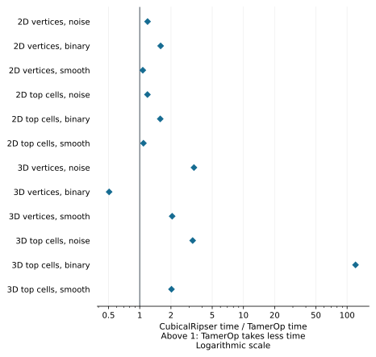
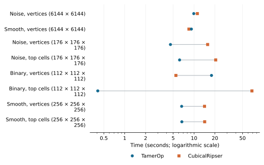

# Cubical barcodes: TamerOp and CubicalRipser

[CubicalRipser](https://github.com/shizuo-kaji/CubicalRipser) specializes in
persistent homology of images and volumes. It adapts Ripser's approach to
cubical complexes, whose cells are vertices, edges, squares and cubes, and
provides both C++ programs and a Python array interface. That specialization
makes it a useful comparison for TamerOp's direct computation of a barcode
from a scalar image or volume.

## Results

**TamerOp was 2.18× as fast in the aggregate** across the 48 image and
volume requests measured on 11 October 2026. This is the geometric mean of
CubicalRipser's time divided by TamerOp's time, with equal weight for each
request. The timer runs from an already loaded array to the complete barcode,
after compilation.

The largest differences occur in 3D. On noisy vertex data of size `176³`,
TamerOp took **4.57 s**, compared with **15.7 s** for CubicalRipser. Binary
volumes show why the input convention matters: on a `112³` array, vertex
values took **17.9 s in TamerOp and 5.48 s in CubicalRipser**, while top-cell
values took **0.409 s and 68.4 s**, respectively. Vertex values assign numbers to
the grid's corners; top-cell values assign them to its pixels or voxels.

```@raw html
<a href="presentation/cubicalripser_ratios.svg"><picture>
<source media="(max-width: 600px)" srcset="presentation/cubicalripser_ratios_narrow.svg">

</picture></a>
```

Each marker summarizes four requests: three regular sizes and one asymmetric
array. Values to the right of one favor TamerOp. The logarithmic axis makes
equal multiplicative differences equally spaced. The large binary top-cell advantage contributes
substantially to the overall 2.18 ratio, while most 2D differences are smaller.

### Actual runtimes and input sizes

The table shows the largest regular array in each family. Each time is the
median of three process medians, in seconds. Each ratio is the geometric mean
of the three paired process ratios, so it need not equal the quotient of the
two displayed times. The complete case table is available as
[CSV](cubicalripser_v1/results.csv).

| Input | Array shape | TamerOp (s) | CubicalRipser (s) | CubicalRipser / TamerOp |
| :--- | :--- | ---: | ---: | ---: |
| 2D vertices, noise | 6144 × 6144 | 9.90 | 11.1 | 1.11 |
| 2D top cells, noise | 6144 × 6144 | 8.94 | 9.47 | 1.09 |
| 2D vertices, binary | 6144 × 6144 | 4.53 | 7.51 | 1.61 |
| 2D top cells, binary | 6144 × 6144 | 4.34 | 6.49 | 1.49 |
| 2D vertices, smooth | 6144 × 6144 | 9.15 | 8.43 | 0.927 |
| 2D top cells, smooth | 6144 × 6144 | 9.34 | 8.45 | 0.933 |
| 3D vertices, noise | 176 × 176 × 176 | 4.57 | 15.7 | 3.46 |
| 3D top cells, noise | 176 × 176 × 176 | 6.18 | 20.5 | 3.38 |
| 3D vertices, binary | 112 × 112 × 112 | 17.9 | 5.48 | 0.313 |
| 3D top cells, binary | 112 × 112 × 112 | 0.409 | 68.4 | 165 |
| 3D vertices, smooth | 256 × 256 × 256 | 6.62 | 14.2 | 2.16 |
| 3D top cells, smooth | 256 × 256 × 256 | 6.67 | 14.2 | 2.13 |

```@raw html
<a href="presentation/cubicalripser_times.svg"><picture>
<source media="(max-width: 600px)" srcset="presentation/cubicalripser_times_narrow.svg">

</picture></a>
```

These selected rows show the waiting times behind the ratios. The
[2D size curves](cubicalripser_v1/runtime_2d.svg) and
[3D size curves](cubicalripser_v1/runtime_3d.svg) show every measured size,
including the asymmetric arrays. Their vertical bars give the observed range
of process medians.

## What the comparison computes

A scalar image or volume determines a growing cubical complex. In the vertex
convention, called **V**, a cell enters at the largest value of its vertices.
In the top-cell convention, called **T**, a face enters at the smallest value
of its incident pixels or voxels. These rules give different filtrations even
when they start from the same array of numbers.

Both tools compute the complete ordinary barcode over F₂, the field with two
elements, with nonperiodic boundaries. The answer includes every interval of
positive length and every interval that persists indefinitely, retaining
multiplicities. For 2D arrays it includes components and loops, the homology
degrees H₀ and H₁; for 3D arrays it includes voids as well, in H₂. The array
dimension describes space, while the filtration has one persistence parameter.
Every measured answer agreed exactly between the tools.

The arrays contain eight-level random noise, two-level random binary data, or
an integer-rounded radial quadratic field. Each combination of dimension,
input convention and structure has three regular sizes and one reserved
asymmetric array, giving twelve families of four requests. The reserved
arrays use separate seeds; the reserved binary and smooth cases run in
superlevel order, including cells from larger values downward. These are
synthetic integer-grade inputs, whose repeated values make simultaneous cell
entries common.

TamerOp uses its direct cubical barcode routine. The request does not retain
a finite encoded module or representative cycles. CubicalRipser 0.0.37 is
called through its supported `cripser.compute_ph` interface. That interface
also returns birth and death coordinates, so the time needed to produce
those columns is included in its measurement.

## How the measurements were taken

The study used the shared [benchmark computer](../benchmarking.md#the-benchmark-computer).
The following settings identify this run:

| Component | Recorded version or setting |
| :--- | :--- |
| Date | 11 October 2026 |
| TamerOp | Frozen development source, identified by the [source hashes](cubicalripser_v1/candidate_hashes.json) |
| Julia | 1.12.1; existing package images; 3 GiB garbage collection heap hint |
| CubicalRipser | `cripser` 0.0.37, unchanged CMake Release build, `-O3 -DNDEBUG` |
| Python and NumPy | Python 3.12; NumPy 2.5.3 |
| Compiler | GCC 11.4.0 |
| Execution | Serial workers on logical CPU 0; one numerical thread |
| Host conditions | `powersave` frequency policy; other heavy computations paused |
| Repetitions | Three fresh processes per tool and request; three accepted samples per process |

Each process first warms the same public route on a shifted array and discards
the result. Timed requests then recompute the grid, reduction and barcode.
Only the supplied input and input-independent package data remain available
between requests. Tool order alternates between cases and process passes, and
every accepted Julia sample records zero compilation and recompilation.

Both tools receive the same column-major Float64 array. Loading and decompressing
the input, checking its hash, comparing barcodes and writing result files are
outside the timer. The timer includes native construction, required conversions,
superlevel negation and creation of the complete native result. Exact interval
counts verify births, deaths and multiplicities without expanding repeated
intervals into millions of duplicate JSON rows.

### Array construction and result checks

The generator uses NumPy PCG64 with UInt16 draws in blocks of 1,048,576 values.
Noise takes values from zero through seven; binary data takes values zero and
four. At zero-based coordinate `i`, the smooth value is
`sum((2*i[j] - (shape[j]-1))^2) // maximum(shape)`. Arrays are generated in
column-major order, stored losslessly, and converted to Float64 before timing.
The [input manifest](cubicalripser_v1/formal_manifest.json) records the shapes,
seeds, conventions and hashes.

Independent small examples checked the barcode against a separate oracle
before timing. CubicalRipser 0.0.37 returned an incorrect component count for
vertex arrays shaped `1 × 3` in sublevel and superlevel order. The timed arrays
have no singleton axes, and their corresponding controls passed. The
[qualification record](cubicalripser_v1/qualification.json) retains these
outcomes, along with separate checks of representative cycles and the
top-degree shortcut. The timed requests use complete barcodes without either
optional output.

### Larger binary arrays and memory

Size selection used absolute runtime and resource limits. The preliminary
`160³` binary vertex call took **113 s in TamerOp and 14.6 s in CubicalRipser**,
with matching barcodes. On the top-cell version, TamerOp took **1.31 s** and
CubicalRipser reached the 180 s warmup limit before a measured query completed.
These single calibration samples are retained in the
[calibration data](cubicalripser_v1/calibration.json), separately from the
three-process estimates in the main results. The final binary volume ladder
uses smaller arrays.

All formal runs stayed within the common 8 GiB process memory cap and 180 s
phase limit. Each worker had a 30 minute limit, within a four hour campaign
budget; the supervisor also required 2 GiB of available system memory.
TamerOp's construction estimate was allowed up to 128 GiB because its general
estimate exceeds the direct grid algorithm's actual storage. This allowance
does not allocate that memory or change the observed 8 GiB cap.

The following ranges span the requests in each group. Peak resident memory
includes the runtime, input, compiled code, temporary storage and verification.
Retained-result size measures the returned object using each runtime's own
accounting; CubicalRipser's result includes its coordinate columns.

| Input group | TamerOp peak memory (GiB) | CubicalRipser peak memory (GiB) | TamerOp result (MiB) | CubicalRipser result (MiB) |
| :--- | ---: | ---: | ---: | ---: |
| 2D vertices | 2.26–3.85 | 3.28–7.38 | 0.000465–189 | 0.000191–686 |
| 2D top cells | 2.25–3.91 | 3.16–7.10 | 0.000465–189 | 0.000191–686 |
| 3D vertices | 1.20–3.91 | 0.277–2.40 | 0.000542–31 | 0.000191–102 |
| 3D top cells | 1.15–3.96 | 0.664–3.01 | 0.000542–31 | 0.000191–100 |

Package import took a median of 2.33 s for TamerOp after SHA, JSON3 and
LinearAlgebra were loaded, and 0.0771 s for NumPy and CubicalRipser together.
Process launch and the later compilation warmup are separate from those
diagnostic import times. The [sample records](cubicalripser_v1/samples.json)
retain them alongside allocation traffic and compilation counters.

## Reproduce the results

The [reproduction recipe](../benchmark_reproduction.md) gives the common
procedure for verifying the downloaded evidence, recomputing summaries and
figures, and preparing another measurement. The runnable
[CubicalRipser study](https://github.com/erikmnovak/TamerOp-benchmarks/tree/cc389ab410d3d3e6df163a6af6bef48c9cf7b1f1/studies/cubicalripser-v1)
includes the frozen TamerOp source, pinned competitor build and array generator.
Start with these evidence files:

| File | What it contains |
| :--- | :--- |
| [Data dictionary](cubicalripser_data.md) | File and field descriptions |
| [Results JSON](cubicalripser_v1/analysis.json) | Process medians, paired ratios, family summaries and memory measurements |
| [Samples JSON](cubicalripser_v1/samples.json) | Individual measured calls and compilation counters |
| [Input manifest](cubicalripser_v1/formal_manifest.json) | Array shapes, seeds, conventions and input hashes |
| [Verified barcodes](cubicalripser_v1/barcodes.json) | Interval multiplicities for every request |
| [Source hashes](cubicalripser_v1/candidate_hashes.json) | The measured TamerOp source files |
| [Build record](cubicalripser_v1/build.json) | CubicalRipser source archive, build commands and binary hashes |
| [SHA256 checksums](cubicalripser_v1/SHA256SUMS) | Checksums of the published evidence files |

The SHA256 of `analysis.json` is:

```text
855f3917a5b6b2ea2a49c211def8009e66de928e2809f62ebb8a8c13251bf2db
```

The [methods](../benchmarking.md) explain the shared timing and comparison
rules. The [benchmark overview](index.md) places this image and volume result
beside the comparisons of point-cloud persistence and finite-module algebra.
