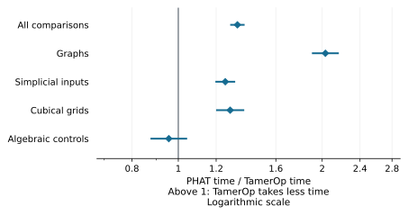
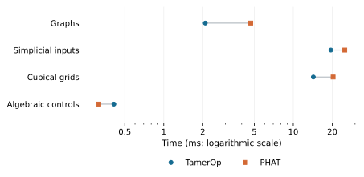
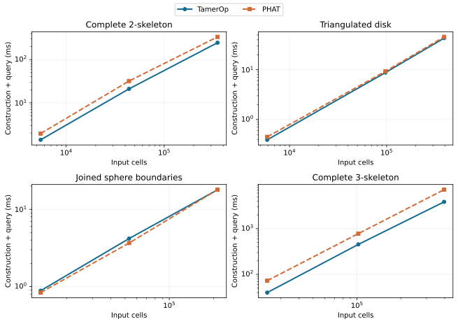

# Ordinary persistence: TamerOp and PHAT

[PHAT](https://bitbucket.org/phat-code/phat/), the Persistent Homology Algorithms
Toolbox, is a C++ library for recovering barcodes by reducing boundary matrices.
Its design separates the reduction algorithm from the representation of the
matrix, making it possible to combine several algorithms and storage choices.
That focus makes PHAT a useful comparison for TamerOp's ordinary persistence
computation: both can start from the same boundary data and recover the same
lifetimes of connected components, holes and higher-dimensional classes.
The [PHAT paper](https://www.geometrie.tugraz.at/kerber/kerber_papers/phat_jsc.pdf)
describes this design.

## Results

**TamerOp took about 25% less time across this ordinary persistence suite**,
measuring native construction and the complete barcode together. The balanced
aggregate is 1.33× as fast, with an approximate 95% ratio interval of
1.290–1.370×. Both programs completed all 48 inputs with matching barcodes.

The largest aggregate advantage is on graphs, where TamerOp is 2.03× as fast.
Simplicial and cubical inputs show smaller advantages, while the algebraic
controls are close overall and include cases that favor PHAT. On the largest
complete 3-skeleton, which contains every simplex through dimension three on
its vertex set, the actual times are **3.86 seconds in TamerOp and
7.14 seconds in PHAT**, a difference of about 3.28 seconds.

```@raw html
<a href="presentation/phat_ratios.svg"><picture>
<source media="(max-width: 600px)" srcset="presentation/phat_ratios_narrow.svg">

</picture></a>
```

The horizontal axis is **PHAT time / TamerOp time**. Values above one favor
TamerOp; values below one favor PHAT. Each point is a geometric mean of paired
ratios, with an approximate 95% interval from five process passes. Every family
contains four structural variants at three sizes and receives equal weight.

| Input family | PHAT time / TamerOp time | 95% interval |
| :--- | ---: | ---: |
| Graphs | 2.03× | 1.91–2.16× |
| Simplicial inputs | 1.25× | 1.20–1.31× |
| Cubical grids | 1.28× | 1.20–1.37× |
| Algebraic controls | 0.955× | 0.878–1.039× |

The algebraic controls illustrate why the family breakdown matters. PHAT is
faster on all three inputs with the sparsest boundary matrices. The smallest
takes about 0.049 ms in PHAT and 0.087 ms in TamerOp. On the larger, denser
controls the advantage shifts toward TamerOp. A single aggregate would hide
that change.

### Actual runtimes and input sizes

The plot gives the median case time within each family, including all twelve
inputs in that family. It shows the scale of the waiting time; the ratio plot
above compares paired observations before aggregation.

```@raw html
<a href="presentation/phat_times.svg"><picture>
<source media="(max-width: 600px)" srcset="presentation/phat_times_narrow.svg">

</picture></a>
```

The table gives the largest input in every structural variant. Times are
**milliseconds** (1,000 ms = 1 second), with each time the median of five process
medians. Cells count generators in all supplied degrees, and boundary entries
count nonzero coefficients. These two measures distinguish a large sparse
complex from a smaller complex with denser matrices.

| Family / variant | Cells | Boundary entries | TamerOp ms | PHAT ms |
| :--- | ---: | ---: | ---: | ---: |
| Graph / Path forest | 131,071 | 131,070 | 9.197 | 13.009 |
| Graph / Single cycle | 131,072 | 131,072 | 8.983 | 13.212 |
| Graph / Disconnected cycles | 131,072 | 131,072 | 9.564 | 13.223 |
| Graph / Graph with extra edges | 327,680 | 524,288 | 26.870 | 246.669 |
| Simplicial / Complete 2-skeleton | 349,632 | 1,040,384 | 246.686 | 336.172 |
| Simplicial / Triangulated disk | 391,171 | 781,320 | 43.221 | 45.712 |
| Simplicial / Joined sphere boundaries | 212,993 | 393,216 | 17.930 | 17.990 |
| Simplicial / Complete 3-skeleton | 396,606 | 1,555,400 | 3,862.012 | 7,141.729 |
| Cubical / Open 2D grid | 1,046,529 | 2,091,012 | 101.147 | 145.291 |
| Cubical / Periodic 2D grid | 1,048,576 | 2,097,152 | 99.329 | 153.654 |
| Cubical / Open 3D grid | 250,047 | 738,234 | 34.985 | 38.608 |
| Cubical / Periodic 3D grid | 262,144 | 786,432 | 41.979 | 44.854 |
| Algebraic / 2 transvections per cell | 1,539 | 11,470 | 0.492 | 0.330 |
| Algebraic / 4 transvections per cell | 1,542 | 47,878 | 0.909 | 0.951 |
| Algebraic / 8 transvections per cell | 1,545 | 119,270 | 1.706 | 2.946 |
| Algebraic / 16 transvections per cell | 1,548 | 157,959 | 2.199 | 4.679 |

The algebraic variants apply transvections, elementary changes of basis that
add one basis vector to another, while preserving the known barcode. More
changes make the matrices denser. On these inputs, cell count alone does not
describe the work of reduction.

[](phat_v2/presentation/simplicial_scaling.svg)

These panels follow each simplicial variant through its three sizes. Both
axes are logarithmic; the lines join measured points within the same variant.
TamerOp is blue with circles, and PHAT is orange with squares. The largest
disk and joined-sphere inputs have similar times, even though the complete
3-skeleton shows a substantial separation. The other size sequences are
available for [graphs](phat_v2/presentation/graph_scaling.svg),
[cubical grids](phat_v2/presentation/cubical_scaling.svg) and
[algebraic controls](phat_v2/presentation/algebraic_scaling.svg), with exact
values in the [per-case CSV](phat_v2/timings.csv).

## What the comparison computes

Both programs receive the same ordered boundary data: cell dimensions, integer
filtration grades and boundary columns over F₂, arithmetic modulo two. They
return the complete ordinary barcode in every supplied degree. This includes
every positive-length finite interval and every essential birth, a class that
survives to the end of the supplied filtration. Pairs born and killed at the
same grade have zero length and are omitted in both answers.

TamerOp uses the public `persistence_diagram(...; representatives=false)` call
on a `GradedComplex`. PHAT v1.7 uses its default twist reduction with bit-tree
pivot columns on one thread. PHAT's adapter converts cell pairs to intervals
and recovers essential births; this work belongs to the complete query.
TamerOp's normal public validation remains enabled.

The supplied boundary data already describe the filtered complex. Constructing
that complex from an image or point cloud is a different task, covered by the
corresponding input comparisons. This direct ordinary persistence route
returns a barcode without constructing a finite encoding; the
[ordinary persistence guide](../ordinary_persistence.md) explains the workflow.

The four input families exercise different boundary structures. Graphs include
forests and cycles. Simplicial inputs include triangulated disks, joined sphere
boundaries and complete skeleta. Cubical grids have open or periodic boundaries
in two and three dimensions. Algebraic controls vary matrix density while
preserving a known barcode.

Every input is checked for valid filtration order, cell dimensions and the
identity d² = 0. Graph barcodes are checked independently using component-map
ranks and cycle counts; algebraic controls retain their known barcodes through
the basis changes. Simplicial and cubical inputs have complete agreement
between the programs and independently known terminal Betti numbers, which
count the homology classes at the final grade. Small additional controls use
an independent rank calculation to check every interval.

## How the measurements were taken

The main timer includes converting decoded boundary data into each program's
native representation, computing the barcode and materializing its sorted
intervals. Parsing, input generation, loading packages, compilation, checking
answers and serializing results are outside the timer. Separate timers show
how construction and query contribute:

| Phase | PHAT time / TamerOp time | 95% interval |
| :--- | ---: | ---: |
| Native construction | 0.508× | 0.452–0.571× |
| Complete barcode query | 1.63× | 1.57–1.69× |
| Construction plus query, measured together | 1.33× | 1.29–1.37× |

PHAT constructs its native representation sooner, while TamerOp's lower query
times produce the combined advantage. The combined time is measured directly;
adding separately measured medians would give a different statistic.

Each of five paired process passes uses two fresh warmups and three accepted
measurements per input and phase. A request starts with an unreduced PHAT
matrix or a TamerOp complex containing only the input. Reset checks prevent
reuse of a previous barcode, and accepted Julia measurements record no
compilation. Both programs may reuse intermediate work within one request.
Tool and input order reverse in alternating passes.

Ratios are PHAT time divided by TamerOp time, paired within each pass. Family
and overall summaries use geometric means with equal weight for families,
variants and sizes. The approximate 95% intervals describe variation across
the five paired passes on this suite and computer. Inputs favoring PHAT stay
in the calculation. The [measurement methods](../benchmarking.md) explain the
common statistical procedure.

### Computer, versions and memory

The study ran on the [shared benchmark computer](../benchmarking.md#the-benchmark-computer)
on 4 October 2026, with one computation thread and serial workers.

| Component | Recorded version or setting |
| :--- | :--- |
| TamerOp implementation snapshot | `phat-2026-10-04` |
| Comparison candidate | `phat-v2-2026-10-04` |
| Julia | 1.12.1 |
| PHAT | 1.7, commit `a74705e4628e447084d47dbf13a16dfb6d2ebd9a` |
| C++ compiler | g++ 11.4.0; `-O3 -DNDEBUG -std=c++17` |
| Limits | 60 s per operation, 900 s per worker, 4 GiB sampled process memory |

The [provenance JSON](phat_v2/provenance.json) identifies the measured source,
inputs and adapters by hash. The shared computer's sampled one-minute load
ranged from 1.42 to 2.33, and available memory remained above 7.39 GiB.
No worker reached a resource limit.

TamerOp used more process memory despite its lower aggregate computation time:

| Measurement | TamerOp | PHAT |
| :--- | ---: | ---: |
| Range of peak sampled resident process memory | 1392.1–1540.5 MiB | 155.8–155.8 MiB |

The range covers the five workers for each tool. Resident process memory
includes the runtime, compiled code, temporary storage and work outside the
timer. Julia's per-request allocation and retained-object measurements are
separate fields in the downloads; PHAT has no corresponding counters. A missing
counter is left empty rather than treated as zero memory use.

## Reproduce the results

The [reproduction recipe](../benchmark_reproduction.md) walks through checking
the downloads and recomputing the reported comparisons. Start with the
[summary JSON](phat_v2/results.json), whose SHA-256 is:

```text
25a190420618b46fee0da49a209862fc113df23c9ffb9f0bc6988d530e8d87eb
```

| Download | What it contains |
| :--- | :--- |
| [Per-case CSV](phat_v2/timings.csv) | Times, ratios, cell counts and boundary sizes |
| [Per-pass observations](phat_v2/observations.json) | The paired process medians and memory measurements |
| [Provenance JSON](phat_v2/provenance.json) | Machine, software and source identities |
| [SHA-256 manifest](phat_v2/SHA256SUMS) | Checksums of the original data and figures |
| [Data dictionary](phat_v2/README.md) | Units, phases and field meanings |
| [Figure record](presentation/presentation.json) and [checksums](presentation/SHA256SUMS) | Sources and integrity of the common comparison figures |
| [Scaling figure record](phat_v2/presentation/presentation.json) and [checksums](phat_v2/presentation/SHA256SUMS) | Sources and integrity of the size sequences |

The [PHAT study](https://github.com/erikmnovak/TamerOp-benchmarks/tree/cc389ab410d3d3e6df163a6af6bef48c9cf7b1f1/studies/phat-v2)
provides the frozen TamerOp source, deterministic boundary inputs and original barcode workers.
The common recipe walks through checking the evidence, preparing the tools
and collecting a new measurement on your computer.
