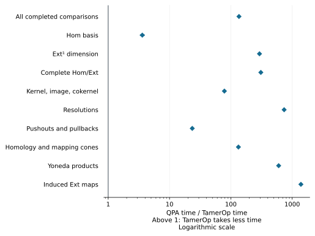
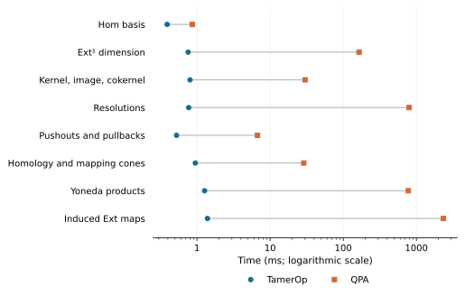

# QPA: finite module algebra

[QPA](https://gap-packages.github.io/qpa/), short for Quivers and Path Algebras,
is a GAP package for computing with vector spaces and maps arranged along a
directed graph, together with relations between compositions. Its tools extend
from module maps to complexes and resolutions, which express a module through
simpler modules. This breadth makes QPA a natural comparison for the algebra
we perform on a finite encoding: both programs can answer questions about its
maps and extension classes.

## Results

**TamerOp was 135.7× as fast across the 200 completed comparisons**, measuring
the time to build each program's input objects and compute the complete answer. The
weighted ratio has an approximate 95% interval of 134.6–136.8×. QPA's other
20 requests failed while evaluating elementary tensors, so those requests
have no speed ratio. TamerOp completed them.

The size of the difference depends strongly on the operation. A Hom basis,
which describes all compatible maps between two modules, has a 3.60× aggregate
advantage for TamerOp. Resolutions and operations on extension classes show
larger differences. Across all completed requests, the smallest measured
ratio was 1.76×; every round of measurements favored TamerOp.

```@raw html
<a href="presentation/qpa_ratios.svg"><picture>
<source media="(max-width: 600px)" srcset="presentation/qpa_ratios_narrow.svg">

</picture></a>
```

The horizontal axis is **QPA time / TamerOp time**: a value of 10 means that
TamerOp took one tenth of QPA's time for that comparison. Points summarize
paired measurements, and the bars show approximate 95% intervals calculated
from five rounds of measurements.
The logarithmic scale keeps the smaller and larger ratios visible together.

| Requested answer | Completed pairs | QPA time / TamerOp time |
| :--- | ---: | ---: |
| Complete Hom basis as module maps | 12 | 3.60× |
| Dimension of Ext¹ | 12 | 292.9× |
| Complete Hom maps, Ext representatives and their coordinates | 12 | 308.1× |
| Kernel, image and cokernel, with their structural maps | 20 | 78.4× |
| Projective or injective resolution, with its maps | 40 | 739.1× |
| Pushout or pullback, with canonical maps | 40 | 23.5× |
| Homology modules or a mapping cone, with maps | 40 | 132.9× |
| Yoneda product table: Ext¹ × Ext¹ → Ext² | 12 | 601.7× |
| Induced Ext maps in degrees 1 and 2 | 12 | 1388× |
| Balanced tensor product and elementary-tensor coordinates | 0 of 20 | QPA evaluation errors |

Ext describes extension classes, and the Yoneda product composes such classes;
the product request returns their coordinates in a basis of Ext². These
requests compare actual maps, representatives and coordinates wherever they
are part of the requested answer. The request for the dimension of Ext¹ is listed
separately because it asks for less output.

### Actual runtimes and input sizes

For many of these inputs, TamerOp's complete request takes around a millisecond.
QPA's median time ranges from less than a millisecond for a Hom basis to about
2.34 seconds for induced Ext maps. The following plot gives the median case
time in eight request groups. Resolutions, pushouts/pullbacks and
homology/mapping cones are grouped here and separated in the table below;
the table includes the combined Hom/Ext and tensor requests as well.

```@raw html
<a href="presentation/qpa_times.svg"><picture>
<source media="(max-width: 600px)" srcset="presentation/qpa_times_narrow.svg">

</picture></a>
```

All table times are **milliseconds** (1,000 ms = 1 second). Each entry gives
the median across the indicated inputs, followed by their minimum and maximum
in parentheses. For each input, we take the middle time from each round of
measurements, then the middle of those five times.
These ranges describe different inputs. They are not confidence intervals.
“Input dimension sum” adds the vector space dimensions in every supplied
module record; several modules contribute to a map or diagram request.

| Request | Inputs | Input dimension sum | TamerOp ms: median (min–max) | QPA ms: median (min–max) |
| :--- | ---: | ---: | ---: | ---: |
| Hom basis | 12 | 12–74 | 0.391 (0.143–2.266) | 0.863 (0.570–7.239) |
| Ext¹ dimension | 12 | 12–81 | 0.757 (0.542–2.154) | 164.583 (56.066–1,335.089) |
| Complete Hom/Ext | 12 | 2–81 | 0.962 (0.653–3.384) | 240.087 (78.012–2,180.459) |
| Kernel, image, cokernel | 20 | 17–99 | 0.803 (0.413–2.610) | 30.026 (13.452–441.323) |
| Projective resolution | 20 | 1–37 | 0.694 (0.465–1.602) | 101.116 (78.825–2,166.712) |
| Injective resolution | 20 | 1–42 | 1.008 (0.621–2.366) | 2,123.944 (171.368–6,637.038) |
| Pushout | 20 | 3–143 | 0.525 (0.240–1.935) | 20.953 (3.603–429.239) |
| Pullback | 20 | 19–123 | 0.509 (0.345–1.253) | 4.414 (2.255–7.638) |
| Homology | 20 | 4–180 | 1.085 (0.526–3.620) | 445.181 (19.458–16,045.105) |
| Mapping cone | 20 | 22–253 | 0.806 (0.552–2.211) | 15.550 (7.547–41.173) |
| Yoneda products | 12 | 8–20 | 1.269 (0.883–3.421) | 776.278 (129.790–11,717.391) |
| Induced Ext maps | 12 | 20–56 | 1.392 (1.147–2.150) | 2,339.180 (338.540–16,328.116) |
| Balanced tensor and evaluations | 20 | 25–73 | 1.109 (0.631–1.646) | No verified completion |

The ratios compare the same input in each paired pass before aggregation.
Dividing the two medians in this table would instead compare summaries across
different inputs, so it need not reproduce the reported ratio. The
[complete CSV table](qpa_v1/timings.csv) gives every input's times, dimensions and field.

## What the comparison computes

A module on a finite poset assigns a vector space to each label and a linear
map to each order relation. QPA expresses the same data using a quiver, a
directed graph, whose relations require the same compositions. Both programs
therefore receive the same mathematical problem while using their own data
structures and algorithms. The [QPA manual](https://gap-packages.github.io/qpa/doc/chap0.html)
describes its module, map and resolution operations.

The inputs use the Boolean three-cube, a 4×4 grid and capped crowns, with
8, 16, 9 or 17 poset vertices. Modules include intervals, projective and
injective controls, nonsplit extensions, and modules specified by projective
presentations. Coefficients are exact rational numbers or arithmetic modulo
the primes 2, 3 and 101. Changing the coefficient field can change the answer,
so correctness is checked in each field.

For the complete Hom/Ext and resolution requests, the maximum degree is three
on the Boolean cube and two on the grid and crowns. Product requests compute
all products of the chosen Ext bases. The tensor request computes the quotient
by the balancing relations and the coordinates of every elementary tensor;
this is where QPA's evaluations failed.

The comparison starts from finite module data. Constructing a finite encoding
from geometry is a separate computation, and the derived answers here belong
to the specified finite poset category. The accounts of
[finite encodings](../finite_encodings.md) and
[mathematical categories](../math_categories.md) explain that relationship.

Answers are checked using independent exact linear algebra. Hom checks establish
that the returned maps span the whole solution space. Resolution checks verify
the differentials and exactness; diagram checks verify the defining commuting
maps and universal properties. Independent bar resolutions put Ext classes,
products and induced maps into a common model where their coordinates can be
compared. Tensor checks verify the balancing relations. These checks establish
the requested mathematical answers without requiring the tools to choose
identical bases.

## How the measurements were taken

The main timer starts with the finite category and the matrix entries already
prepared. It measures building each program's modules and computing the
requested answer, including its maps and coordinates. Loading and compiling
the software, reading the input files, checking the answer and writing it to
disk happen outside the timer.

Separate measurements locate the difference between construction and query:

| Phase | QPA time / TamerOp time |
| :--- | ---: |
| Building the input objects | 3.94× |
| Complete query | 201.6× |
| Construction plus query, measured together | 135.7× |

All three rows use the same 200 completed comparisons. Construction alone can
favor QPA on some inputs; the complete query accounts for most of TamerOp's
advantage. The combined time is measured directly, rather than obtained by
adding independently measured medians.

We ran five rounds of measurements, taking three timings for each program,
input and phase in every round. A preliminary run compiles the code before
timing begins. Each measured request then computes its answer afresh, and the
programs take turns going first between rounds.

The original weighting gives equal weight to five mathematical areas, then to
request variants, fields and cases within them. Completed pairs retain 90% of
that original weight. Their geometric mean gives the 135.7× result; giving
each completed case equal weight instead gives 129.1×. The 95% interval uses
variation between the five paired passes on this fixed suite and computer.
QPA's unsuccessful tensor requests remain in the completion record and never
receive a numerical time ratio. The [measurement methods](../benchmarking.md)
explain the aggregation and missing-result conventions.

### Computer, versions and memory

The study ran on the [benchmark computer](../benchmarking.md#the-benchmark-computer)
on 3 October 2026. Each program used one computation thread, with one program
running at a time.

| Component | Recorded version or setting |
| :--- | :--- |
| TamerOp snapshot | `qpa-v1-529681519b5d1b40` |
| Julia | 1.12.1 |
| GAP / QPA | 4.16.1 / 1.37 |

TamerOp's faster computations used more RAM: the largest recorded amounts
were **1.57 GB for TamerOp and 145 MB for QPA**, measured for each program
as a whole. The [data dictionary](qpa_data.md#read-the-memory-and-verification-records)
explains the memory measurements, and the [software record](qpa_v1/provenance.json)
gives the full versions and build settings.

## Reproduce the results

The [reproduction recipe](../benchmark_reproduction.md) walks through checking
the downloads and recomputing the reported comparisons. Start with the
[summary JSON](qpa_v1/results.json), whose SHA-256 is:

```text
3bfe85fd092d11c176b1b0961b1f5aac127028378c061f81131c11e2764cf302
```

| Download | What it contains |
| :--- | :--- |
| [Per-case CSV](qpa_v1/timings.csv) | Times, ratios, input sizes, fields and weights |
| [Per-pass observations](qpa_v1/observations.json) | The paired process medians used in the aggregates |
| [Provenance JSON](qpa_v1/provenance.json) | Machine, software and source identities |
| [SHA-256 manifest](qpa_v1/SHA256SUMS) | Checksums of the original data and figures |
| [Data dictionary](qpa_data.md) | Units, phases and field meanings |
| [Figure record](presentation/presentation.json) and [checksums](presentation/SHA256SUMS) | Sources and integrity of the figures displayed here |

The [QPA study](https://github.com/erikmnovak/TamerOp-benchmarks/tree/cc389ab410d3d3e6df163a6af6bef48c9cf7b1f1/studies/qpa-v1)
provides the frozen TamerOp source, exact module inputs and original algebra workers.
The common recipe walks through checking the evidence, preparing the tools
and collecting a new measurement on your computer.
