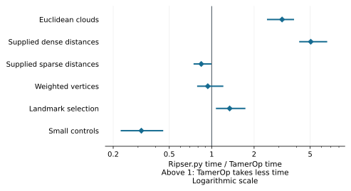
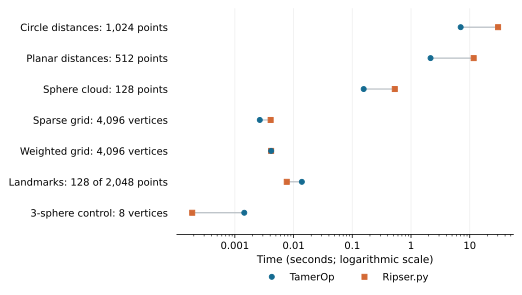

# Vietoris–Rips persistence: TamerOp and Ripser.py

[Ripser.py](https://ripser.scikit-tda.org/en/latest/) brings Ripser's C++
persistence engine to Python. It accepts dense and sparse distance data,
can select a smaller set of representative points called landmarks, and
returns representative cochains, algebraic descriptions of the detected
classes. These capabilities let us compare choosing points, computing their
barcodes and retaining information about the classes those bars describe.
This report uses Ripser.py 0.6.15 and the measurements of 5 October 2026.

## Results

**TamerOp was 5.05× as fast on the supplied dense-distance development family.**
Across all six development families, the equally weighted geometric mean of
the query ratios was **1.32×**. Euclidean clouds and larger dense inputs favored
TamerOp; sparse inputs and small controls favored Ripser.py in their family
summaries. Landmark performance depended on how many points were selected.

The difference is substantial in elapsed time on the largest dense requests.
The 1,024-point circle took **7.01 s in TamerOp and 30.4 s in Ripser.py**;
the 512-point planar input took **2.15 s and 11.7 s**. These measurements cover
a complete query from each program's native input, after compilation, with
fresh mathematical work on every call.

```@raw html
<a href="presentation/ripser_ratios.svg"><picture>
<source media="(max-width: 600px)" srcset="presentation/ripser_ratios_narrow.svg">

</picture></a>
```

Each marker is a geometric mean of Ripser.py time divided by TamerOp time.
A value of 2 means TamerOp took half as long; a value of 0.5 means Ripser.py
took half as long. The lines show the range across four paired process passes.
The 31 development requests were used during optimization; the six reserved
evaluation requests are reported separately below.

| Development family | Requests | Ripser.py / TamerOp time | Range across passes |
| :--- | ---: | ---: | ---: |
| Euclidean clouds | 4 | 3.16× | 2.50–3.80× |
| Supplied dense distances | 7 | 5.05× | 4.23–6.53× |
| Supplied sparse distances | 4 | 0.843× | 0.752–0.984× |
| Weighted vertices | 4 | 0.938× | 0.797–1.20× |
| Landmark selection | 8 | 1.34× | 1.08–1.72× |
| Small controls | 4 | 0.317× | 0.229–0.448× |

Each request has equal weight within its family, and each family has equal
weight in the 1.32× development aggregate. Its range across passes is
1.18–1.49×. The ranges describe the observed repetitions; they are not
confidence intervals.

### Actual runtimes and input sizes

The examples below cover all six development families, including the largest
dense requests, the largest grids, a landmark request favoring Ripser.py and
a small higher-degree control. The [complete table](ripser_v1/summary.csv)
contains every request. Times are medians of four process medians. A degree
label H₂ includes H₀, H₁ and H₂; F₂, F₃ and F₁₀₁ denote arithmetic modulo
2, 3 and 101.

| Input | Points or vertices | Field / through | TamerOp (s) | Ripser.py (s) |
| :--- | ---: | :--- | ---: | ---: |
| Circle distances | 1,024 | F₂ / H₁ | 7.01 | 30.4 |
| Planar distances | 512 | F₁₀₁ / H₂ | 2.15 | 11.7 |
| Sphere point cloud | 128 | F₁₀₁ / H₂ | 0.156 | 0.530 |
| Sparse grid | 4,096 | F₂ / H₁ | 0.00266 | 0.00407 |
| Grid with weighted vertices | 4,096 | F₂ / H₁ | 0.00416 | 0.00415 |
| Landmark selection | 2,048 → 128 | F₂ / H₁ | 0.0139 | 0.00766 |
| 3-sphere control | 8 | F₂ / H₃ | 0.00145 | 0.000188 |

```@raw html
<a href="presentation/ripser_times.svg"><picture>
<source media="(max-width: 600px)" srcset="presentation/ripser_times_narrow.svg">

</picture></a>
```

The plot shows the same examples as the table. Keeping actual seconds beside
the ratios distinguishes a saving of several seconds from a difference of a
fraction of a millisecond. Ratios are averaged within paired process passes,
so dividing the displayed median times need not reproduce the reported ratio.

### Reserved evaluation requests

These inputs were reserved before optimization and measured with the same
frozen implementation. They retain the same mixed pattern: TamerOp is faster
on the circle, dense distances and grid, while Ripser.py is faster on the
weighted octahedra and the selected landmark request.

| Input | Points or vertices | Field / through | TamerOp (s) | Ripser.py (s) | Ripser.py / TamerOp |
| :--- | ---: | :--- | ---: | ---: | ---: |
| Jittered circle | 512 | F₂ / H₁ | 0.854 | 3.51 | 4.13× |
| Random planar distances | 128 | F₁₀₁ / H₂ | 0.0254 | 0.127 | 4.83× |
| Random sphere distances, with cocycles | 96 | F₃ / H₂ | 0.0497 | 0.186 | 3.81× |
| Permuted grid | 4,096 | F₂ / H₁ | 0.00419 | 0.00769 | 1.85× |
| Permuted octahedra with weighted vertices, with cocycles | 96 | F₁₀₁ / H₂ | 0.000747 | 0.000621 | 0.832× |
| Landmark selection | 2,048 → 128 | F₂ / H₁ | 0.0157 | 0.00790 | 0.546× |

## What the comparison computes

As a distance threshold increases, a Vietoris–Rips complex adds edges between
nearby points and fills every clique with its simplex. The barcode records
when homology classes appear and disappear. Both programs return every
positive-length interval through the requested degree, including classes
that remain at the end of the filtration and repeated intervals.

Some requests also retain **cocycles**, cochains representing cohomology
classes. Their coefficients can differ between programs while describing
valid classes. A landmark request selects a smaller set of points, computes
persistence on that set, and returns its distance table and coverage
information. Selection is part of the timed query.

The inputs include Euclidean point clouds, supplied dense and sparse distances,
and graphs whose vertices have assigned birth grades. An omitted sparse entry
means an absent edge; an explicitly stored zero remains an edge. The fields
and requested degrees are recorded for each case in the
[manifest](ripser_v1/manifest.json).

TamerOp computes these ordinary barcodes directly. A
[finite encoding](../finite_encodings.md) serves questions that require the
module's vector spaces and maps, particularly with several parameters. The
[original C++ Ripser report](ripser_cpp.md) compares larger barcode requests
through the upstream executable; its different inputs and timing boundary
make it a separate comparison.

## How the measurements were taken

The primary timer begins with a native input container and ends with the
complete native result. Native construction is measured separately, starting
from decoded JSON rows: typed Float64 row vectors in Julia and lists of
numbers in Python. The construction-plus-query column in the downloads adds
the two stages for each sample. Parsing, input generation, answer export and
verification take place outside both timers.

Four paired process passes reverse tool and case order on alternate passes.
Each request receives a discarded warmup and three accepted computations on
fresh inputs. TamerOp uses `cache=nothing`, and both programs build new graphs,
reductions and results for each call. Julia's accepted measurements record
zero compilation and recompilation. [The shared methodology](../benchmarking.md)
explains why warming methods and discarding earlier mathematical answers are
separate steps.

Cocycle requests retain all native representatives inside the timer. TamerOp
also retains H₀ cocycles, while Ripser.py returns positive-degree cocycles.
Landmark outputs differ slightly too: TamerOp retains nearest-distance data
whose maximum gives the covering radius; Ripser.py returns that radius
directly. Computing the maximum for verification and exporting cocycles occur
outside timing.

### Matching the answers

Complete interval multisets agree exactly on supplied distances, whose grades
are exactly representable in Float32. Euclidean point clouds use each program's
own distance calculation: Float64 in TamerOp and Float32 filtration grades in
Ripser.py. Their endpoints are compared within eight Float32 epsilons times
their scale, with tiny bars that collapse under rounding recorded separately.

Independent checks reconstruct landmark choices, distance tables and covering
radii. Small controls use oriented boundary reduction; graph families use
independent formulas or reduction on their connected components. Cocycle
checks verify closure and nontriviality for up to six longest positive-degree
representatives per degree. Large H₂ witnesses additionally use an exact
sparse linear-system check that they are not coboundaries. The
[verification record](ripser_v1/verification.json) identifies the checked
outputs and numerical conditions.

### Computer, versions and memory

The study ran on [the benchmark computer](../benchmarking.md#the-benchmark-computer)
with one numerical thread and serial workers pinned to logical CPU 0.
The recorded one-minute load ranged from 1.29 to 7.02. Four process passes
capture the observed variation on that shared workstation.

| Component | Recorded version or setting |
| :--- | :--- |
| TamerOp | Frozen source identified by [source hashes](ripser_v1/candidate_hashes.json) |
| Julia | 1.12.1 |
| Python | 3.12.3 |
| Ripser.py | 0.6.15; supported Robin Hood 3.11.5 source build with `-O3` |
| Worker limits | 7 GiB resident memory; 180 s per measured phase |

The optimized Ripser.py extension was checked against its recorded hash before
launch. First-use diagnostics include development-snapshot loading flags;
the query comparison measures already compiled computation.

The largest monitored worker resident memory was 3.09 GiB. The downloads
separate resident memory, Julia allocation traffic and retained output size.
Resident memory includes the runtime and temporary working storage; allocation
traffic counts bytes allocated during a call, including memory later freed.
Python allocation traffic was not measured. These quantities answer different
questions and are kept in separate columns.

## Reproduce the results

Follow [Reproduce a benchmark report](../benchmark_reproduction.md) to verify
the downloaded records and regenerate the common figures. The central files
for this study are:

| Record | Download |
| :--- | :--- |
| File and field descriptions | [Data dictionary](ripser_v1/README.md) |
| Full summary and paired ratios | [summary.json](ripser_v1/summary.json) · [summary.csv](ripser_v1/summary.csv) |
| Accepted timing samples | [accepted_samples.json](ripser_v1/accepted_samples.json) |
| Mathematical checks | [verification.json](ripser_v1/verification.json) |
| Inputs and reserved evaluation | [manifest.json](ripser_v1/manifest.json) · [heldout_reservation.json](ripser_v1/heldout_reservation.json) |
| Software, harness and computer | [source hashes](ripser_v1/candidate_hashes.json) · [harness hashes](ripser_v1/harness_hashes.json) · [comparator build](ripser_v1/build_verified.json) · [Python dependencies](ripser_v1/python-freeze.txt) · [machine.json](ripser_v1/machine.json) |
| Integrity checks | [SHA256SUMS](ripser_v1/SHA256SUMS) |

The SHA-256 of `summary.json` is:

```text
cbf7b4abf1755eb08e137e8fa7d072c286512c1c1eddafc2f79e4d122cd08f63
```

The [benchmark project](https://github.com/erikmnovak/TamerOp-benchmarks/tree/cc389ab410d3d3e6df163a6af6bef48c9cf7b1f1/studies/ripser-py-v1)
provides the frozen source, measurement workers and deterministic input
generators. Preparation checks every generated input against its original hash;
new timings are saved separately from the published evidence. The reproduction
guide covers checking these records, rebuilding the figures and running the
computations on your own machine.
