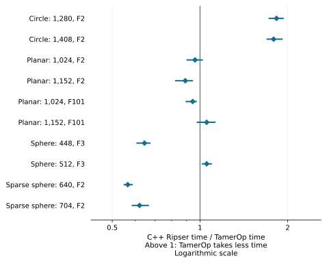
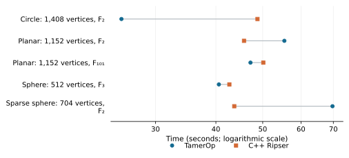

# Ordinary Rips barcodes: TamerOp and C++ Ripser

[Ulrich Bauer's Ripser](https://github.com/Ripser/ripser) specializes in computing
Vietoris–Rips persistence barcodes, with algorithms designed to keep the
calculation fast while using little memory. We chose the original C++ executable
as a comparison for TamerOp's direct Rips computations: both programs start
from distances and return the intervals describing when homology classes
appear and disappear. The study below measures larger barcode requests using
the results of 6 October 2026.

## Results

**TamerOp was about 1.8× as fast on the two circle inputs.** C++ Ripser was
**1.61–1.77× as fast on the sparse spheres** and **1.55× as fast on the smaller
dense sphere**. Most planar requests and the larger dense sphere were closer,
with the larger planar request over F₂ favoring C++ Ripser by a factor of 1.12.

On the 1,408-vertex circle, the complete request took **25.5 s in TamerOp and
48.8 s in C++ Ripser**. On the 704-vertex sparse sphere, it took **69.7 s and
43.7 s**. The timer includes reading the distance file, computing the barcode
and emitting its intervals; Julia methods are already compiled.

```@raw html
<a href="presentation/ripser_cpp_ratios.svg"><picture>
<source media="(max-width: 600px)" srcset="presentation/ripser_cpp_ratios_narrow.svg">

</picture></a>
```

A ratio above one favors TamerOp: a value of 2 means it takes half as long.
A ratio below one favors C++ Ripser. Markers are geometric means of paired
process ratios, and lines show their minimum and maximum across three passes.
These ranges describe the repetitions on a shared workstation; they are not
confidence intervals.

### Actual runtimes and input sizes

Times are medians of three process medians, in seconds. F₂, F₃ and F₁₀₁ denote
arithmetic modulo 2, 3 and 101. A degree label H₂ includes H₀, H₁ and H₂.
All ten measured inputs appear below.

| Input | Vertices | Field / through | TamerOp (s) | C++ Ripser (s) | C++ / TamerOp time |
| :--- | ---: | :--- | ---: | ---: | ---: |
| Circle | 1,280 | F₂ / H₁ | 15.5 | 28.6 | 1.83× |
| Circle | 1,408 | F₂ / H₁ | 25.5 | 48.8 | 1.79× |
| Planar | 1,024 | F₂ / H₂ | 31.7 | 28.7 | 0.962× |
| Planar | 1,152 | F₂ / H₂ | 55.4 | 45.7 | 0.890× |
| Planar | 1,024 | F₁₀₁ / H₂ | 38.5 | 37.4 | 0.944× |
| Planar | 1,152 | F₁₀₁ / H₂ | 47.2 | 50.1 | 1.05× |
| Sphere | 448 | F₃ / H₂ | 24.9 | 16.8 | 0.645× |
| Sphere | 512 | F₃ / H₂ | 40.6 | 42.7 | 1.05× |
| Sparse sphere | 640 | F₂ / H₂ | 49.8 | 28.0 | 0.565× |
| Sparse sphere | 704 | F₂ / H₂ | 69.7 | 43.7 | 0.620× |

```@raw html
<a href="presentation/ripser_cpp_times.svg"><picture>
<source media="(max-width: 600px)" srcset="presentation/ripser_cpp_times_narrow.svg">

</picture></a>
```

The plot selects the larger input from each family and field. It shows how
the ratio translates into elapsed time, including the sparse-sphere result
favoring C++ Ripser. Reported ratios use the paired process medians. The time
columns summarize each program separately, so dividing the displayed times
need not give the reported ratio.

## What the comparison computes

A Vietoris–Rips filtration adds an edge when its distance reaches the threshold
and fills every clique with its simplex. Both programs return the complete
barcode through the requested homology degree, including repeated intervals
and classes that remain at the end of the filtration. TamerOp uses its direct
ordinary persistence route, without constructing a
[finite encoding](../finite_encodings.md).

The inputs contain equally spaced circle points, random planar points in
(-1,1)², or normalized Gaussian points on a sphere in R³. Their Euclidean
distances are rounded to multiples of 1/4096, which both Float32 and Float64
represent exactly. The benchmark therefore computes persistence on the same
supplied dissimilarities in both programs. The
[input definitions](ripser_cpp_v1/fixtures.json) give the sizes, seeds and
construction rules.

Sparse inputs retain only edges within the stated radius before either tool
reads the graph. A class that remains at the end of such a filtration is
essential in that restricted graph; later edges from the full point cloud
could kill it. This common restriction matters because a separate small
control exposed a cutoff error in the pinned upstream sparse CLI. The
[four-vertex example and expected answer](ripser_cpp_v1/sparse_threshold_limitation.json)
record that behavior. It is excluded from speed comparisons.

The [Ripser.py report](ripser.md) measures a different interface, which adds
landmark selection and representative cocycles to its Python workflow. Here
the requested result is the barcode alone, from a supplied distance file.

## How the measurements were taken

Both programs start from the same text file. C++ Ripser runs in a new process
for each call, so its timer includes executable launch, input parsing and
barcode printing. TamerOp runs in a loaded Julia process; its uninterrupted
timer includes file reading, native construction, the checked public query
and full barcode emission. The comparison measures complete requests with
compiled Julia methods, including C++ executable launch.

Each case starts a fresh Julia worker in each of three passes. A discarded
warmup precedes two accepted samples per tool. Case order reverses in the
second pass, and tool order alternates between samples. Every request rereads
its input and creates new mathematical state. TamerOp uses `cache=nothing`;
C++ process exit discards its graph and reduction. The accepted Julia samples
record zero compilation and recompilation.

Sizing used absolute runtimes and resource feasibility, after which inputs
were frozen for confirmation. [The shared methodology](../benchmarking.md)
explains the treatment of warmup, paired ratios and fresh computation.
The [observation record](ripser_cpp_v1/observations.json) retains individual
measurements and discarded warmups.

### Matching the answers

Complete interval multisets agree by degree, including essential classes and
multiplicities. The supplied grades are separated sufficiently that Ripser's
printed endpoints decode uniquely to their original values; the harness
rejects inputs whose values would become ambiguous when printed. Small
controls additionally agree with an independent explicit boundary reduction,
covering several fields, equal grades, a stored zero edge and a disconnected
sparse component. See the [verification record](ripser_cpp_v1/verification.json).

### Computer, versions and memory

The study used [the benchmark computer](../benchmarking.md#the-benchmark-computer),
with one numerical thread and serial workers pinned to logical CPU 0.
Recorded one-minute load ranged from 1.59 to 18.11. The ranges beside the
ratios show the timing variation observed on that shared workstation.

| Component | Recorded version or setting |
| :--- | :--- |
| TamerOp | The same [frozen source](ripser_cpp_v1/candidate_hashes.json) as the Ripser.py study |
| Julia | 1.12.1 with `--heap-size-hint=4G` |
| C++ Ripser | Upstream commit `01add51ff64aaf40889483260cc5c3b7d0f2a1e7` |
| Compiler | g++ 11.4.0; `-O3`, `NDEBUG`, Robin Hood hashing |
| Coefficient builds | F₂ specialization; `USE_COEFFICIENTS` for odd primes |
| Worker limits | 6 GiB resident memory; 240 s per request |

The heap hint informs Julia's garbage collector of the memory budget.
Natural garbage collection during a request remains timed. Earlier attempts
with the default heap policy, and then with several cases sharing a Julia
session, exceeded the memory limit. The reported measurements use a separate
worker for each case and pass, with the stated heap hint. The
[configuration record](ripser_cpp_v1/runtime_configuration_revision.json)
retains those changes and links them to the excluded observations.

Across these cases, TamerOp's process peaks ranged from 2.90 to 5.28 GiB,
while C++ invocation peaks ranged from 0.02 to 2.03 GiB. The Julia peak includes
loading, compilation, warmup and repeated computations of that case; each C++
call has its own process. Retained TamerOp barcode objects occupied
11.2–48.8 KiB. These are different memory quantities: the small returned
barcode does not account for the runtime and temporary reduction storage.
Per-case resident memory, allocation traffic and retained sizes are separate
columns in the [complete data table](ripser_cpp_v1/summary.csv).

## Reproduce the results

Follow [Reproduce a benchmark report](../benchmark_reproduction.md) to verify
the records and regenerate the common figures. The study's principal files are:

| Record | Download |
| :--- | :--- |
| File and field descriptions | [Data dictionary](ripser_cpp_data.md) |
| Full summary and paired ratios | [summary.json](ripser_cpp_v1/summary.json) · [summary.csv](ripser_cpp_v1/summary.csv) |
| Individual observations | [observations.json](ripser_cpp_v1/observations.json) |
| Mathematical checks | [verification.json](ripser_cpp_v1/verification.json) · [control checks](ripser_cpp_v1/control_verification.json) |
| Inputs and timing protocol | [manifest.json](ripser_cpp_v1/manifest.json) · [fixtures.json](ripser_cpp_v1/fixtures.json) |
| Software, harness and computer | [source hashes](ripser_cpp_v1/candidate_hashes.json) · [harness hashes](ripser_cpp_v1/harness_hashes.json) · [machine and build](ripser_cpp_v1/machine_and_build.json) |
| Integrity checks | [SHA256SUMS](ripser_cpp_v1/SHA256SUMS) |

The SHA-256 of `summary.json` is:

```text
0ee767629be22d60dc77760cd654feba76b0983d4b8a512c343166a5dae8607d
```

The [benchmark project](https://github.com/erikmnovak/TamerOp-benchmarks/tree/cc389ab410d3d3e6df163a6af6bef48c9cf7b1f1/studies/ripser-cpp-v1)
provides the frozen TamerOp source, original measurement workers and input
generator. Preparation checks out the pinned C++ source, builds its two
coefficient variants and verifies the generated input hashes. The reproduction
guide walks through checking the published records, rebuilding these figures
and running a new comparison on your own machine.
