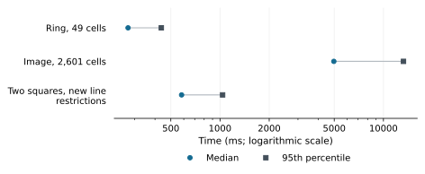

# Continuous inspection: time from input to picture

When we move an inspector's control, the useful question is how long we wait
for the corresponding picture. This report follows a browser input through
Julia's computation and back to the displayed result. It measures TamerOp's
live viewers on three mathematical examples, including a new restriction of
a module to a line.

## Results

**Updating the 49-cell ring took 274 ms at the median** after first browser
use. A new line restriction of the two-square module took **582 ms**. The
larger image, with 2,601 cells, took **4.97 s**, and its slower updates reached
**13.3 s at the 95th percentile**. These times measure the wait from a browser
input to the updated picture in the 12 October 2026 run. Chromium drew the
figures in software, without graphics acceleration.

```@raw html
<a href="presentation/visual_interaction_times.svg"><picture>
<source media="(max-width: 600px)" srcset="presentation/visual_interaction_times_narrow.svg">

</picture></a>
```

The median places half of the subsequent interactions on either side. The
95th percentile locates the slower end of the recorded sample: the nineteenth
of twenty sorted image interactions, or the twelfth of twelve line
restrictions. It describes the observed delays, rather than uncertainty in
the estimated median.

### Actual runtimes and input sizes

The figure uses milliseconds (1,000 ms = 1 second). The table expresses the
same delays in seconds and includes the first browser query.

| Retained object and request | First browser query (s) | Subsequent median (s) | Subsequent 95th percentile (s) |
| :--- | ---: | ---: | ---: |
| Ring, 49 cells; grades 0 and 5 | 6.88 | 0.274 | 0.437 |
| Image, 2,601 cells; grades 0 and 4 | 1.54 | 4.97 | 13.3 |
| Two closed squares; distinct line restrictions | 1.92 | 0.582 | 1.04 |

The larger image behaves differently in the two directions. Returning to
grade zero took **11.2 s at the median**; returning to grade four took
**1.03 s**, with ten observations in each direction. Its pooled median hides
that separation. The complete
[distribution of recorded interactions](visual_interaction_v1/latency.svg)
makes both groups visible. Selecting fewer active cells was the slower update
in this example.

## What the viewer computes

The ring comes from the top-cell array `[0 0 0; 0 5 0; 0 0 0]`. At grade zero
the central square is absent; at grade five it enters and fills the hole.
Its 49 cells comprise 16 vertices, 24 edges and nine squares. The larger
image has 25 by 25 squares with values `mod(i+j,5)`, together with their 676
vertices and 1,300 edges. All its cells are present at grade four.

These two viewers retain their source geometry and grades. Each new
parameter selection finds the active cells and changes the drawing, without
reconstructing the filtration or computing a barcode. Consecutive planar
cells with identical styling are drawn together, while their identities
remain available for selection and boundary queries. Compatible updates keep
the figure and axes and replace the drawing commands that have changed.

The example of restriction to a line starts with the direct sum of the closed square
modules supported on `[0,2]²` and `[1,3]²`, over the rational numbers. Its
finite encoding has nine labels. Changing the line computes a new
restriction to that line and displays its intervals. Every measured line is
new, so the answer is recomputed while the figure and axes are retained.
The [inspection-session account](../implementation/inspection_sessions.md#keep-drawing-objects-when-the-selection-changes)
explains how the mathematical selection and the retained drawing fit together.

## How the measurements were taken

The study used the [benchmark computer](../benchmarking.md#the-benchmark-computer),
with other Julia computations running at the same time. The measured wait
includes Julia's calculation, sending the result to the browser and drawing
it on screen.

| Component | Recorded version or setting |
| :--- | :--- |
| Date | 12 October 2026 |
| TamerOp | Development source identified by the [source hashes](visual_interaction_v1/source_sha256.json) |
| Julia | 1.12.1, using one computation thread |
| Plotting packages | Makie 0.24.15; WGLMakie 0.13.15; Bonito 5.2.0 |
| Browser | Chromium 153.0.8010.12, driven by Playwright 1.63.0 |
| Drawing | SwiftShader, which draws the figures in software |
| Browser viewing area | 1,440 × 1,050 pixels |

After the first interaction, we recorded 20 successive selections for each
image and 12 new line restrictions. Image selections alternate between the
slider's endpoints; line selections change the angle. Timing starts at the
input event and ends after the updated values and drawing reach the browser,
allowing two additional animation frames. The browser's recording tools
were enabled during these measurements, so their overhead is included.

Julia had already loaded the packages and run preliminary computations before
the browser measurements. The first browser interaction may still compile
code needed for that interaction, which is why it appears separately in the
table. Later interactions recompute the selection or line restriction while
keeping the existing figure.

The measurements follow successive interactions in one session. They show
the total wait, including the larger image's slower updates toward grade
zero; they do not identify which part of the update causes that difference.

## Reproduce the results

Follow the shared [reproduction recipe](../benchmark_reproduction.md) to
verify the downloads and recompute the summaries and figures. The runnable
[interaction study](https://github.com/erikmnovak/TamerOp-benchmarks/tree/cc389ab410d3d3e6df163a6af6bef48c9cf7b1f1/studies/visual-interaction-v1)
provides the source, browser scenarios and commands for collecting another
series of live measurements.

| File | What it contains |
| :--- | :--- |
| [Results JSON](visual_interaction_v1/measurements.json) | Every recorded interaction, first-use times and browser renderer identity |
| [Machine and software](visual_interaction_v1/machine.json) | Package versions, thread counts and host conditions |
| [Source hashes](visual_interaction_v1/source_sha256.json) | The development files associated with the measurements |
| [SHA-256 checksums](visual_interaction_v1/SHA256SUMS) | Checksums of the published evidence files |

The SHA-256 of `measurements.json` is:

```text
8f6662e353c3871d18b475abd09121e784ffb5f3c219939aeaf4ba11f186970d
```

The source hashes distinguish the measured development files from their base
commit. The shared [methods](../benchmarking.md) explain why first use,
subsequent queries and full interaction time are reported separately.
