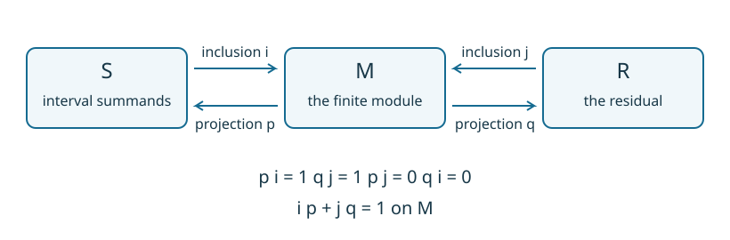
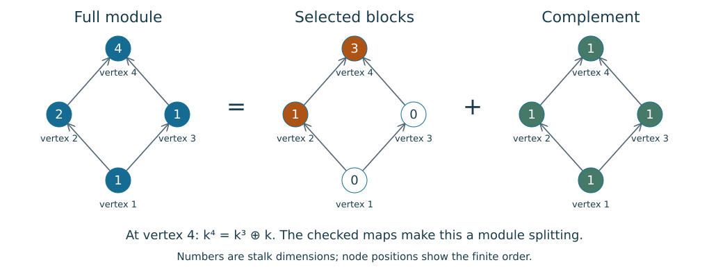
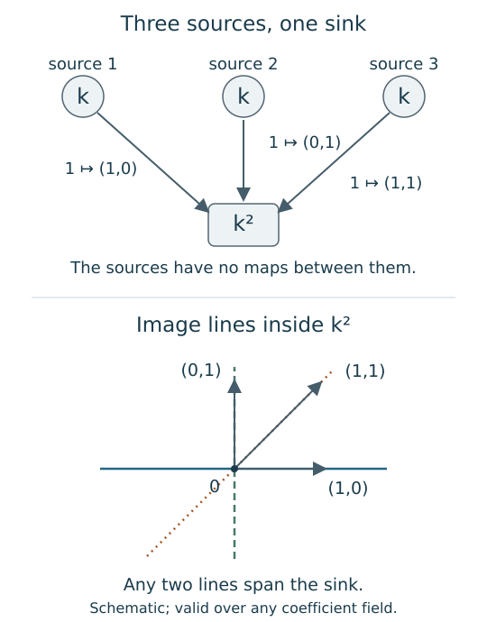

# When does a module split into intervals?

In the [two-square example](two_parameters.md), we built a module from two
simpler modules. At a parameter covered by both squares its space has dimension
two, and the maps across an overlap boundary tell us which coordinate continues.
Suppose instead that someone gives us the spaces and maps without telling us
how they were assembled. We would like to recover the pieces, even if a change
of basis has mixed their coordinates.

Work first on the finite poset of an encoding. This keeps the algebraic
question explicit, whether the original input was a filtration, a lattice
presentation, a collection of geometric regions, or a directly supplied diagram.

## A summand needs a way back

A submodule consists of a subspace at each vertex, with structure maps that
carry these subspaces into one another. To recover it as a separate component
of $M$, we need a module map $p:M\to S$ that reverses its inclusion
$i:S\to M$: the equation $pi=1_S$ says that a vector returns unchanged.
Such a map $p$ is a **retraction**, and $S$ is then a **direct summand**.
Its kernel $R=\ker p$ supplies a complement, giving $M\cong S\oplus R$.

At each vertex, a vector $v$ separates as $ip(v)+(v-ip(v))$. The first term
lies in the selected copy of $S$, and the second lies in $\ker p$ because
$p(v-ip(v))=p(v)-pi(p(v))=0$. Since $i$ and $p$ commute with the structure
maps, this separation is compatible across the whole diagram.

```@raw html
<div class="notebook-figure-scroll" style="--notebook-figure-min-width: 820px" tabindex="0" role="region" aria-label="Scrollable figure: inclusion and projection maps for a module splitting">
```

[](assets/decomposition/splitting.svg)

```@raw html
</div>
```

*The two pieces are modules, not just separate subspaces at each vertex.
Every displayed map must commute with the structure maps of the finite poset.*

For a small obstruction, consider the identity arrow $k\to k$ on the chain
$1<2$. The submodule $0\to k$ certainly exists. A projection onto it would be
zero at vertex 1 and the identity at vertex 2. Those components do not commute
with the arrow: one route gives the identity and the other gives zero.
Thus this submodule does not split.

## Which pieces count as intervals?

An **interval** $I$ in a finite poset is a nonempty connected, order-convex
set. Connected means connected through comparable vertices, ignoring arrow
directions. Order-convex means that $a,b\in I$ and $a\le z\le b$ force
$z\in I$. An interval can branch; it need not be a rectangle or a totally
ordered chain.

The **interval module** $k_I$ has one copy of the coefficient field $k$ at each vertex in $I$ and
zero elsewhere. Maps inside $I$ are identities, and the other maps are zero.
Convexity makes these maps consistent with composition. Connectedness means
that an endomorphism, a module map from $k_I$ to itself, must multiply every
nonzero stalk by the same scalar. In particular, $k_I$ is **indecomposable**:
it cannot split into two nonzero modules. Otherwise projection onto either
piece would be an idempotent other than zero or the identity, whereas a scalar
satisfying $a^2=a$ in a field is either zero or one. Such a module is also
called **thin**, meaning that every stalk has dimension at most one.

The **interval multiplicity** $m_I(M)$ is the number of copies of $k_I$ in a
decomposition of $M$ into indecomposable modules. Equivalently, it is the largest $m$ for
which $k_I^{\oplus m}$ is a direct summand. For finite-dimensional modules on
a finite poset, the Krull–Schmidt theorem says that the indecomposable pieces
are unique up to isomorphism and order, so these counts are well defined.
This is the multiplicity problem
studied by [Asashiba and Liu](https://arxiv.org/abs/2411.11594).

On the square with arrows $1\to2$, $1\to3$, $2\to4$, $3\to4$, take
$M=k_{\{1,2,3,4\}}\oplus k_{\{2,4\}}\oplus k_{\{4\}}^{\oplus2}$.
Its dimensions are $(1,2,1,4)$. The three displayed supports have multiplicities
$1,1,2$. A change of basis can mix those coordinates at each vertex, but cannot
change the multiplicities. Inclusions and projections recover a splitting in
the supplied coordinates; that choice of maps is generally not unique.

## Reading a selection of summands

Select the edge interval and both copies at the sink in the square example.
Together they contribute dimensions $(0,1,0,3)$, leaving the constant square
with dimensions $(1,1,1,1)$. At vertex 4 the inclusion picks out a
three-dimensional subspace of $k^4$, and the projection recovers its three
coordinates. The same choices commute with all four arrows, which makes the
selection a submodule with a complement.

```@raw html
<div class="notebook-figure-scroll" style="--notebook-figure-min-width: 1020px" tabindex="0" role="region" aria-label="Scrollable figure: stalk dimensions of selected summands and their complement">
```

[](assets/decomposition/selected_summands.svg)

```@raw html
</div>
```

*The dimension equality holds at every vertex. The inclusion and projection
supply the compatible maps needed to turn these equalities into a splitting.*

The [prepared comparison in the guide](tutorials/decomposition.ipynb#put-the-pieces-beside-the-whole-module)
lets you change the selected blocks while keeping the full module fixed.
Follow the top vertex as the selection changes: the edge contributes one
coordinate, the two copies at the top contribute two, and their complement
accounts for the remaining coordinates.

If the module has an encoding map, assigning each original parameter its
finite label, the preimage of a selected support gives the region where the
piece is present. We can draw that region directly from the encoding. A support
picture produced by an approximation procedure has its own accuracy question;
the splitting maps alone give no information about the error in its boundary.
For a piece whose stalk dimension varies, a dimension panel also records
information that a uniformly colored support would omit.

## A rank on a region asks a different question

Return to $k\xrightarrow{1}k$. Restricting to $I=\{2\}$ gives a
one-dimensional space, so its generalized rank is 1. Its multiplicity as the
ambient summand $k_{\{2\}}$ is 0. The incoming arrow, discarded by restriction,
is exactly the obstruction to a retraction.

| Construction | What its numbers describe |
| :--- | :--- |
| Interval multiplicity | Copies of $k_I$ inside $M$, with a complement. |
| Generalized rank on $I$ | Compatible persistence through the restricted diagram. |
| Signed interval-family summary | Coefficients reconstructing specified rank queries on a declared family. |
| Matched slice tracks or support approximations | A chosen comparison or approximation, with its own guarantees. |

The last three do not by themselves give inclusion/projection maps for a
splitting of $M$.

## What can remain after every interval is removed?

Intervals do not exhaust the indecomposable modules of a general finite
poset. Put $k$ at each of three incomparable sources and $k^2$ at their common
sink, with image lines spanned by $(1,0)$, $(0,1)$ and $(1,1)$.

[](assets/decomposition/three_lines.svg)

*The upper diagram specifies the three maps. The lower is a schematic of their
image lines in the common sink; the arrows mark the images of the source
basis vectors. A projection that vanishes on any two of these lines must
vanish on the whole sink.*

This module has no interval summand. To retract onto a piece carrying one source, a functional
at the sink would have to vanish on the other two lines, which span $k^2$.
A piece carrying two or more sources would require their distinct image lines
to lie in the same one-dimensional sink stalk. A piece supported only at the
sink would require a functional vanishing on all three lines. Finally, a piece
supported only at a source cannot be a submodule, since its outgoing map is
nonzero. These possibilities exhaust the interval supports of this poset.

Every finite-dimensional module on this finite base has a maximal part that
is a sum of interval modules, unique up to
isomorphism, with a residual containing no interval summands. That residual
can still split into several pieces that are not intervals. A complete interval search
therefore answers interval-decomposability without solving general
indecomposable decomposition. With only a chosen family, a nonzero residual
leaves the global question open.

A splitting on an encoding's finite base pulls back along its classifier.
Claiming that it is a complete decomposition in a larger ambient category
requires additional comparison hypotheses. The finite answer alone does not
supply them.

## Continue with the computation

[Compute interval multiplicities and inspect a splitting](tutorials/decomposition.ipynb)
to see the square example in Julia, request actual maps, and compare a complete
search with a chosen family.
