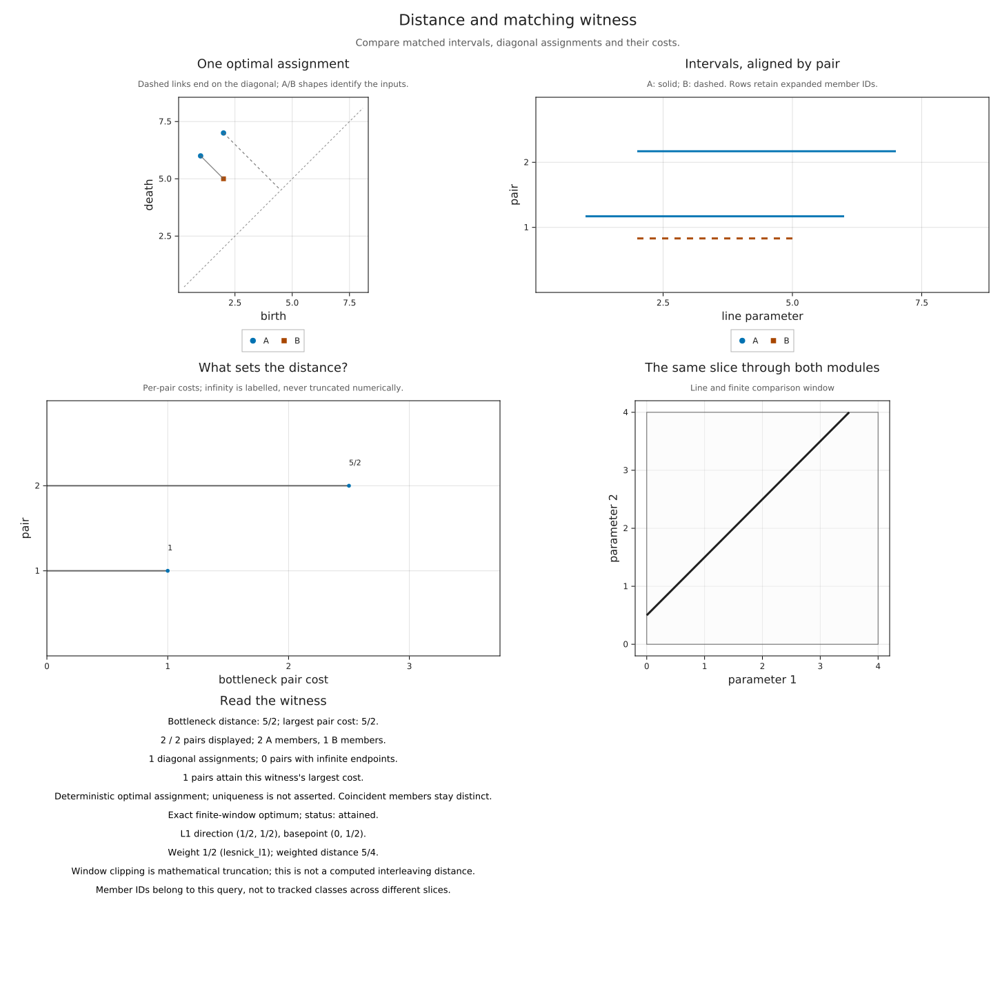
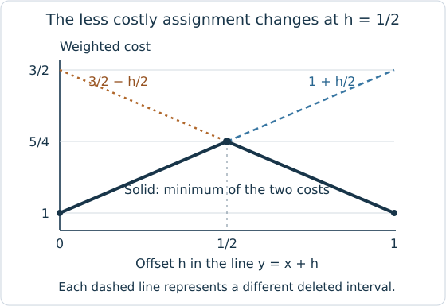

# Exact matching distance in a finite window

Two modules can differ in how their classes continue as both parameters
increase. To compare them along a line, restrict their spaces and maps to that
line and compute the resulting barcodes. The bottleneck distance chooses an
assignment of intervals that minimizes its largest endpoint cost, allowing a
finite interval to be discarded at half its length. Matching distance asks how
large this comparison can become as the line varies, with a weight that
accounts for its direction. The [finite encoding
introduction](finite_encodings.md) describes the retained modules to which we
apply these restrictions.

`matching_distance_exact_2d` computes the supremum, or least upper bound, of weighted bottleneck
distances over all lines of positive slope, with both slice barcodes clipped to
the same finite rectangle. The line geometry and optimization use exact
arithmetic. The default answer converts the resulting optimum to `Float64`;
requesting a witness keeps the exact value together with a line and interval
assignment attaining it.

```julia
import TamerOp as OP
const OA = OP.Advanced
opts = OA.InvariantOptions(box=([xmin, ymin], [xmax, ymax]), threads=false)
d = OP.matching_distance_exact_2d(encM, encN; opts)
```

Here `encM` and `encN` are existing encodings; `xmin`, `ymin`, `xmax` and
`ymax` specify their common viewing rectangle. A [complete
construction](#a-module-pair-whose-maximum-needs-a-cost-switch) appears below.
The two encodings must use the same classifier, the assignment from parameters
to finite labels, and the same finite poset. An omitted window is inferred by
`encoding_box`; choose it explicitly when it is part of the mathematical
question. `:L1` with `:lesnick_l1` and `:Linf` with `:lesnick_linf` give the
same weighted quantity. Here `normalize_dirs` chooses the direction
normalization and `weight` chooses its corresponding weight; changing them
together preserves the weighted comparison. The API rejects other pairings.

## Retain and inspect the witness

A scalar gives the optimum but leaves its cause unexplained. Keeping a witness
lets us examine a line where the optimum occurs and the interval costs
responsible for it. Use the same compatible encodings and `opts` as above:

```julia
result = OP.matching_distance_exact_2d(encM, encN; opts, witness=true)
OP.describe(result)
```

`OA.slice_query(result)` gives a basepoint, direction and weight. Its line is
`basepoint + t * direction`; the endpoints in `OA.matching_witness(result)` use
that same parameter `t`. Consequently, weight times the largest pair cost is
the exact windowed answer. The optimizer retains its exact endpoints even at a
*cost switch*, a line where two possible matching assignments have equal cost
and exchange which one is preferable as the line moves. The displayed line uses
floating coordinates; rounding that line and asking a new query is not the
definition of its witness.

```julia
using CairoMakie
OP.visualize(result)
```

Read the panels together: the parameter window locates the common line, the
barcodes show its restrictions, the diagram draws the chosen assignment, and
the cost panel identifies its largest costs. A missing partner is paired to the
diagonal at half its finite interval length. The figure retains separate member
IDs for repeated intervals. Equal members and tied costs can leave more than
one optimal assignment; the returned deterministic choice does not establish
uniqueness or identify source cycles. For a small calculation with a predicted
answer, [follow the individual interval assignments](tutorials/distance_witness.ipynb#follow-each-member-of-the-assignment)
in the matching recipe. Its prepared comparison distinguishes repeated copies,
a deletion to the diagonal and an essential pair.

```@raw html
<div class="notebook-figure-scroll" style="--notebook-figure-min-width: 1100px" tabindex="0" role="region" aria-label="Scrollable figure: optimizing slice and interval assignment">
```

[](assets/exact_matching/witness.svg)

```@raw html
</div>
```

*For the rectangle modules [constructed
below](#a-module-pair-whose-maximum-needs-a-cost-switch), the optimizing line
is $y=x+1/2$. The figure's endpoints use its displayed line parameter, in which
the largest pair cost is $5/2$. Multiplying by the slice weight $1/2$ gives the
exact weighted answer $5/4$.*

For a window of positive area under this solver's hypotheses, the result
reports `:attained`. A window of zero area reports `:degenerate_window`, with
value zero and no asserted maximizing line. These statuses concern the declared
finite window. They do not claim an attained maximum for a different,
unrestricted problem, and matching distance is not a computed interleaving
distance.

### Explore before requesting the optimum

A live comparison starts with a diagonal slice and a small map of explicit
sample queries. The two encodings must share the same classifier and poset;
placing pictures on the same axes does not establish that correspondence.

```julia
using WGLMakie
session = OP.inspection_session(encM, encN; opts)
OP.visualize(session; backend=:wglmakie)
```

Click a diagram point or barcode row to select its pair. The same pair is
highlighted in the charts and its exact endpoints and cost appear in the
readout. Coincident points cycle through their separate members. A field for
the pair ID reaches every retained pair, including those outside the display
budget.

Open **Compare slices and search the window** to select a sample, enter a
common positive direction and basepoint, or request the exact window optimum.
The default sample family has five angles and three normal offsets per angle.
Its map shows discrete costs, without interpolating between samples or
certifying an error bound. **Best sample** chooses the largest of those
measured values. The exact button invokes the optimizer with its candidate
budget; exhaustion is an error and leaves the previous selection in place.

The distinction matters even on small examples. For two rectangular summands
`[0,3) × [1,4)` and `[1,4) × [0,4)`, compared with `[1,3) × [1,3)`, diagonal
lines `y = x + h`, with `0 ≤ h ≤ 1`, give weighted costs

```math
\min(1+h/2,\;3/2-h/2).
```

The endpoint samples `h=0` and `h=1` both give one. Their cost switch at
`h=1/2` gives `5/4`; the order of grid crossings stays fixed there. The graph
below shows why sampling only those offsets misses the maximum: the smaller of
the two matching costs rises and then falls as the preferable assignment
changes.

```@raw html
<div class="notebook-figure-scroll" style="--notebook-figure-min-width: 500px" tabindex="0" role="region" aria-label="Scrollable figure: exact cost switch between two interval assignments">
```

[](assets/exact_matching/cost_switch.svg)

```@raw html
</div>
```

*This graph plots the exact formulas for diagonal slices of the rectangle
example. Dashed lines show the two candidate assignments; the solid graph is
the smaller cost, with its maximum at the crossing.*

The same controls are available from Julia:

```julia
OA.select_inspection!(session; sample=1)
OA.select_inspection!(session; slice=(basepoint=(0, 1//2), direction=(1, 1)))
OA.select_inspection!(session; optimum=true)
OA.select_inspection!(session; pair=1)
```

Pair selection and hover reuse the retained assignment. Queries on a selected
slice compute only the requested pair of barcodes; the exact optimization is
explicit and reused within the session. `max_pairs` limits the drawing, not the
matching. Pass `samples=[]` when no sample map is wanted, or supply a bounded
vector of `(basepoint=..., direction=...)` queries. Cache inputs share their
arrangement's fixed window. `OA.inspection_snapshot(session)` gives a static
exportable view; `OA.close_inspection!(session)` releases live inputs and
callbacks. The live inspector owns its canvas; use the snapshot when composing
the selected view into a supplied Makie figure.

## Scope and hypotheses

The classifier must be constant on the open cells of its declared axis grid and
order preserving, including at coordinate boundaries. Every open cell met by
the window must be represented. The two modules must be functors on the same
poset over the same field. These are mathematical input hypotheses; the
optimizer checks encountered region labels and comparability, but does not
prove global functoriality or a custom classifier's correctness.

Box encodings and `GridEncodingMap` classifiers with increasing axes are
supported. A custom classifier must faithfully locate exact interior query
points: rational points for rational coordinates, real algebraic points when
algebraic coordinates or window endpoints are supplied. A locator that silently
rounds those points to `Float64` does not meet this contract. Polyhedral
classifiers and rounded lattice classifiers are outside this optimizer's scope
and are rejected. The coordinate orientations must be positive; see [exact
grades](exact_grades.md) for expressing rhomboid coordinates as `(radius,
-depth)`.

The window has finite, ordered endpoints. A window with zero width or height
has value zero. For the rational arrangement route, the window also has to fit
its floating query storage; the algebraic coordinate route retains exact window
storage. A finite floating coordinate means its represented binary value, not
an intended decimal value. Geometry uses `Rational{BigInt}` or `AlgebraicReal`,
including predicates, intersections and cost comparisons. Linear algebra over
the coefficient field retains its separate contract: exact fields give exact
barcode ranks; `RealField` uses its numerical rank policy.

Every essential bar is cut at the window exit. Thus a finite answer is not a
claim that the unrestricted matching distance is finite. The windowed and
unrestricted quantities agree if the window contains both modules' support. For
example, the constant module with one dimensional stalks versus zero has
windowed distance `min(width, height)/2`, although its unrestricted slices have
essential bars. Enlarging the window changes the question.

The final conversion to `Float64` can lose information. A positive exact result
below its representable range can round to zero, and a large finite result can
round to infinity. Within that range the result is rounded; the default scalar
does not expose a certified interval. With `witness=true`,
`OP.describe(result).exact_distance` retains the exact optimum before
conversion.

## Proof of coverage

There are infinitely many lines through the window, so checking a chosen sample
would not establish the maximum. The proof below divides the line parameters
into finitely many pieces on which both barcode events and matching costs have
fixed formulas. It then explains why checking the vertices of those pieces
suffices under the preceding hypotheses.

Write the window as `[xmin,xmax] × [ymin,ymax]`, and initially assume positive
width and height. In the shallow chart parameterize a line by

```text
y = q*x + h,       0 < q <= 1,
u = q*x,           x = u/q, y = u+h.
```

The parameter `u` includes the weight for either supported normalization.
Translating its origin translates both barcodes equally and changes no cost. A
vertical crossing at `x=a` has `u=q*a`; a horizontal crossing at `y=b` has
`u=b-h`. These are affine functions of `(q,h)`: linear expressions plus a constant.

### Keep the order of crossings fixed
Lines meeting the window form the polygon

```text
0 <= q <= 1,
ymin - q*xmax <= h <= ymax - q*xmin.
```

Include the window sides among the coordinate cuts. Vertical event order is
fixed for `q>0`, as is horizontal event order. Consequently every possible
change in event order lies on one of the mixed equalities `q*a = b-h`. Cutting
the polygon by all these equalities fixes the entry event, exit event, and
sequence of open cells on each piece with nonempty interior. Window/grid
intersections are necessary even when no window corner is a grid vertex. An
exact interior point identifies the chain of labels. Its barcode, first
expressed in chain indices, is constant throughout the piece; replacing index
endpoints by the corresponding events gives affine birth and death functions.
Repeated adjacent region labels may be compressed because the corresponding
maps are identities.

### Keep the ordering of costs fixed
For two finite bars with endpoints $(b,d)$ and $(b',d')$, the cost of pairing them is

```text
max(b - b', b' - b, d - d', d' - d).
```

A bar's diagonal cost is `(d-b)/2`. Collect all these affine expressions for
both barcodes, including zero. Multiplicities give distinct matching vertices
even when their endpoint expressions coincide. The augmented bipartite graph
has one diagonal copy per bar and a complete block of zero cost edges between
diagonal copies, so every allowed partial matching with diagonal deletions is
included.

Refine the geometric polygon by every pairwise equality of these affine
expressions that crosses its interior. Their ordering is fixed in each
resulting open polygon. The largest cost in any fixed perfect matching is
therefore one fixed expression there; the smallest such maximum over the
finitely many matchings is also one fixed expression. Hence the bottleneck
distance is affine on each refined polygon. This accounts for switches both
between assignments to another bar and between such assignments and deletion to
the diagonal.

### Evaluate the vertices of the refined polygons
An affine function on a compact polygon attains a
maximum at a vertex. Those vertices are geometric vertices, switch/border
intersections or switch/switch intersections. The implementation includes all
three. Parallel lines need no intersection; a switch merely touching a
vertex or coinciding with a border introduces no new vertex. Exact tests
discard intersections outside the polygon. Zero and duplicate costs require
no perturbation or tolerance.

### Include slices on the boundaries
On a geometric wall, some successive crossing times
coalesce. Remove the intervening segments of length zero from a neighboring
chain. Functoriality identifies the composite through those segments with
the map between the retained endpoints. Thus the rank invariant, and hence
the barcode after zero length intervals have been removed, is that of this coarsened chain. Approaching the
wall from either neighboring polygon gives this same barcode after deleting
bars of length zero. A value supported only at the crossing time is ephemeral
and has zero bottleneck cost. This explains why evaluating neighboring
affine formulas on their closures gives the correct boundary value; it is
not an assumption about a floating locator's choice of labels at boundaries. It also
explains why order preservation and module functoriality are essential
hypotheses. At a line tangent to the window, all clipped bars have zero
length.

### Include limiting directions and steep slopes
Every bar in the shallow chart has weighted
lifespan at most `q*(xmax-xmin)`. Deleting all bars bounds the distance by half
that number, so the `q=0` limit is zero uniformly in offset. Swap the axes and
repeat to cover slopes greater than or equal to one and the other axis
limit. The diagonal occurs in both charts. The two compactified charts and
their vertices therefore cover the entire stated supremum.

This argument applies over the rational and real algebraic ordered fields: all
constructed coordinates, affine intersections and comparisons stay exact. The
finite algorithm terminates if its work budget permits it.

## A module pair whose maximum needs a cost switch

Let `I(R)` denote the rectangle interval module, with identity maps within the
rectangle and zero maps outside it. Endpoint inclusion does not affect the
bottleneck values below. In the window `[0,4] × [0,4]`, take

```text
M = I([0,3] × [1,4]) ⊕ I([1,4] × [0,4]),
N = I([1,3] × [1,3]).
```

Their exact weighted matching distance is `5/4`. To see the upper bound,
parameterize any positive line in weighted units as `x=a*t`, `y=b*t+h`, with
`a,b>=1` and `min(a,b)=1`. The rectangle of `N` lies in both rectangles of `M`.
Each endpoint moves by at most one weighted unit on passing from either `M`
interval to the `N` interval: the relevant coordinate differences are at most
one and the divisors `a,b` are at least one. Whenever the `N` interval is
present, matching it to either `M` interval therefore costs at most one.

If the `M` intervals have lengths `l1,l2`, their endpoint formulas give

```text
l1 <= 3/a - (1-h)/b,
l2 <= (4-h)/b - 1/a,
l1 + l2 <= 2/a + 3/b <= 5.
```

Match `N` to the longer interval and delete the shorter one, at cost at most
`max(1, (l1+l2)/4) <= 5/4`. If `N` is absent, each existing `M` interval has
length at most two by the same bounds on endpoint displacements, so deleting
them costs at most one.

On the diagonal line `y=x+1/2`, the diagrams are

```text
M: [1/2,3], [1,7/2],
N: [1,5/2].
```

At least one `M` interval must be deleted, costing `5/4`; matching the other to
`N` costs at most one. This attains the bound. More generally, on `y=x+h`,
`0<=h<=1`, the exact distance is `min(1+h/2, 3/2-h/2)`. Its maximum at `h=1/2`
switches which `M` interval is deleted. No integer grid event coincides on this
line: the order and identity of its barcode events remain fixed in a
neighborhood. The diagonal belongs to both slope charts used by the
implementation, while it lies in the interior of the space of lines of positive
slope. An optimizer that only checks changes in the order of geometric
crossings would therefore miss the change of optimal assignment that produces
this maximum.

The following constructs those same half-open rectangles with rational
coefficients. Each rectangle has a one dimensional space at its active labels
and identity maps between them. Both encodings use one grid classifier and
poset, so their slice coordinates are already comparable.

<!-- BEGIN exact_matching_example -->
```julia
import TamerOp as OP
using CairoMakie
const OA = OP.Advanced
QQ = Rational{BigInt}
coordinates = QQ[0, 1, 3, 4]
P = OA.ProductOfChainsPoset((4, 4))
classifier = OA.GridEncodingMap(P, (coordinates, coordinates))
rectangles = [((0,1), (3,4)), ((1,0), (4,4)), ((1,1), (3,3))]
summands = map(rectangles) do (lo, hi)
    dimensions = [Int(lo[1] <= x < hi[1] && lo[2] <= y < hi[2])
                  for y in coordinates for x in coordinates]
    maps = Dict((a,b) => fill(one(QQ), dimensions[b], dimensions[a])
                for (a,b) in OA.cover_edges(P))
    OA.PModule{QQ}(P, dimensions, maps; field=OP.CoreModules.QQField())
end
encM = OP.EncodingResult(P, OA.direct_sum(summands[1], summands[2]), classifier)
encN = OP.EncodingResult(P, summands[3], classifier)
```

Keep the witness to compare its exact answer with the bound just proved. The
weighted assignment cost must agree with that answer, and its line must have
slope one and intercept one half.

```julia
opts = OA.InvariantOptions(box=([0,0], [4,4]), threads=false)
result = OP.matching_distance_exact_2d(encM, encN; opts, witness=true)
query = OA.slice_query(result)
assignment = OA.matching_witness(result)
@assert OP.describe(result).exact_distance == 5//4
@assert query.weight * assignment.distance == 5//4
@assert query.direction[1] == query.direction[2]
@assert query.basepoint[2] - query.basepoint[1] == 1//2
OP.visualize(result)
```
<!-- END exact_matching_example -->

## Literature and limits

Critical barcode events alone do not determine the maximum: optimal matching
switches also matter, as explained by [Brooks et al., *Switch Points of
Bi-Persistence Matching Distance*](https://arxiv.org/abs/2312.02955).
[Bjerkevik and Kerber's exact
algorithm](https://jocg.org/index.php/jocg/article/view/3341) uses arrangements
and a decision procedure with different complexity bounds. The implementation
here is an exhaustive affine refinement for the finite window and hypotheses on
classifier cells proved above. It does not implement either paper's complete
algorithm or claim their asymptotic performance.

`max_candidates` conservatively charges geometric splits, barcode expansion,
cost pairs and intersection pairs, including rejected intersections. Exceeding
it throws rather than returning a partial or sampled maximum. The arrangement
has a separate `max_cells` budget. These are combinatorial work guards, not
bounds on elapsed time or peak memory. Pass `cache=session` with a retained
`SessionCache()` to reuse the arrangement and cached module barcodes in chain
indices across compatible encoding queries. The optimizer's exact geometric
cells and cost switches for the pair of modules are rebuilt for each exact
call. Use the explicit sampled API for exploratory queries when this exhaustive
optimizer is too costly.
