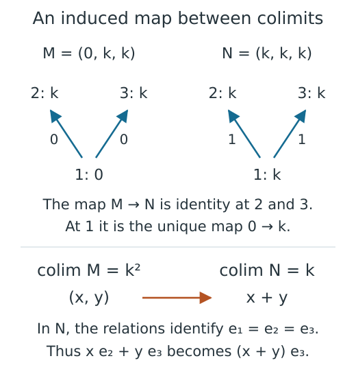

# Change of poset, refinement and Kan extensions

Changing a finite encoding means deciding how its old labels relate to the
new ones, and then following the spaces and linear maps through that relation.
An order map supplies the first part. Restriction and Kan extension use it
to construct a module on the new base, while comparison morphisms describe
how the old and new modules are related.

This account follows those constructions from their finite data to the
matrices used in a comparison. The [usage notebook](../tutorials/compare_encodings.ipynb)
explores two descriptions of a square; the [reference](../src/reference/change_of_posets.md)
gives the complete calling conventions. The [category lesson](../math_categories.md)
explains which conclusions survive a change of base and which need further
hypotheses.

## The finite base is retained, not inferred from a drawing

An `EncodingMap` stores a source poset $Q$, a target poset $P$ and the target
label $\pi(q)$ of every source vertex. Monotonicity means that
$\pi(q)\leq\pi(q')$ whenever $q\leq q'$. The check uses the labelled orders;
numeric labels and positions in a drawing do not determine those orders.
A Hasse layout is a schematic of the cover relations, with no intermediate
vertex between their endpoints.

A `PModule` stores the coefficient field, stalk dimensions and cover matrices.
Its composition laws require different cover paths with the same endpoints
to give the same map. Matrices have source columns and target rows throughout.
Restriction along $\pi$ assigns $M(\pi(q))$ to $q$ and
$M(\pi(q)\leq\pi(q'))$ to an ordered pair. A source cover can map to a longer
chain in the target, requiring composition, or to an equality, requiring an
identity matrix. This includes the empty identity at a zero stalk. Copying
only target cover keys would therefore miss valid restricted maps.

The comparison viewer puts both branches on a declared common base before
inspecting their maps. For a refinement it uses the two projections. For a
single map $Q\to P$, it uses the identity on $Q$ and $\pi$, so both displayed
modules live on $Q$. Geometry may help explain the labels, but the order maps
determine the algebra.

## Realized pairs and the product answer different questions

Suppose two finite classifiers $a:S\to P$ and $b:S\to R$ share the same
labelled source. Their joint image is

$$J=\{(a(s),b(s)):s\in S\}\subseteq P\times R.$$

`joint_encoding` collects these pairs, removes duplicates, labels them in
lexicographic order and gives them the order induced from the product. It
returns the surjection $S\to J$ together with the projections to $P$ and $R$.
Checking this result verifies surjectivity, distinct pairs, monotonicity and
the induced order. Pair collection is linear in the finite source before
sorting; storing and checking the explicit relation uses quadratic space and
time in the number of distinct pairs, in addition to the order query costs.

A common refinement supplied with this result restricts both modules to $J$.
Without it, different finite bases lead to an abstract product and restrictions
on the entire product. Specialized product computations can reuse repeated
blocks, but they preserve that meaning. Neither construction silently
intersects continuous classifier fibers. Establishing which pairs occur over
an infinite parameter space requires more information than a finite sample.

The pair panel reflects the distinction. Outlines mark pairs that belong to
the actual comparison base; a supplied finite witness determines which pairs
occur on its source. If the optional Cartesian background exceeds its display
budget, it is omitted with a notice while the actual common pairs remain.
An absent drawing cell does not assert that a stalk is zero.

## Kan extensions retain chosen limit and colimit coordinates

For a module $M:Q\to\mathrm{Vect}_k$ over a field $k$ and an order map
$\pi:Q\to P$, the left Kan stalk at $p$ is the colimit over
$I_p=\{q:\pi(q)\leq p\}$. A colimit combines all these spaces while identifying
a vector with its image along every arrow. The right Kan stalk is the limit
over $J_p=\{q:p\leq\pi(q)\}$. Its vectors are families whose entries agree
under the diagram's maps. These pointwise formulas come from the categorical
theory of [Kan extensions and adjunctions](references.md#kan-extensions-and-adjunctions);
the finite matrices described below are TamerOp's implementation of them.

### Quotient coordinates for the left Kan extension

Let $S=\bigoplus_{q\in I_p}M(q)$. For an arrow $u\leq v$ and a vector
$x\in M(u)$, place $x$ in the $u$ summand and $-M(u\leq v)x$ in the $v$
summand. These relation vectors span the subspace to be identified with zero.
If `Rel` has these vectors as columns, the colimit is $S/\operatorname{im}(\mathrm{Rel})$.
Cover relations suffice because longer relations follow by composition.

The implementation assembles the transpose of this relation matrix and
computes a nullspace basis `N`. Put `Q = transpose(N)`, using `Q` here for a
matrix rather than the source poset. Then `Q*Rel=0`, and the nullspace dimension
shows that `ker(Q)=im(Rel)`. Thus `Q` is a quotient coordinate map: two vectors
of `S` have the same `Q` coordinates precisely when their difference is a
relation.

To choose representatives, take a left inverse `J` of `N`, so `J*N=I`, and put
`W = transpose(J)`. The equality `Q*W=I` says that `W` is a section: it selects
a vector in `S` for each quotient coordinate. In the rational elimination
route, the identity block on free rows of the nullspace basis supplies this
left inverse by row selection. Other field routes use the corresponding field
linear algebra. These equalities describe the exact field calculation;
`RealField` uses its declared tolerances for nullspaces and coordinate solves,
as explained in [numerical algebra](../numerical_algebra.md).

A diagram map `F` that preserves relations induces the quotient matrix
`Q_target * F * W_source`. This follows a quotient vector to its chosen
representative, applies `F`, and then takes target quotient coordinates. A
different section changes the representative only by a source relation,
whose image is a target relation killed by `Q_target`; the induced map is
therefore independent of that section. The quotient bases themselves remain
choices, so their coordinate matrices need not look identical after a
separate construction.

Consider the poset with $1<2$ and $1<3$, collapsed to one point. The module
$M=(0,k,k)$ has no nonzero relation vectors, giving colimit $k^2$. The constant
module $N=(k,k,k)$ has relations $e_1-e_2$ and $e_1-e_3$, giving colimit $k$.
Here $e_i$ denotes the vector from the copy of $k$ at vertex $i$.

*This schematic follows the map from $M$ to $N$ that is identity at vertices
2 and 3. In the target colimit, the classes of $e_2$ and $e_3$ agree, so
$(x,y)$ maps to $x+y$. Knowing only the dimensions would leave this matrix
undetermined. Arrows within each module carry their scalar maps, and the
vertex labels are the same in both diagrams.*

For these coordinates, `Q_target=[1 1 1]`, and `F` includes the two source
summands as the last two target summands. Their product is `[1 1]`, the
addition map. This example also explains why a nullspace inclusion `N` must
not be mistaken for a quotient section. The required equation is `Q*W=I`;
`transpose(N)*N` need not be invertible over a general field.

### Kernel coordinates for the right Kan extension

For $J_p$, form the finite product of its stalks, represented as a direct sum
because the index set is finite. A family $(x_q)$ belongs to the limit when
$x_v-M(u\leq v)x_u=0$ for every cover $u\leq v$ in this set. The corresponding
constraint matrix `C` therefore gives the limit as `ker(C)`.

A basis matrix `K` includes limit coordinates into the family of stalk
coordinates. Its left inverse `L` recovers coordinates from a compatible
family, with `L*K=I`. For $p\leq p'$, the index set $J_{p'}$ is contained in
$J_p$, so projecting a compatible family to the smaller set and applying the
new left inverse gives the target structure map. Left Kan maps similarly
come from inclusions $I_p\subseteq I_{p'}$, followed by quotient coordinates.
The stored coordinate maps supply the units and counits and the induced maps
of module morphisms.

### When one stalk already determines the result

If $I_p$ has a maximum $q_{\max}$, every summand maps to $M(q_{\max})$ and
these maps describe its colimit. TamerOp then uses that stalk directly, with
its structure maps forming the quotient map and its summand inclusion forming
a section. No general relation nullspace is needed. Dually, a minimum in
$J_p$ determines the limit; its outgoing maps produce the compatible family,
and projection back to that stalk recovers its coordinates. An empty indexing
set gives a zero dimensional result in either case.

The preparation records index sets, cover edges, coordinate offsets and how
neighboring sets include into one another. General fibers require field linear
algebra on their sparse relation or constraint matrices; costs depend on the
sum of their stalk dimensions and the size and sparsity of these equations.
Fibers can be computed independently with threading enabled. The retained
preparation and intermediate coordinates can be reused through the session
cache, while the viewer receives an already computed Kan object. It does not
construct a Kan extension or a missing comparison as part of drawing.

## What a commuting-square certificate actually checks

Let $L,R$ be the modules restricted to the common base, and suppose a supplied
comparison has components $f_q:L(q)\to R(q)$. For a selected ordered pair,
the viewer computes both sides of

$$R(q\leq q')f_q=f_{q'}L(q\leq q').$$

Each side carries a vector from $L(q)$ to $R(q')$. The four matrices and two
products are retained in the readout. Once the input modules satisfy their
path relations, checking this equation on every cover proves it on every
ordered pair by composition. A natural morphism is an isomorphism precisely
when every component is invertible, so the additional component ranks determine
the finite natural isomorphism result. A comparison in the opposite direction
exchanges $L$ and $R$.

Matrices of the wrong shape or belonging to incompatible endpoints are
rejected. A comparison with suitable shapes but failed naturality equations
can be drawn with those failures visible. Reversed or incomparable pairs
have no forward square. Real coefficient comparisons report their residuals
and tolerances, with ranks determined by the numerical field policy. Exact
matrices and the selected products are copied into the snapshot, so later
cache activity does not change its saved equations.

These checks concern the displayed finite representation category. For
example, the constant module on the four element poset with two minima below
two maxima has an invertible left Kan unit for collapse to one point. Its
degree one self-Ext nevertheless differs from that of the resulting vector
space. The [category lesson](../math_categories.md) derives this counterexample;
the comparison result retains `finite_poset_representations` and does not
assert ambient or derived invariance when its component checks pass.

## Preparation, navigation and optimization boundaries

Inspection preparation validates the order maps, supplied modules, agreement
of the restrictions on covers and any comparison. It computes deterministic
Hasse layouts and supported planar classifier geometry. Supplying a lazy
encoding for these checks materializes its finite module because dimensions
alone cannot determine the equations being checked.

A session retains this preparation. A selection requests only its maps and
products, although obtaining a transitive map can still require composition.
Selecting a side label retains all its preimages; selecting a parameter
classifies it independently through both retained classifiers. Hover reads
stored geometry and IDs. None of these operations chooses an arbitrary
representative or infers ambient order from finite labels.

An update constructs and validates its proposed state before replacing the
current state, so a failure preserves the old snapshot and revision. Closing
releases prepared inputs and listeners while keeping the final snapshot.
The [inspection account](inspection_sessions.md) develops this lifecycle for
the shared session interface. Any reuse must preserve the bases, comparison
maps, coefficient policy, finite witness and stated display limits, since
these data determine what the inspected equations mean.

See the [implementation bibliography](references.md).
