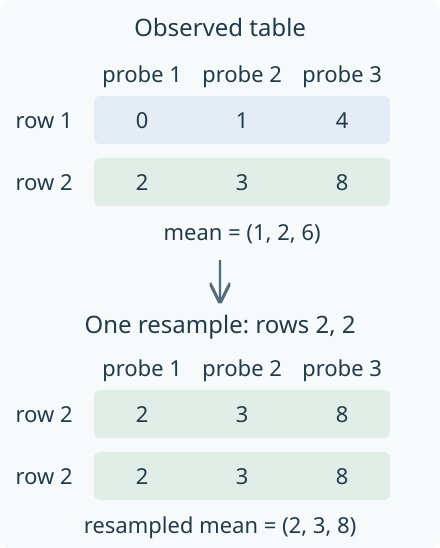

# Aligned ensembles and statistical uncertainty computations

Suppose two persistence computations give different answers. Before taking an
average, we need to decide what we are averaging and where the answers are
being compared. A landscape height at parameter 2 and a dimension at parameter
$(2,3)$ are both scalar observations, but they answer different questions. Even
two dimensions need a common query: vertex 4 in one finite encoding need not
represent the same original parameters as vertex 4 in another.

The ensemble computation begins after we have made this choice. Each row
records one repetition of the experiment, and each column records one fixed
query, called a *probe*. The [guide](../tutorials/uncertainty.ipynb) constructs
these tables from diagrams and encoded modules. Here we follow a table through
the reductions that describe its variation and the resampling used to estimate
uncertainty about a mean. The [reference](../src/reference/ensembles.md) collects
the calling conventions and options.

## One row is one observation

`persistence_ensemble` copies the supplied observations into an array with one
row per replicate and one column per probe. For a Cartesian grid with several
axes, columns follow Julia's indexing order: the first coordinate changes
fastest. The original coordinates and values are retained. Drawing and
statistical arithmetic use `Float64`, so distinct axis coordinates must remain
distinct after conversion, and infinite values are rejected. An unavailable
observation is recorded as `missing`; replacing it by zero would change the
question being answered.

For example, two rows $(0,1,4)$ and $(2,3,8)$ have mean $(1,2,6)$. The three
entries in a row belong to three specified probes. Swapping entries in the
second row while leaving the probe labels fixed would compare different
queries and give a different mean. The constructor therefore expects alignment
to have been settled beforehand; it does not sort observations into agreement,
interpolate them, or match their bars.

The retained context describes the observable and its units, coefficient
field, degree, selected layer, normalization, treatment of essential intervals,
sampling procedure and population. When the input is an array, these are the
caller's declarations. A vector of `ScalarField` objects supplies more
information: its adapter checks that axes, axis labels, units and ordered layer
identities agree. The ordinary-diagram adapter checks coefficient fields and
filtration orders, then evaluates landscape tents or counts active intervals
at the requested parameters. It retains the diagrams so that a selected row
can later be inspected beside its source. This direct diagram calculation
does not require an encoding.

## Descriptive reductions keep their denominators

`summarize_ensemble` computes down each column, producing its mean, median,
sample standard deviation, empirical interval and fraction above a chosen
threshold. The default interval is given by two empirical quantiles, with
linear interpolation between ordered observations. Choosing `band=:range`
uses their minimum and maximum instead. A frequency counts values *strictly*
greater than the threshold.

Missing observations make the denominator part of the answer. In the table

| Replicate | First probe | Second probe |
| --- | ---: | ---: |
| 1 | 1 | `missing` |
| 2 | 3 | 5 |

we obtain means 2 and 5, based on two and one observations respectively. Each
probe retains this count. A column with no observations has `NaN` summaries;
with only one observation it has a mean but no sample standard deviation.
Plots show these undefined values as gaps or masked cells.

These reductions describe what was available at each probe. If an observation
is more likely to be missing because of its value, the available rows may
represent different parts of the population at different probes. The inference
methods below therefore require complete rows. They do not fill missing
entries or change the sample between coordinates.

## Conditional confidence from known bounds

Write $X_{ij}$ for replicate $i$ at probe $j$, with $n$ rows and $p$ probes.
Assume that the rows are independent and identically distributed (IID), the
probes were chosen independently of the observations, and known bounds satisfy
$a_j\leq X_{ij}\leq b_j$ with probability one. The target is the population mean
$\mu_j=\mathbb E[X_{ij}]$ at each supplied probe.

For a nonconstant bound, Hoeffding's inequality gives

$$
\Pr\bigl(|\overline X_j-\mu_j|>r_j\bigr)
\leq 2\exp\!\left(-\frac{2nr_j^2}{(b_j-a_j)^2}\right),
$$

where $\overline X_j$ is the observed column mean. We want the probability of
*any* missed mean among the $p$ probes to be at most $\alpha$. Assigning a bound
$\alpha/p$ to each event and adding their probabilities gives the radius

$$
r_j=(b_j-a_j)\sqrt{\frac{\log(2p/\alpha)}{2n}}.
$$

Thus all intervals $[\overline X_j-r_j,\overline X_j+r_j]$ contain their means
simultaneously with probability at least $1-\alpha$, under the assumptions.
The final intervals are intersected with the known bounds $[a_j,b_j]$.
When $a_j=b_j$, the variable is constant and the radius is zero.

This argument does not require independence between columns. Several probe
values can come from the same persistence diagram and depend on one another;
we only used independence between the rows. With `scope=:pointwise`, the
formula uses 1 in place of $p$, yielding the requested coverage separately at
each probe. This removes the allowance for several possible failures and
usually narrows the interval.

The algorithm checks the observed values against the declared bounds. The
claim about values that have not been observed must come from the model or the
construction. For instance, an interval contained in $[0,6]$ has a first
landscape tent of height at most 3, whatever sample we later draw. Observed
extrema alone provide no such population bound.

The calculation uses [Hoeffding's inequality](https://www.cs.rpi.edu/academics/courses/spring06/random/hoefding.pdf)
and the finite union bound just described. Its domain is the supplied probes
and its target is their mean vector. A confidence statement about a whole
module or every possible parameter would require a further argument.

## Bootstrap whole rows

A bootstrap replaces a draw from the unknown population by a draw from the
observed rows. For each resample, TamerOp draws $n$ row indices independently
with replacement and computes the resulting mean vector. An index can appear
several times, and a row can be absent. The same sampled indices are used at
every probe, so the values from one observation stay together.

*One possible resample of the two-row table. Repeating row 2 repeats all three
of its values; choosing a separate row at each column would lose the observed
relations between probes.*

Let $\overline X^{*(b)}$ denote the mean of resample $b$. For a pointwise band,
the algorithm retains $|\overline X^{*(b)}_j-\overline X_j|$ at each probe. For
a simultaneous band it instead retains

$$
D_b=\max_j |\overline X^{*(b)}_j-\overline X_j|.
$$

Given $B$ resamples and requested level $\ell$, it sorts these deviations and
uses the value in position $\lceil B\ell\rceil$ as a symmetric half-width around
the observed mean. The simultaneous calculation uses one common half-width
in the observable's units. There is no division by an estimated standard
error, which is the meaning of *nonstudentized* here. A private pseudorandom
generator, `Xoshiro`, uses the supplied seed and leaves the caller's random
sequence unchanged.

This bootstrap approximates sampling uncertainty; it does not supply
Hoeffding's finite sample guarantee. In a constant sample, for example, every
resampled mean is identical and the band has width zero, although the unknown
population need not be constant. At least two complete rows and an IID
sampling declaration are required, but these checks cannot establish that
the observations are independent. Dependent subjects or probes selected after
looking at the data need an appropriate statistical method and justification.

García-Redondo, Monod and Wang's
[Confidence Bands for Multiparameter Persistence Landscapes](https://arxiv.org/abs/2504.01113)
develops a functional statistical theory for a specified multiparameter
landscape and sampling model. It provides related background for mean
inference. The implementation here operates on a finite vector of declared
observables; arbitrary sampled slice landscapes do not inherit that paper's
continuous-domain conclusion.

## Drawing and selection consume prepared results

`Featurizers` owns the numerical calculation. Visualization receives its
prepared summary, so selecting a probe or replicate does not rerun the
bootstrap or change its seed. For one coordinate axis, the figure shows the
sampled mean and band alongside a selected replicate and, when retained, its
ordinary diagram. Connecting lines guide the eye between probes. For two
axes, the picture preserves nonuniform physical coordinates and masks missing
values. Mean and replicate values share a scale in the same units; frequency
has a separate scale from zero to one.

The [guide's prepared views](../tutorials/uncertainty.ipynb) follow individual
rows through one descriptive summary and compare two thresholds on the same
frequency scale. Their hand chosen intervals make the selected values
checkable without introducing a sampling claim. Changing a browser choice
selects one of those prepared figures; it does not rerun a summary or draw a
new sample.

A selected observation retains its original coordinates and value beside the
numerical summary. Optional source figures follow the supplied replicate IDs.
The caller establishes those associations; the display does not prove a new
correspondence between the objects. Before a live selection is accepted, a
candidate snapshot is prepared. Invalid input leaves the previous snapshot
visible. Linked viewers receive the accepted selection, and closing a session
releases its inputs and listeners while retaining the final static snapshot.
[Inspection sessions](inspection_sessions.md) explains these shared operations.

## Costs and domain boundaries

For $n$ observations at $p$ probes, the input table stores $O(np)$ values and
the summary stores $O(p)$. Sorting each column for empirical quantiles costs
$O(pn\log n)$. With $B$ resamples, bootstrap arithmetic costs $O(Bnp)$; retained
deviations use $O(Bp)$ space for pointwise bands or $O(B)$ for simultaneous
bands. Construction, diagram evaluation, resampling and drawing each have
explicit budgets. Exceeding one rejects the request rather than truncating
the observations. No pairwise diagram distances are computed in this process.

A drawn strip between probes may look continuous, but the statistical domain
remains finite. Extending a bound to intermediate parameters requires a
regularity assumption and an estimate of the error from sampling. For example,
a Betti count can jump at a birth, so a landscape's continuity estimate cannot
be transferred to it merely because both are plotted on the same grid.

The arithmetic is numerical. Known bounds are converted outward to `Float64`
and their original declarations are retained. Endpoint rounding is adjusted
outward so that a positive interval does not disappear through drawing
precision. These guards address conversion and endpoint rounding; they do not
turn every floating point reduction into an exact arithmetic certificate.

[Bibliography](references.md)
