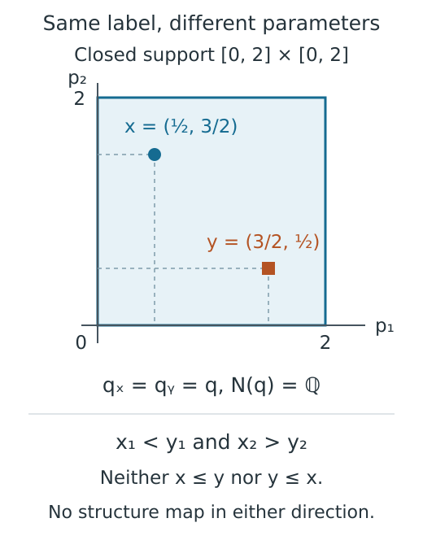
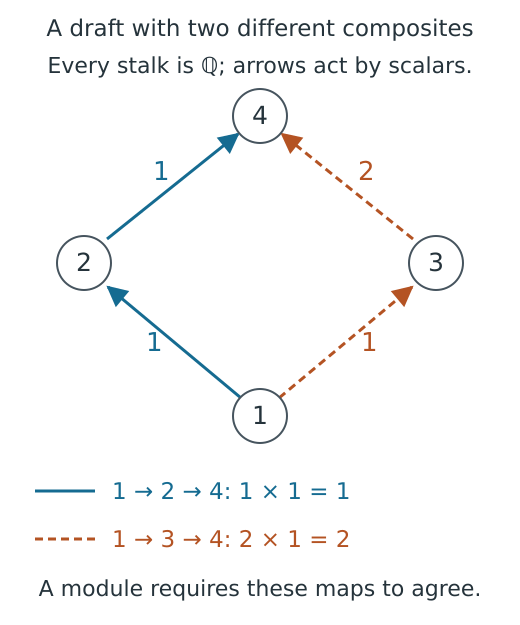

# Linked inspection sessions and browser execution

When we select a map in an encoded module, several parts of a figure help us
understand the answer. The parameter picture locates its endpoints, the finite
poset shows their labels, and a matrix describes the map in the stored bases.
Those parts need to refer to the same selection, even while another query is
being computed or a browser is waiting to draw it.

An inspection session keeps the selected question together with its prepared
answer. Its *snapshot* is the complete static specification of that answer,
including the panels, values and selected coordinates. A viewer draws this
snapshot and follows later completed selections. Saving a view copies the
prepared data, so the answer can remain available after the original Julia
session has closed.

We will follow the square example from the
[usage guide](../tutorials/live_inspection.ipynb), first through selection and
reuse, then through browser updates and saving. The
[session reference](../src/reference/visual_sessions.md) gives the calling
conventions; this account explains why the session retains particular data
and when it has to compute again.

## Retain the parameter question as well as its finite labels

An encoding consists of an order preserving map $\pi:P\to Q$ and a module $N$
on the finite poset $Q$. The module on the original parameter poset $P$ is
recovered by reading $N$ through $\pi$. Thus the space, or *stalk*, at $x$ is
$N(\pi(x))$, and a comparable pair $x\leq y$ has the structure map
$N(\pi(x)\leq\pi(y))$. Write $q_x=\pi(x)$ for the finite label of $x$.

For the guide's module, $P=\mathbb R^2$ with the product order: both coordinates
must increase for one parameter to precede another. The module is $\mathbb Q$
on the closed square $[0,2]^2$, zero outside, with identity maps between
comparable parameters in the square. Its encoding assigns the interior of the
square one finite label $q$. Consider

$$x=(1/2,3/2),\qquad y=(3/2,1/2).$$

These points have the same finite label, but the second coordinate decreases
from $x$ to $y$, while the first decreases from $y$ to $x$. Neither point
precedes the other. The finite module has an identity map at $q$, yet the
original parameter order prescribes no map between $x$ and $y$. Asking for
that parameter pair must retain this distinction.



*This schematic follows the same pair through its two descriptions. The finite
label identifies the space at each point; the original coordinates determine
whether there is a structure map between them.*

The selected state therefore keeps the original query points and their order
relation alongside the finite vertex or pair. It records which view was
requested and whether the coordinates came from supplied numerical input or
an approximate pointer position. A click near a boundary cannot silently
become an exact claim about the boundary itself.

Other inspectors retain the identity needed for their own question. Several
ordinary intervals may have equal endpoints and be drawn as one group. The
group and the selected original member are both needed to recover a retained
representative. An interval identifier in a slice belongs to that particular
line; changing the line clears the interval selection. Likewise, the finite
Hasse diagram, which draws the covering relations of $Q$, has schematic
positions. Moving a drawn vertex would not change $\pi$ or the order on $P$.

## Build a candidate before committing an update

A selection proceeds in private until its answer is ready. The session checks
the requested domain, endpoints and options, prepares the selected algebra,
and constructs the entire snapshot. Only after those steps succeed does it
replace the current selection, snapshot and associated session cache entries.
This replacement is the *commit*. A failed request leaves the previous answer
available to every attached viewer.

For example, a successful move from an interior stalk to $(5/2,1)$ must replace
the selected point, its finite label and the one dimensional stalk readout
together: the new stalk is zero. Publishing only the marker while keeping the
old algebra would briefly describe a different mathematical object. Preparing
the snapshot before commit avoids that inconsistency.

A lock prevents two state changes from committing at once. During notification,
the session also rejects a callback that tries to begin another update before
the current notification finishes. A viewer can still fail while drawing an
already committed answer; its error is recorded in a bounded list, and the
valid mathematical selection remains in place. Several viewers may consequently
finish drawing at different times, but each receives a complete snapshot.

The same arrangement applies to other questions without merging their
mathematical meanings. A signed measure inspector prepares the selected sum
and any supplied direct comparison. A spectral or chain inspector validates
the page, index or vector with the corresponding mathematical operations.
Those operations may maintain their own caches while preparing an answer;
leaving the session unchanged after failure does not erase useful intermediate
work owned elsewhere in the library.

## Reuse the answer at the level where it remains valid

Finite module inspection prepares its geometry and layout once and keeps a
bounded cache, a store of answers from earlier algebraic selections. A rank section fixes one finite label and
retains the ranks of maps from it, or to it, rather than constructing a table
for every pair of labels. Moving the selected parameter inside the same fiber
of $\pi$ can reuse those finite ranks. The display must still check order in
$P$ at the new point: the pair above has no map, even though its labels agree.

A slice session retains the module restricted to its current line. Choosing
another barcode member can reuse that restriction; changing the line or
changing between a finite window and the whole line requests a new one. A
bar ending at the viewing boundary may be *censored*, meaning that the
calculation stops there without determining the bar's true endpoint. It does
not thereby become an essential interval, which persists indefinitely. The
[visual specifications account](visual_specs.md) explains these endpoint
conventions.

For a signed measure, a supplied direct callable evaluates the original
observable at the selected query and smoothing choice. Changing the displayed
term or view can keep that answer, while changing the query or smoothing must
evaluate it again. Agreement between the signed sum and the direct value at
one query supports that comparison; reuse does not extend it to every query.

Resource limits need to be interpreted at the operation they bound. A matrix
crop limits the entries drawn, although constructing the selected map may
require more work. A slice limit bounds the event strata used to calculate
its ranks. Cache capacities bound the answers retained for reuse. Saving
several snapshots has a further cost because each keeps the mathematical and
graphical data needed to explain that selection.

## [Regions and their retained calculations](@id select-a-region-without-conflating-its-domains)

A generalized rank session asks how classes persist across a selected region.
There are two supported domains. One is a set of finite labels that is connected
through comparabilities and order convex: if it contains $a\leq b$, it contains
every label between them. The other is a continuous closed *worm* in a positive
two dimensional grid encoding, a square stretched along an anti-diagonal
segment. The [generalized rank and GRIL account](generalized_rank.md) defines
that shape and derives the finite calculation of its rank.

The continuous query uses the grid encoding's specified extension: zero below
either first coordinate, constant on each grid cell and constant along the
upper tails. Selecting grid vertices inside a drawn polygon would generally
ask a different question. The snapshot consequently retains the exact domain
beside its rank; floating coordinates used to draw the worm do not replace
the continuous restriction.

An encoding reaches this inspector through `encoding_module`. With a lazy
encoding, whose finite module is constructed when needed, that call first constructs and caches the full finite module,
including its maps. Query and drawing budgets are validated afterward, so they
bound the selected computation and its drawing, not that initial construction.
Later selections reuse the retained module.

Further calculations are explicit. A finite region can request matrices for
its rank computation and, on a supported grid, a barcode along its boundary
path. Choosing another occurrence or bar reuses that barcode, while changing
the region clears selections whose identifiers belonged to the old path. For
a worm, changing its width reuses the landscape at the same center and declared
probe family; this landscape records widths at which specified rank levels
persist. Choosing another displayed level reuses both the landscape and the
current worm rank. Changing the center computes a new landscape. The session
retains the current answer rather than an unlimited history of visited regions.

Exact coordinate entry and approximate pointer positions remain distinguishable.
Hover reads retained values. Invalid domains, unsupported fields and exceeded
budgets are rejected before commit, leaving the previous region and answer
together on screen.

## Linked coordinate sections

A sampled scalar field assigns a number to each point of a stored coordinate
grid. A field session copies those samples and keeps one selected index on
every coordinate axis. Each displayed plane varies its own two coordinates
and fixes the others at that shared selected point. In three dimensions, for
example, the $xy$ panel shows $f(x,y,z_0)$ while the $xz$ panel shows
$f(x,y_0,z)$. Changing $z_0$ changes the samples shown in the first panel and
moves the selected marker in the second, whose section still fixes $y_0$.

No invariant is recomputed during this navigation. Clicking a plane chooses
the nearest stored sample on its two axes; it does not evaluate $f$ at an
intermediate continuous coordinate. The sliders identify stored indices, and
subtitles give the actual values of the coordinates held fixed. Multiple
layers, such as sampled quantities in different degrees, have stable string
identifiers. The default color range is computed across all supplied samples
and layers, so selecting another layer preserves the comparison. An explicit
range is retained as supplied. Changing the baseline or normalization prepares
a new common scale.

As with module inspection, the complete candidate and snapshot are checked
before they replace the previous state. Closing one WGL viewer removes its
controls and event handlers. Closing the session releases the copied sample
arrays and listeners while retaining the final snapshot, including copies of
the selected planes. Those planes can be saved as static views. This inspector
has no saved source reconstruction route for arbitrary new sections, and its
live controls require Julia.

## [Several viewers can follow one session](@id a-viewer-observes-a-session-it-does-not-own-its-mathematics)

The WGLMakie extension uses Makie to draw the figure and Bonito to exchange
messages with the browser. Controls turn finite label choices, typed
coordinates or pointer positions into the same selections available from
Julia. Each viewer owns its controls, the handlers watching its scene, and
its subscription to the session's completed updates. Several viewers can
therefore follow one mathematical session while keeping their own canvases.

Removing a viewer releases those resources without closing the other viewers.
Closing the shared session notifies all remaining clients, then releases its
listeners, inputs, prepared navigation data and caches. The final static
snapshot remains available even though further selections require a new
session.

Live inspection depends on a running Julia process and a working connection
to the browser. A direct Julia selection checks the mathematical transition;
keyboard entry, pointer events, message delivery and closing a browser involve
additional behavior. The [display guide](../visualization.md#choose-a-display) describes
the available display modes, and the
[browser checking guide](https://github.com/erikmnovak/TamerOp.jl/blob/main/test/browser/README.md) describes how those
interactions are exercised.

## Move a control while a query is running

Dragging a filtration cursor or slice handle can produce coordinates faster
than their answers can be computed and drawn. The session keeps at most one
executing request and one waiting request. A further movement replaces the
waiting coordinates with the latest choice, so the queue does not grow with
the duration of a drag. Until an answer commits, the visible snapshot still
describes the preceding completed selection.

The worker prepares each answer on a private copy of the state and bounded
session cache containers, sharing the mathematical input and prepared geometry
as read only data. Before adopting the answer, it checks two counters. The
request *generation* changes when a later gesture supersedes the request; the
session *revision* changes when a direct selection has already replaced the
visible state. Either change makes the private answer obsolete. Its snapshot
and new session cache entries are then discarded.

Suppose a slow query starts for radius $r_1$ and the user moves on to $r_2$.
Even if the first computation finishes successfully, its answer cannot commit
once the new request has changed the generation. Similarly, an exact Julia
selection made while that query runs changes the revision and protects its
answer from the older browser request. This check concerns the state requested,
not which calculation happens to finish last.

The worker briefly gathers a burst of events before beginning another query
and yields to waiting tasks before the final check. It does not interrupt an
algebraic operation already running. Closing a requesting viewer invalidates
its work; closing the session cancels all its requests and releases the shared
inputs after notification. A private calculation already underway may finish
before its result is discarded. Mathematical owners can retain their own
intermediate caches, as during a failed synchronous query.

Exact Apply controls for slices and connected complex controls use this worker
as well. Inserting a WGL plot can require an acknowledgement from the browser.
Doing that inside Bonito's incoming message callback would prevent the same
task from receiving the acknowledgement. The queue lets the callback return
before drawing starts. It preserves coordinates supplied through exact entry;
direct selections from Julia remain synchronous.

The work performed by a request depends on the question. Selecting active cells
compares their stored appearance grades with the parameter. A geometric viewer
additionally computes its requested invariant. Its radius barcode depends on
depth and can be reused while only radius or cell selection changes. An encoded
module slice uses its bounded restriction cache and may calculate new ranks
and intervals for a changed line. These operations use the retained filtration
or module; they do not rebuild the source filtration or estimate a new density.

## Keep drawing objects when the selection changes

A changed mathematical selection often leaves most of the drawing intact.
The axes and colorbars of a coordinate section keep their meaning while its
values and marker move. A selected matching pair changes highlighting within
the same assignment. These viewers retain their figures and plot buffers,
as do complex viewers when their source axes remain compatible.

The renderer first prepares drawing commands from the committed specification
and compares their panel identities, coordinate planes, legends and shapes
with the current drawing. Compatible commands change their arguments and
attributes together through [Makie's coordinated update API](https://docs.makie.org/stable/explanations/observables).
Unchanged commands require no drawing update. If the declared coordinate
limits stay the same, the axes preserve the reader's viewport and existing
pointer handlers continue to refer to the same scene.

For a complex, a changed number of cells can require replacing plots on an
existing axis; its limits and three dimensional camera can remain. A slice
likewise keeps its barcode and diagram axes while interval counts and endpoint
decorations change. Picking reads the current interval records. The interval
axes follow the newly computed endpoint range, while the source view keeps
its own coordinate frame. This avoids repeatedly creating browser canvases
while older ones may still be waiting to initialize.

Consecutive planar cells with identical styling share a drawing primitive.
Faces, edges and vertices retain their paint order, and a selected cell or a
change to faint inactive context separates the groups. The picture can thus
update a few polygon, path and point arrays while keeping individual cell
identities for selection. Grouping drawing commands does not identify cells
in the mathematical complex.

If the panel layout or contour legend changes, the renderer prepares a new
figure offscreen and replaces the canvas once, then releases the old figure
and handlers. A viewer whose browser has disconnected is disposed before
further plot insertion; the other viewers can continue. Literal matrix layouts
and composed figures use their own rendering paths. Each viewer retains one
current drawing plan, with no shared scene cache or accumulated history of
selections.

## Reuse a declared atlas

An atlas displays a declared finite collection of parameter states together.
Keeping their source pictures visible helps us compare changes in both
parameter directions. Figure 1 of
[Loiseaux and Schreiber's multipers paper](https://doi.org/10.21105/joss.06773)
uses such a grid, while Figure 3 of
[Fersztand and Jendrysiak's Skyscraper paper](https://doi.org/10.4230/LIPIcs.SoCG.2026.47)
relates a sampled bifiltration to its homology diagram. These are visual
precedents; the atlas computes with TamerOp's homology and module map operations.

The caller supplies a list of states or a small coordinate grid. Construction
prepares their spaces and all supported endpoint maps before the browser opens.
For source complexes, the
[representative account](source_representatives.md#explain-a-transition-between-sampled-parameters)
explains the homology inclusions and optional cycles and fillings that witness
a transition. Later choices of source, target, event and witness select among
those retained answers without recomputing homology. An unavailable witness
or invalid state index leaves the old selection in place. An incomparable
pair is a valid selection, shown with no map; a comparable pair may instead
have a defined map whose matrix is zero.

Each viewer keeps the grid of source pictures on one canvas, preserving the
source coordinates, finite poset layout and cameras. Changing the selected
transition replaces only its detail figure, which contains the matrix, cell
entries or witness charts. Connected controls use the shared request worker
so the browser can continue exchanging messages while WGL installs those plots.
Hover reads the prepared labels and dimensions without requesting new work.

A saved atlas selection retains its grid of pictures, selected matrix, source
cell records and witness coefficients. It has no request for reconstructing
the live atlas input. The offline viewer can select another saved answer, but
a new parameter query requires the original computation.

## [Editing and checking a mathematical draft](@id keep-a-draft-distinct-from-a-mathematical-object)

Editing an input raises a different question from selecting a result. Suppose
we start with a diamond whose four stalks are $\mathbb Q$ and whose four cover
maps are identities, then change the map $3\to4$ to multiplication by two.
The editor should retain the changed entry so we can understand its failure.
There are now two proposed answers for the map $1\to4$:

$$
A_{24}A_{12}=[1],\qquad A_{34}A_{13}=[2].
$$

Here $A_{ij}$ is the entered matrix from vertex $i$ to vertex $j$, with target
coordinates indexing rows and source coordinates indexing columns. A module
over the diamond must assign one map to $1\leq4$, so these two products must
agree. The changed draft fails that condition.



*In this schematic, following the vector $1$ along the solid route gives $1$
at vertex 4, while the dashed route gives $2$. The editor keeps both paths
and their actual composite matrices so the disagreement can be inspected.*

`ModuleEditorSession` retains the entered numbers and a validation report.
Constructing an ordinary `PModule` or finite `FringeModule` is a separate,
checked export. The [construction guide](../tutorials/presentations.ipynb)
works through the diamond. An invalid mathematical draft is a useful editing
state, while malformed input and exceeded budgets leave the old draft intact.

A module draft stores the full reflexive transitive relation, dimensions, and
one matrix for each cover relation. A cover joins $i<j$ with no intermediate
vertex. The editor checks the finite order, dimensions, cover coverage and
matrix shapes before asking `Modules.module_path_witness` whether all paths
agree. A fringe draft instead stores memberships in upsets and downsets, supports
closed upwards and downwards in the finite order, with their coefficient matrix. `FiniteFringe.check_fringe_data` checks closure of those
supports and permitted intersections; a selected stalk is the image of the
active coefficient submatrix. The finite drawing supplies no additional
assignment from ambient parameters.

The path check orders the vertices so each cover points forward, regardless
of their numerical labels. For each source, it retains one path and its
composite to every reached vertex. An alternative incoming edge extends an
already checked prefix and compares the resulting product with the stored
path. By induction along the ordering, once all prefixes into a vertex agree,
checking every incoming extension establishes agreement of all paths to the
next vertex. This handles routes of different lengths even when no elementary
square exposes the conflict. In real fields the comparison uses the configured
numerical tolerance; exact fields use equality.

No cached module composite supplies the diagnostic products. With $n$ vertices,
$m$ covers and stalk dimension at most $d$, the traversal uses $O(nm)$ dense
matrix products, each costing at most $O(d^3)$ field operations, in addition
to validating the order and recording paths. Exact coefficient sizes affect
the cost of those field operations. For each source it retains composite
matrices of at most $d^2$ entries per reached vertex and explicit vertex paths.
This is intended for bounded authoring; repeated map queries in a large valid
module use their own caches.

Every edit normalizes and checks a fresh candidate, then prepares the snapshot
before replacing the draft. Undo keeps a bounded sequence of preceding inputs
and selections; a new edit clears redo. Selecting a vertex or edge creates no
history entry, and Reset restores the initial input as an undoable edit. Changing
a stalk dimension does not silently resize its adjacent matrices. Input limits
on vertices, dimensions, entries and history are separate from the matrix crop
shown in the figure. Revalidation currently constructs the small object anew;
an incremental implementation would still have to check the full relations
and preserve a conflicting path when they fail.

Browser entry uses labelled text tables and buttons. Coefficients are parsed
as numeric literals, including an explicit matrix shape when a stalk has
zero dimension. Julia export is generated from checked numbers; entered text
is never evaluated. Saved snapshots retain the draft's typed data and its
diagnostics. Reopening uses the ordinary editor constructor to validate it
again and starts a fresh history. An invalid saved draft can therefore explain
a failed relation without being accepted as a mathematical module.

## Freeze data, then choose how it will reopen

`visual_state` copies the current snapshot, exact selection and a declarative
request describing how a supported inspector was constructed. Later selections
cannot rewrite that frame. Renderer objects, callbacks and runtime caches
remain outside the saved record. Unsupported opaque metadata is listed as
omitted, so a display label is not mistaken for recovered mathematical data.
Style and figure size are separate save options: preserving a chosen palette
requires passing that style when saving.

For a resumable frame, capture also calculates a content identity from the
complete supported source. This *fingerprint* identifies the retained content,
including mathematical data away from the currently selected map.
Calculating it can construct a lazy finite module and validate its cover maps.
A static specification can instead be captured with its selected data, without
a reconstruction request or full source fingerprint:

```julia
visual_state(Advanced.inspection_snapshot(session);
    selection=Advanced.inspection_selection(session))
```

When saving an attached or referenced source, the library checks its identity
against every resumable frame and replays the supported requests. The selected
coordinates and prepared answer must agree with the frozen state. This adds
query work, but catches an unrelated source whose currently selected matrix
happens to look the same.

| Restoration | What is recovered | Work on reopening |
| --- | --- | --- |
| Load a saved frame | The recorded snapshot and exact selection | Read the prepared answer; drawing it still costs rendering work |
| Resume a supported inspector | A new session from an included or checked referenced source and its request | Run the constructor and selected queries with fresh caches |

A closed inspector can still supply its static answer, though its released
source cannot be recovered from that snapshot. Live restoration supports finite
modules, supported encodings and ordinary persistence diagrams. Other families
can retain portable snapshots without a reconstruction route. For an encoding,
resuming a displayed matrix additionally requires its original finite module
coordinates: an isomorphic module expressed in different bases could show a
different matrix. The [serialization account](serialization.md) explains how
those coordinates and referenced resources are preserved.

## Offline interaction selects among prepared answers

HTML export renders every retained state to SVG with CairoMakie and embeds
the drawings, session record, plotted values and a small program for selecting
states. The browser changes the displayed image and its associated records.
All module, persistence and geometry calculations have already happened.
Download controls expose the selected SVG, exact plotted values and complete
session JSON, while a URL fragment can identify a saved state.

The program updates the page from data text without executing metadata. Its
script and style are identified by hashes in the page's content policy, and
it needs no network resources. Without script execution the initial figure
remains visible; switching states requires the bundled program. Including a
mathematical source in the file makes it available to a supported Julia
restoration, rather than adding Julia computation to the browser.

Annotations retain their recorded meaning. An authored arrow remains an
authored explanation. A previously checked connector keeps its frozen
coordinates and evidence status; reopening its picture does not recalculate
a source certificate or establish a correspondence to a changed object.

Preparing a portable collection includes rendering each state, calculating
complete source fingerprints for resumable captures, and checking attached
sources and queries. Storage includes every retained specification and SVG.
Switching among those states is inexpensive because their answers have already
been prepared. A small collection of informative selections can therefore
explain the result while leaving further exploration to Julia.

## Implementation locations

| Concern | Source |
| --- | --- |
| Module selections, commits, reuse and closing | [`inspection_session.jl`](https://github.com/erikmnovak/TamerOp.jl/blob/main/src/visualization/inspection_session.jl) |
| Waiting browser requests and obsolete answers | [`inspection_requests.jl`](https://github.com/erikmnovak/TamerOp.jl/blob/main/src/visualization/inspection_requests.jl) |
| Grade ranges, exact events and coordinates | [`filtration_controls.jl`](https://github.com/erikmnovak/TamerOp.jl/blob/main/src/visualization/filtration_controls.jl) |
| Interval groups and retained members | [`inspection_intervals.jl`](https://github.com/erikmnovak/TamerOp.jl/blob/main/src/visualization/inspection_intervals.jl) |
| Signed query reuse | [`inspection_signed.jl`](https://github.com/erikmnovak/TamerOp.jl/blob/main/src/visualization/inspection_signed.jl) |
| Region queries and linked coordinate sections | [`inspection_generalized_rank.jl`](https://github.com/erikmnovak/TamerOp.jl/blob/main/src/visualization/inspection_generalized_rank.jl), [`inspection_fields.jl`](https://github.com/erikmnovak/TamerOp.jl/blob/main/src/visualization/inspection_fields.jl) |
| Draft checking, history and export | [`module_editor.jl`](https://github.com/erikmnovak/TamerOp.jl/blob/main/src/visualization/module_editor.jl), [`editor_export.jl`](https://github.com/erikmnovak/TamerOp.jl/blob/main/src/visualization/editor_export.jl) |
| Capture, saved states and live reconstruction | [`saved_sessions.jl`](https://github.com/erikmnovak/TamerOp.jl/blob/main/src/visualization/saved_sessions.jl) |
| Browser controls and subscriptions | [`visualization_wgl_inspection.jl`](https://github.com/erikmnovak/TamerOp.jl/blob/main/ext/visualization_wgl_inspection.jl) |
| Continuous controls and canvas gestures | [`visualization_wgl_controls.jl`](https://github.com/erikmnovak/TamerOp.jl/blob/main/ext/visualization_wgl_controls.jl), [`visualization_wgl_slices.jl`](https://github.com/erikmnovak/TamerOp.jl/blob/main/ext/visualization_wgl_slices.jl) |
| Reused drawing commands | [`visualization_makie_retained.jl`](https://github.com/erikmnovak/TamerOp.jl/blob/main/ext/visualization_makie_retained.jl) |
| Portable SVG states, downloads and offline controls | [`session_html.jl`](https://github.com/erikmnovak/TamerOp.jl/blob/main/src/visualization/session_html.jl) |

[Bibliography](references.md).
