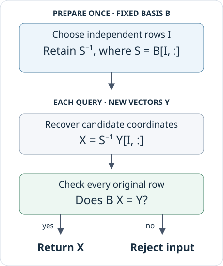

# Exact rational coordinates

Many computations with a finite encoded module eventually ask the same linear
algebra question: how do we express these vectors in this basis? An image basis
identifies a subspace, but a map into that subspace must also be written in its
coordinates. Homology adds another step: express a cycle in a cycle basis, then
pass to coordinates modulo boundaries.

This account follows the rational solver for a matrix with independent columns,
called the *full column* solver in the API. Selecting a square invertible
submatrix of its rows gives enough equations to recover candidate coordinates.
The remaining equations then tell us whether those coordinates really describe
the supplied vectors. We will follow that calculation through its reusable
data, its checks and the specialization for homology coordinates.

The retained *factor* is the data prepared from a fixed basis for later solves.
We develop that route first, then explain [how the implementation is
selected](#when-the-modular-route-is-selected) when a direct request uses
modular arithmetic instead. Here *backend* means the implementation chosen to
carry out the same rational operation.

## The problem and its certificate

Let $B\in\mathbb Q^{m\times n}$ have independent columns, with $m\geq n$. Its
columns are the chosen basis of a subspace of $\mathbb Q^m$. Given $Y\in\mathbb Q^{m\times r}$, we seek

$$
B X=Y,\qquad X\in\mathbb Q^{n\times r}.
$$

Independent columns make the coordinates unique if they exist. Existence
requires every column of $Y$ to belong to the image of $B$, so the routine must
recover coefficients and verify that multiplying by $B$ returns the supplied
vectors. Since the arithmetic is rational, we can check equality itself instead
of deciding how small an error to accept.

TamerOp selects $n$ independent rows of $B$, in an ordered index list $I$. The
square matrix $S=B[I,:]$ is invertible, so any solution must satisfy

$$
X=S^{-1}Y[I,:].
$$

This gives a candidate without eliminating the whole augmented matrix on every
query. It does not, by itself, establish membership. If $E_I$ selects the rows
in $I$, then $L=S^{-1}E_I$ satisfies $LB=I_n$. Thus $BL$ is a projection onto
the image of $B$, and the remaining question is whether $BLY=Y$. In the general
solver this becomes the complete check $BX=Y$.



*The candidate uses selected rows; the certificate covers the original
equation. Reuse is valid only while the basis matrix remains unchanged.*

### A row that the candidate calculation cannot see

Consider

$$
B=\begin{bmatrix}1&2\\2&4\\0&1\end{bmatrix},\qquad
y=\begin{bmatrix}1\\2\\-1\end{bmatrix}.
$$

The first two rows are dependent. The ordered row selection is $I=(1,3)$,
giving

$$
S=\begin{bmatrix}1&2\\0&1\end{bmatrix},\qquad
S^{-1}=\begin{bmatrix}1&-2\\0&1\end{bmatrix},\qquad
x=S^{-1}\begin{bmatrix}1\\-1\end{bmatrix}
=\begin{bmatrix}3\\-1\end{bmatrix}.
$$

Multiplication verifies $Bx=y$. Now replace $y_2=2$ by $3$. The selected rows
are unchanged, so the candidate is still $(3,-1)^\mathsf T$. But its second
image coordinate is $2$, not $3$: the new vector is outside the subspace. A
cached inverse without the membership check would silently return coordinates
for the wrong vector.

Change the second coordinate below while keeping the selected rows fixed.
The candidate does not move, but the complete equation can cease to hold.
This illustration follows the same rational calculation as the code that
follows.

```@raw html
<link rel="stylesheet" href="../assets/arithmetic/choices.css">
<figure class="arithmetic-example" id="certificate-explorer" data-arithmetic-example="certificate">
<div class="choice-control"><label for="certificate-choice">Second coordinate of y</label>
<select id="certificate-choice" aria-describedby="certificate-explanation" disabled>
<option value="lower">y₂ = 1</option>
<option value="member" selected>y₂ = 2</option>
<option value="upper">y₂ = 3</option>
</select></div>
<div class="choice-drawing"><svg viewBox="0 0 250 230" role="img" aria-label="y₂ = 2. The selected rows give x = (3, −1), and the second row agrees too. All three coordinates of Bx equal those of y, so these are the exact coordinates of y in the image of B."><text x="4" y="25" text-anchor="start" class="">Row</text><text x="115" y="25" text-anchor="middle" class="">Supplied y</text><text x="200" y="25" text-anchor="middle" class="">Bx</text><text x="8" y="68" text-anchor="start" class="">1</text><text x="115" y="68" text-anchor="middle" class="">1</text><text x="200" y="68" text-anchor="middle" class="">1</text><text x="157.5" y="68" text-anchor="middle" class="">=</text><line x1="3" y1="78" x2="247" y2="78" class="axis"></line><text x="8" y="122" text-anchor="start" class="">2</text><text x="115" y="122" text-anchor="middle" class="">2</text><text x="200" y="122" text-anchor="middle" class="">2</text><text x="157.5" y="122" text-anchor="middle" class="">=</text><line x1="3" y1="132" x2="247" y2="132" class="axis"></line><text x="8" y="176" text-anchor="start" class="">3</text><text x="115" y="176" text-anchor="middle" class="">-1</text><text x="200" y="176" text-anchor="middle" class="">-1</text><text x="157.5" y="176" text-anchor="middle" class="">=</text><line x1="3" y1="186" x2="247" y2="186" class="axis"></line><text x="125" y="218" text-anchor="middle" class="small">Rows 1 and 3 determine the candidate.</text></svg></div>
<dl class="choice-values">
<dt>Candidate x</dt><dd>(3, −1)</dd>
<dt>Residual Bx − y</dt><dd data-value="residual">(0, 0, 0)</dd>
<dt>Does y belong to the image?</dt><dd data-value="accepted">Yes, Bx = y</dd>
</dl>
<p class="choice-convention">The first and third coordinates stay fixed at 1 and −1. All arithmetic is rational.</p>
<figcaption id="certificate-explanation" data-choice-explanation aria-live="polite">The selected rows give x = (3, −1), and the second row agrees too. All three coordinates of Bx equal those of y, so these are the exact coordinates of y in the image of B.</figcaption>
<noscript><p>The displayed case remains available; enable JavaScript to change the selection.</p></noscript>
</figure>
<script src="../assets/arithmetic/choices.js"></script>
```

The linear algebra owner, `TamerOp.FieldLinAlg`, exposes the operation
directly:

```julia
using TamerOp

FL = TamerOp.FieldLinAlg
field = TamerOp.CoreModules.QQField()
K = Rational{BigInt}

B = K[1 2; 2 4; 0 1]
y = K[1, 2, -1]
factor = FL.factor_fullcolumn(field, B;
                              backend=:julia_exact, cache=false)
x = FL.solve_fullcolumn(field, B, y;
                       factor, backend=:julia_exact)
@assert x == K[3, -1]
```

The explicit backend makes this an example of the retained Julia factor path.
With automatic routing, problems whose relevant dimensions are all at most four
take a specialized tiny solver before factor dispatch, even if a factor was
supplied. That solver uses the same idea of inverting a selected minor, enumerating small row
subsets. The explicit choice here ensures that the supplied factor is used even
for this small example.

## What factor construction actually does

The internal `FullColumnFactor` holds two pieces of information: the selected
row indices and the inverse of the selected square matrix. It does not hold the
original matrix. The internal Nemo variant holds the inverse in Nemo's matrix
representation.

### Native rational elimination

For a dense rectangular matrix, the Julia implementation selects independent
rows by finding pivot columns of $B^\mathsf T$. It scans columns in order and
uses forward elimination: eliminate below each pivot and continue. Full reduced
row echelon form would also identify these pivots, but would do unnecessary
normalization and elimination above them. The selected indices preserve the
existing ordered basis convention. For a sparse matrix stored by compressed
columns (CSC), the implementation instead selects rows through its sparse
reduced row echelon form (RREF). CSC stores the nonzero entries of each column
together, avoiding a dense array of zeros. The forward elimination described
here applies to dense storage.

After selection, the implementation obtains $S^{-1}$ by reducing $[S\mid I_n]$.
A square input takes a shorter route: reduce $[B\mid I_n]$ once, both checking
invertibility and obtaining the inverse. This uses exact rational Gauss–Jordan
elimination.

The explicit inverse is a choice for repeated application. A new supplied vector or matrix needs row selection and matrix multiplication, without another solve
against $S$. The resulting inverse can be dense and contain large rational
coefficients, so its storage cost matters alongside the saved computation.

### Try a likely minor before searching for one

The Nemo factor path can first try the leading $n\times n$ block when the dense
eligibility conditions below hold. If it is invertible, the answer is already
the first possible ordered row basis. General row selection would return those
same rows, so the shortcut preserves the factor's mathematical convention.

If that block is singular, the implementation falls back to row selection using
the RREF of $B^\mathsf T$, then inverts the selected minor. The small example
above explains why fallback is necessary, although its size does not activate
this optimization. Only the backend's specific noninvertibility error is
caught; unrelated failures are propagated.

This attempt trades a possible failed inverse for avoiding row selection when
the leading block works. The choice was made after benchmarking the
alternatives.

## Where native exact arithmetic earns its conversion cost

Julia's `Rational{BigInt}` representation is convenient for the surrounding
code. Nemo offers rational matrices implemented by FLINT, a native library for
exact arithmetic that can reduce the cost of dense matrix operations. The
[Nemo/Hecke paper](https://doi.org/10.1145/3087604.3087611) explains the
combination of Julia algorithms and specialized native libraries; [Nemo's
matrix documentation](https://nemocas.github.io/Nemo.jl/stable/matrix/)
identifies the rational matrix type supplied by FLINT. TamerOp uses these
implementations directly.

Conversion is real work. A dense Julia container can also hold a mostly zero
matrix whose native computation is already cheap. The extra dense factor and
product paths therefore use the following default eligibility rules:

| Operation | Conditions for the additional dense path |
| :--- | :--- |
| Factor an $m\times n$ basis | Nemo enabled; $m\ge n\ge16$; storage in a dense array; at least half of all entries nonzero; at least half of the leading $n\times n$ block nonzero |
| Multiply an $a\times b$ matrix by a $b\times c$ matrix | Nemo enabled; $b\ge16$, $a\ge4$, $c\ge4$, and $abc\ge1024$; both operands stored in dense arrays and at least half nonzero |

These are local crossover heuristics, not mathematical restrictions or a
complete description of public backend routing. The public solver also has
separate operation, shape, and sparsity thresholds. An explicit choice of the
Julia implementation keeps the solve on that route. The dense eligibility rules
were chosen after benchmarking different options.

The density of the leading block matters because a readily available sparse
minor can make the original problem inexpensive. An embedding $B=[I_n;A]$ has
an immediately available identity minor even when the lower block makes the
whole matrix dense. Converting such a problem to a general dense implementation
can cost more than solving it directly. Requiring density in the leading block
keeps these inexpensive embeddings out of this additional dense factor path.
Counting actual nonzeros also avoids treating a dense array containing an
identity matrix as a dense arithmetic problem.

The native multiplication routines skip zero contributions and traverse stored
entries of CSC sparse matrices. Structured and sparse inputs therefore need not
be expanded merely to use the dense optimization. The stored representation
therefore affects which route is economical, alongside the dimensions of the
matrix.

[FLINT's documentation for rational matrices](https://flintlib.org/doc/fmpq_mat.html)
describes denominator clearing and several exact solving strategies, including
fraction-free, Dixon, and multimodular methods. Selecting Nemo delegates the
exact operation to that library stack; it does not select TamerOp's separate
modular solver, described below.

## Applying a factor without weakening the contract

For a matrix right hand side, the native factor path first exposes the selected
rows as a view. At nine or more columns it instead gathers them into a
contiguous array, with each column stored consecutively. The copy costs time
and memory, but avoids repeated irregular row access during wider products. A
vector right hand side is gathered directly. The threshold is an implementation
choice; vector and matrix input shapes remain distinct in the returned answer.

After multiplication, certificate evaluation follows the storage and workload:

- Small or structured native calculations use dot products that can stop at
  the first unequal entry.
- CSC sparse certificates traverse stored coefficients and reuse one
  $m$-entry accumulator for each supplied column.
- Eligible dense batches use a complete exact product and comparison. On the
  Nemo solve path, the candidate can remain in Nemo through this check and
  be converted back only after it passes.

The dense certificate reduces the cost of valid wide queries, but gives up the
scalar check's immediate rejection of an early mismatch. Both preserve the
equation $BX=Y$; their failure costs differ.

`check_rhs=true` is the default. Turning it off bypasses the membership
certificate and makes membership a caller precondition. In particular, the
altered vector in the example can no longer be expected to be rejected. A
matrix with dependent columns cannot serve as the basis required here; the
solver rejects it rather than choosing among several possible coordinates.

## When the modular route is selected

The choice is made for each request. A retained Julia or Nemo factor already
specifies the implementation that will apply it. Without such a factor, a
direct solve can instead use TamerOp's modular method: solve in prime fields
first, then recover a rational answer from those solutions.

For `solve_fullcolumn(field, B, Y)`, the selection rules are:

| Request | Selected route |
| :--- | :--- |
| `backend=:auto`, with a retained factor | Use the factor's backend, except that the tiny solver described above runs first |
| `backend=:auto`, no supplied factor, dense $B$, default thresholds, Nemo enabled | Julia for $mn<50{,}000$; Nemo for $mn\ge50{,}000$, after the tiny shortcut |
| `backend=:auto`, no supplied factor, dense $B$, default thresholds, Nemo disabled | Julia for $mn<120{,}000$; a modular attempt for $mn\ge120{,}000$, after the tiny shortcut |
| `backend=:auto`, no supplied factor, recognized sparse storage | Julia or Nemo according to the sparse routing rules; no automatic modular attempt |
| `backend=:modular`, without a retained factor | Attempt modular solving; a plain `SparseMatrixCSC` instead goes directly to Julia exact solving |

Thus the automatic dense route does not reach the separate modular solver with
the default thresholds while Nemo is enabled: the Nemo condition is checked
first. A configured threshold profile can change the crossover values; modular
solving is then selected if the Nemo condition fails and the modular threshold
is met. These thresholds for direct solves are separate from the dense factor and
product gates above.

`factor_fullcolumn` always constructs a reusable Julia or Nemo factor, even if
its routing would otherwise choose modular solving. Apart from the automatic
tiny shortcut, subsequent solves with that public factor keep its backend; an
explicit conflicting backend is rejected. Enabling `cache=true` alone does not
request modular arithmetic.

Once selected, the modular algorithm solves over several independent prime
fields, combines residues with the Chinese remainder theorem, and reconstructs
rational entries. Unusable prime images are skipped. Under the default
`check_rhs=true`, it checks the reconstructed candidate against $BX=Y$ over
$\mathbb Q$. If the bounded attempt produces no accepted answer, that request
falls back to Julia exact solving. Thus an unsuccessful modular attempt still
completes the same request through exact elimination.

Rational reconstruction asks for a small fraction compatible with a residue.
The Euclidean reconstruction method and its uniqueness bounds are classical;
see [Wang, Guy, and Davenport (1982)](https://doi.org/10.1145/1089292.1089293).
For bounds $|u|\le N$ and $0<v\le D$, with the denominator invertible modulo
$M$, the condition $2ND<M$ guarantees uniqueness of a reduced compatible
fraction. [FLINT states this contract
explicitly](https://flintlib.org/doc/fmpq.html#modular-reduction-and-rational-reconstruction).
Uniqueness within a bound does not establish that the reconstructed entries
solve the original problem; this is why the default route still checks the
matrix equation.

[Dixon's p-adic method](https://doi.org/10.1007/BF01459082) instead lifts using
successive powers of one prime. TamerOp's local modular route combines
independent primes, so the two methods have different reconstruction steps.

## Specializing the idea for homology coordinates

A generic full column solve computes all coefficients in a basis. A homology
query may need only their image in a quotient. TamerOp can retain a more
specialized plan for this repeated question.

Let the columns of $Z$ form a cycle basis, choose independent rows $I$, and
write $J$ for the remaining rows and $S=Z[I,:]$. An input vector $z$ is a cycle
precisely when

$$
z[J]=Z[J,:]S^{-1}z[I].
$$

Agreement on the rows in $I$ is automatic. Thus the plan can retain
$C=Z[J,:]S^{-1}$ and test only the complementary rows. If $Q$ sends cycle
coordinates to the chosen homology coordinates, retain $P=QS^{-1}$ as well.
Each subsequent query then performs

$$
Cz[I]=z[J]\quad\text{and, if this holds,}\quad h=Pz[I].
$$

This combines coordinate recovery with quotient projection. It avoids
recovering an intermediate vector merely to immediately project it, and does
not require materializing homology representatives. The projection is derived
from the existing RREF of the boundary coordinates, preserving the package's chosen
quotient basis. Cohomology uses the corresponding construction.

Even homology of dimension zero does not make every input a cycle. Membership is
checked before returning the empty coordinate vector, and an invalid first
query fails before installing the quotient plan. These details prevent a
performance shortcut from silently changing the mathematical domain of the
operation.

## Retained state, temporary work, and ownership

The internal factor retains $n$ row indices and $n^2$ rational entries. For
dense native arithmetic, applying it costs roughly $O(n^2r)$ field operations,
while a complete certificate costs $O(mnr)$. Gathering the selected rows
requires up to $O(nr)$ temporary entries. These count arithmetic operations and
stored entries: rational numerator and denominator sizes also affect time and
memory.

The public `FullColumnSolveFactor` retains more than this internal factor. It
also contains an elimination summary, including RREF and an image basis.
Consequently, the internal $O(n^2)$ count does not describe the entire public
object. Rebuilding that public object may still perform elimination even when
the internal inverse is already cached. Retaining the returned factor avoids
repeatedly asking for that wrapper.

Homology and cohomology results own their internal factors and coordinate
plans. Installing a prepared factor uses a shared lock, while each result has
its own lock for installing coordinate plans. These locks prevent two tasks
from changing the same retained entry at once. Factor computation occurs
outside the lock, so concurrent first requests may duplicate computation before
one complete result is kept. There are also weak factor caches in
`FieldLinAlg`. Their values do not keep the input matrix alive. The weak
dictionaries have no lock around cache access, so the synchronization of plans
owned by individual results does not extend to concurrent access to these
global caches.

All reuse assumes an unchanged basis matrix. The factor does not track changes
to matrix entries and cannot repair itself after an entry of $B$ changes. Cache
eligibility also depends on the input's Julia representation; immutable
wrappers are not necessarily cached. An explicitly retained factor is the
clearest way to state the intended reuse.

## Implementation locations

| Concern | Source and useful symbols |
| :--- | :--- |
| Public solve and retained factor contracts | [`public_api.jl`](https://github.com/erikmnovak/TamerOp.jl/blob/main/src/field_linalg/public_api.jl): `factor_fullcolumn`, `solve_fullcolumn`, `FullColumnSolveFactor` |
| Ordered rows, inverse factors, products, complete certificates | [`qq_engine.jl`](https://github.com/erikmnovak/TamerOp.jl/blob/main/src/field_linalg/qq_engine.jl): `_pivot_columnsQQ`, `_factor_fullcolumnQQ`, `_solve_fullcolumnQQ`, `_verify_solveQQ` |
| Dense conversion gates and general routing | [`thresholds.jl`](https://github.com/erikmnovak/TamerOp.jl/blob/main/src/field_linalg/thresholds.jl), [`backend_routing.jl`](https://github.com/erikmnovak/TamerOp.jl/blob/main/src/field_linalg/backend_routing.jl) |
| Homology/cohomology plans and ownership | [`ChainComplexes.jl`](https://github.com/erikmnovak/TamerOp.jl/blob/main/src/ChainComplexes.jl): `_fullcolumn_factor!`, `_checked_quotient_coordinates`, `coordinates` |

[Bibliography](references.md).