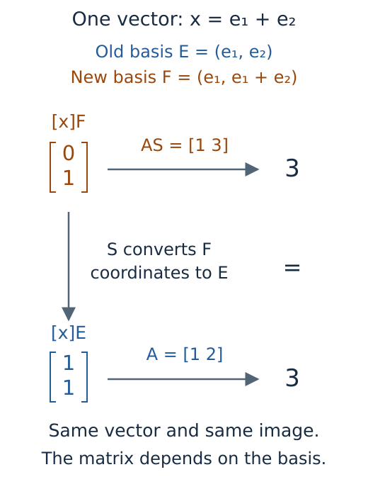

# Serialization, interchange and mathematical provenance

Suppose we save a structure map, then reopen it next week. Its rank may be
unchanged even though its matrix looks different, because reconstructing a
module can choose different bases. If we instead save only the matrix, we
can recover those entries but may no longer have the module needed to query
another pair of parameters. Deciding what to save begins with what we want
to recover.

Serialization is the conversion of a computed object into stored data from
which it can be reconstructed. TamerOp provides separate formats for
mathematical objects and for selected views of them. Each format has a
*schema*, the rules specifying its fields, their types and their meaning.
An *owned* format is one whose schema TamerOp defines and validates itself;
external interchange follows conventions defined by another producer.

This account follows an encoded module and an ordinary persistence diagram
through these formats, paying particular attention to coordinates and to the
information needed for a new query. The
[live inspection guide](../tutorials/live_inspection.ipynb) develops the user
workflow, while the [session reference](../src/reference/visual_sessions.md)
gives the saving and restoration contracts.

## Preserve the object required by the next query

A [finite encoding](../finite_encodings.md) consists of a finite partially
ordered set, a module on that set, and a map assigning original parameters
to finite labels. The module supplies a vector space at each label and a
linear map for each comparable pair. The assignment, called the classifier,
lets us find the space or map belonging to parameters in the original
domain. Saving dimensions alone loses the linear maps; saving the finite
module without its classifier loses the means of locating those original
parameters.

The owned encoding format stores a
[fringe presentation](../indicator_presentations.md): a map between sums of
indicator modules, whose image is the represented module. At each finite
label, loading takes the image of the corresponding matrix to reconstruct
the vector space. The resulting module is naturally isomorphic to the
represented one, meaning that there are isomorphisms at all labels which
commute with its structure maps. This recovers the same module in a
mathematical sense, while allowing its coordinate bases to change. Retaining
the supported classifier makes queries in the original domain possible again.

The file also records the coefficient field and available mathematical
*provenance*: information about the construction, such as the homological
degree, parameter orientation, observation window, discretization and
approximation choices. This information tells us which problem the stored
object describes. For example, preserving a computation made on a selected
grid does not establish that it agrees with a computation on every parameter
of an unstored continuous domain.

Ordinary persistence diagrams use a separate owned format. A diagram records
finite intervals, which have both a birth and a death, and essential intervals,
which have no recorded death, in each homological degree. Its format preserves
the grade values and their types, coefficient field, order convention and
available provenance. Retained representatives carry further choices: a cycle
is a linear combination of cells with zero boundary, a filling chain has that
cycle as its boundary, and a cocycle is a linear functional on chains that
vanishes on boundaries. When the computation retained these data, they travel
with the diagram, together with available links to source cells and landmark
records identifying selected input points. A list of endpoints would not
recover those choices.

On loading a diagram, the implementation compares the reconstructed result
with the file's summary fields and validates its interval and retained-data
structure. When source differentials and correspondences were retained, it
can check the associated boundary equations as well. An endpoint list
without those differentials supplies no way to verify a purported cycle
independently. The [source representative account](source_representatives.md)
develops the equations used when this evidence is present.

The owned formats support inspection before reconstruction. A header summary
lets a reader identify the artifact family and available data without restoring
all retained chains or constructing the module. The corresponding `check_*`
operation performs the loader's validation and reports any issues; loading
then returns the mathematical object. Compact JSON is the default, with
`profile=:debug` available when a person needs to read the file. Formatting
the same data more generously does not strengthen the mathematical checks.

## A coordinate matrix needs more than an isomorphism class

Consider the linear map $f:\mathbb Q^2\to\mathbb Q$ given in the usual source
basis $E=(e_1,e_2)$ by

$$
A=\begin{bmatrix}1&2\end{bmatrix}.
$$

Thus $f(e_1)=1$, $f(e_2)=2$, and the vector $x=e_1+e_2$ maps to $3$.
Now choose the source basis $F=(e_1,e_1+e_2)$ while keeping the target basis
fixed. The columns of

$$
S=\begin{bmatrix}1&1\\0&1\end{bmatrix}
$$

are the new basis vectors written in the old basis, so $[x]_E=S[x]_F$.
Here $[x]_E=(1,1)^{\mathsf T}$ and $[x]_F=(0,1)^{\mathsf T}$. In the new
coordinates the matrix of $f$ is

$$
AS=\begin{bmatrix}1&3\end{bmatrix},
\qquad
A[x]_E=AS[x]_F=3.
$$

*This schematic follows one vector through two coordinate descriptions of the
same map. Both routes give $3$, although a saved matrix readout must choose
which basis its entries refer to.*

A saved visual source therefore retains more than the fringe presentation of
an encoding. It includes the original finite module's dimensions and matrices
in their stored bases, together with its coefficient field and labelled
poset. The classifier still locates original parameters, and the additional
coordinate data allow a resumed inspector to reproduce a saved matrix or
vector. A plain finite module uses the same coordinate representation without
a classifier.

The loader checks the matrix shapes and field and verifies that composition
is independent of the path through the poset's cover relations. A cover
relation is a comparable pair with no label strictly between them. Since
maps on these pairs determine the remaining maps by composition, agreement
between paths is what makes the stored matrices a module. For an encoding,
the coordinate module and the separately stored fringe presentation must also
agree on the labelled poset, coefficient field and dimensions at each label.
These checks do not construct a natural isomorphism between two independently
edited declarations. Compatible data produced by the supported saving path
can be recovered; arbitrary replacement presentations require their own
mathematical justification.

Each captured state that supports new queries records a *content identity*
for its complete source. This is a SHA-256 digest, a fixed length value
computed from a canonical representation of the supported source data.
Canonical here means that choices such as dictionary order have been made
deterministic before computing the digest. Runtime caches are excluded.
When a source is attached to a saved session, the implementation checks this
identity, reconstructs the supported requests and compares their selections
and prepared views with the captured ones.

In the example above, a saved source using $A$ differs from one using $AS$,
even though both describe an isomorphic map. Their coordinate data differ,
so their content identities do too. The identity check asks whether the
retained source content matches; it does not decide whether two modules are
isomorphic. A digest also provides no signature identifying the author of a
file, and no proof of its mathematical claims.

## Encode exact values as typed data

The entries of a saved matrix have a meaning beyond the decimal characters
used to print them. An exact rational such as $1/3$ must retain its numerator
and denominator. An algebraic grade such as $\sqrt{2}$ must retain which
algebraic number it is, even if a drawing places it at an approximate numerical
coordinate. A *codec* is the pair of procedures that writes such a value into
data and reads it back. TamerOp's scalar codecs attach explicit type tags so
that reading a value does not depend on guessing from its printed appearance.

| Value | Retained information |
| --- | --- |
| Integer | Supported integer type and decimal value |
| Rational | Rational type and exact numerator and denominator |
| Real algebraic number | Minimal polynomial in integer coefficients and index among its sorted real roots |
| Floating value | Type, value and precision, including the precision of a `BigFloat` |
| Coefficient field | Rational or prime field identity, or a `RealField`'s numerical tolerances |
| Array or sparse matrix | Element type, shape and entries; a sparse matrix also retains its stored index structure |

An algebraic number's minimal polynomial is a nonzero rational polynomial
of least degree that vanishes at that number. Here it is stored with integer
coefficients having no common factor and a positive leading coefficient.
For $\sqrt{2}$, the polynomial $t^2-2$ alone would be ambiguous: it has two
real roots. Storing root index $2$ in increasing order selects the positive
one. The loader checks the polynomial representation, finds its real roots
and verifies that the polynomial is the chosen root's minimal polynomial.
The [exact coordinate implementation](https://github.com/erikmnovak/TamerOp.jl/blob/main/src/serialization/coordinates.jl)
uses Nemo's algebraic number operations for this reconstruction. Preserving
a floating value similarly means preserving the finite precision value that
was actually supplied; it does not turn an approximation into an exact
measurement of an unknown quantity.

The field belongs to the mathematical data as well. The default encoding
load uses the stored field. Explicitly overriding `field` reinterprets the
stored fringe coefficients in the requested field and recomputes the image.
For example, a scalar coefficient $2$ becomes zero in characteristic two.
The result need not have the original dimensions or homological meaning, so
the loader records this reinterpretation and clears the original degree and
ambient identification rather than claiming invariance under coefficient
change.

For saved views, the codec admits a fixed collection of drawing records:
layers, specifications, styles, mathematical context and annotation anchors.
Tuples, named tuples, dictionaries and supported arrays hold their surrounding
data. These records are *declarative*: they describe values and drawing
choices without providing a program to execute. The loader recognizes a
fixed list of functions that construct these records; it never interprets
a stored type name as Julia source.

Before constructing a value, decoding checks its tags, declared fields, type
parameters and array dimensions. For a sparse matrix, whose unstored entries represent zeros, it also checks
that the stored row and column indices agree with its shape and entries.
Limits on nesting depth and the number of visited entries bound the record's
structural complexity. Large exact coefficients and algebraic numbers may
still be costly to reconstruct, since these limits do not bound every
integer's bit length or the work of finding algebraic roots.

## Save a selected answer independently of its live source

A saved session contains named states and identifies which one should appear
initially. Each state retains a static visual specification, the exact
available selection and a declarative request describing how supported new
queries can resume. A state without such a reconstruction route remains a
snapshot. The collection records a shared style and figure size supplied at
saving time. Capturing the mathematical view does not inspect a renderer's
current palette or camera position.

For our map example, a snapshot can retain $A$, the selected labels and the
figure that displays them. Reopening this snapshot needs no module: all the
values required for that answer are already present. Asking for a different
structure map needs the module and, for original parameter queries, its
classifier. Including that source is an explicit choice through `object=...`
or a checked reference to a source file. Supported encodings and finite
modules retain the coordinates described above; ordinary diagrams reuse
the full owned diagram format.

An active session also contains machinery that has no meaning as portable
mathematical data. Caches retain earlier calculations, callbacks respond to
events, and rendering handles refer to a particular display. Snapshot
conversion retains the supported declarative values and reports metadata
that it omitted. A function's last computed answer may be retained when it
has a supported representation, while the function itself is not restored.
Reopening a saved view does not recreate callbacks, caches or subscriptions
to the original session.

## Check referenced resources at the point where they are needed

A session may refer to a source file under the directory containing its
bundle. The saved path is relative to that directory, so moving the complete
bundle preserves the relationship. Two checks serve different purposes:
the reference records a digest of the source file's bytes, and it records
the content identity of the mathematical source reconstructed from that file.
The first detects changes to the file itself; the second checks the supported
source data to which the recorded requests refer.

Displaying a retained snapshot does not need this optional source. A
recipient can inspect the matrix and selection even if the source file is
unavailable. Resuming computation resolves the relative path, checks the
file digest, loads the appropriate owned object and checks its content
identity. A missing or changed resource rejects the new query. Supplying an
object explicitly can replace an unavailable resource only when that object
matches the recorded source identity.

Path validation rejects references outside the bundle, including symbolic
links that resolve outside it. This makes the reference portable within a
known directory, while the content checks make changes detectable against
the recorded digests. None of these operations establishes who supplied the
bundle or proves its mathematical interpretation. The owned loaders still
validate the reconstructed data, and provenance still has to be interpreted
in the context of the calculation it describes.

## Distinguish reconstruction from rendering

Loading session JSON recovers its data record without running a mathematical
query. Loading saved-session HTML extracts that same embedded record without
executing the page's browser program. Rendering in Julia then uses the stored
specification and style through the usual plotting backend. Resuming a live
inspector is a separate operation that reconstructs a supported session and
applies its validated selection.

The saved-session HTML exporter uses CairoMakie to prepare an SVG for every
retained state and bundles these figures with the session record and
plotted-value downloads. Once created, the HTML needs no Julia process or
network service to show its saved answers. Its controls select among those
answers; they do not compute new ones. The
[inspection session account](inspection_sessions.md) explains that distinction
in terms of what runs in Julia and what runs in the browser. The
[optional integrations guide](../optional_integrations.md) describes the
rendering dependencies.

Exact values remain in the record even though SVG uses numerical drawing
positions. Composition connectors retain their frozen coordinates and
recorded evidence: an authored explanatory arrow remains authored, and an
arrow whose correspondence was checked retains that earlier result. Loading
its picture does not repeat the check against a changed mathematical source.

Exporting one state of a saved session to SVG, PNG or PDF normally writes a
companion JSON record as well. For example, `selected.svg.json` accompanies
`selected.svg`. This *sidecar* contains the exact available plotted values,
selection, caption, provenance and original source identity, together with
the image's filename and SHA-256 digest. It can reopen as a static snapshot
without reading the image. It contains no full mathematical source or request
for new queries; `sidecar=false` omits it. Exporting one saved state to HTML
likewise retains that selected answer and original source identity without
copying the original mathematical object into the figure export.

The image and its companion are prepared before either destination is
replaced. Each replacement is atomic, meaning that the destination receives
a complete file rather than a partially written one. The pair is not a
single transaction: an interruption between replacements can leave an old
record beside a new image. Stored style and size are reused by the saved
session export methods. The specification's declared axes survive, while a
renderer's transient pan, zoom and camera position are outside the captured
data.

Storage grows with the retained state data, the SVG for each HTML state and
any included mathematical source. Identifying a source involves serializing
its complete supported content and may materialize a lazily stored module.
Attaching the source replays the supported requests to verify the saved
answers. Several large snapshots therefore still incur storage and checking
costs even when they share one source. Reopening a static state avoids its
original mathematical query; resuming can repeat preparation and selection
work because runtime caches were excluded.

## Owned artifacts and external interchange have different contracts

An owned loader knows which TamerOp schema it is reading and validates that
schema's version and data. An external adapter interprets a declared
convention from another producer. Such an exchange can supply useful
mathematical data without supplying the selected states, source identities
or provenance of a TamerOp session. Similarly, a table of numerical features
preserves the values of those features, which may be insufficient to recover
the module from which they were computed.

The choice of format follows the intended next operation. An owned module
can support another structure map query; a saved session can recover a
particular selection; an HTML collection can present several prepared
answers without Julia. Their shared use of files or JSON syntax does not
make these preservation guarantees interchangeable.

## Retaining an authored draft

An editor snapshot can retain a proposed order, dimensions, support memberships
and coefficient matrices even when these data fail a module relation. The
value codec records the typed draft and its validation readout as snapshot
metadata. It has not thereby constructed an unchecked `PModule`.
`module_editor(saved)` validates the supplied draft again and starts a fresh
editing history. Exporting Julia source is a separate operation on a valid
open draft; loading a saved view never evaluates that source. The
[session account](inspection_sessions.md#keep-a-draft-distinct-from-a-mathematical-object)
explains how this permits a partially repaired example to be saved without
claiming it already defines a module.

## Implementation locations

| Concern | Source |
| --- | --- |
| Exact coordinate representations | [`coordinates.jl`](https://github.com/erikmnovak/TamerOp.jl/blob/main/src/serialization/coordinates.jl) |
| Owned finite encoding schema and reconstruction | [`owned_encodings.jl`](https://github.com/erikmnovak/TamerOp.jl/blob/main/src/serialization/owned_encodings.jl) |
| Ordinary result schema and retained data | [`owned_persistence.jl`](https://github.com/erikmnovak/TamerOp.jl/blob/main/src/serialization/owned_persistence.jl) |
| Supported visual values and structural validation | [`owned_visual_values.jl`](https://github.com/erikmnovak/TamerOp.jl/blob/main/src/serialization/owned_visual_values.jl) |
| Source coordinates and canonical content identities | [`owned_visual_sources.jl`](https://github.com/erikmnovak/TamerOp.jl/blob/main/src/serialization/owned_visual_sources.jl) |
| Versioned session record and relative resources | [`owned_visual_sessions.jl`](https://github.com/erikmnovak/TamerOp.jl/blob/main/src/serialization/owned_visual_sessions.jl) |
| Capturing, resuming and exporting selected states | [`saved_sessions.jl`](https://github.com/erikmnovak/TamerOp.jl/blob/main/src/visualization/saved_sessions.jl) |
| Portable HTML presentation | [`session_html.jl`](https://github.com/erikmnovak/TamerOp.jl/blob/main/src/visualization/session_html.jl) |

[Bibliography](references.md).
