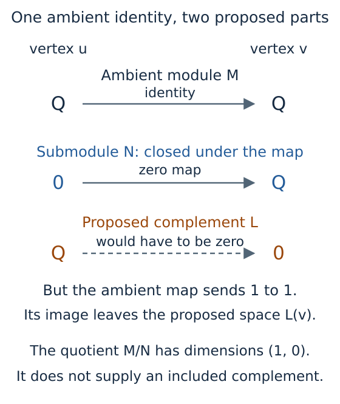

# From selected images to submodules and quotients

A vector can disappear under a structure map while another vector in the same
space survives. If we want the submodule generated by a particular selection,
we therefore need to follow its coordinates through the maps. The dimensions
of the ambient spaces alone cannot tell us what was generated.

This account follows the computation from selected columns to their image
spaces, the induced submodule maps and the quotient projection. The
[usage guide](../tutorials/generated_submodules.ipynb) develops the example of
two overlapping square supports; the [module reference](../src/reference/modules.md)
gives the accepted shapes and coefficient fields. Throughout, a stalk means
the vector space at one vertex of the finite poset. The matrices below use
columns for source coordinates and rows for target coordinates.

## Propagate columns before constructing a new module

Let $M$ be a module on a finite poset $P$, choose a vertex $p$, and place $s$
selected vectors from $M(p)$ in the columns of a matrix $B$. At each vertex
$q\geq p$, the columns we want are

$$Y_q=M(p\leq q)B.$$

The vertices $q\geq p$ form the *upper ideal* of $p$. Outside this set there
is no forward structure map from the source, and the stored image is `nothing`.
Inside it, a zero matrix means that the selected vectors have zero image. Its
row and column counts still record the target dimension and the number of
supplied vectors.

`propagate` first checks the module's storage, then visits successors along
covers, relations with no intervening vertex. The first path to a vertex
supplies its image columns. When another incoming cover reaches a vertex
already visited, the algorithm compares its product with the stored columns
and raises an error if they disagree. Multiplying the cover matrices by $B$
and its subsequent images avoids constructing entire composite matrices for
a selection of only a few vectors.

Over an exact field, agreement on every applicable cover establishes path
independence for the selected columns. Indeed, induction along any path
shows that its partial products equal the stored columns at the vertices it
visits. The ambient diagram is still required to be a module: these checks
concern the selected vectors and do not establish compatibility on all other
vectors. The result retains the supplied columns, including dependent ones,
and computes their image rank at each visited vertex.

For example, take $M(u)=\mathbb Q^2$, $M(v)=\mathbb Q$, and cover matrix
$M_{uv}=[0\;1]$. Selecting $e_1$ gives zero at $v$; selecting $e_2$ or
$e_1+e_2$ gives the scalar 1. All three selections see the same rank-one
ambient map, yet they answer different questions about individual vectors.

The generated spaces are

$$N(q)=\begin{cases}\operatorname{im}Y_q,&p\leq q,\\0,&\text{otherwise}.\end{cases}$$

They are closed under structure maps because $M(q\leq r)Y_q=Y_r$ whenever
$p\leq q\leq r$; maps starting at a zero generated space satisfy closure as
well. Every submodule containing the original columns contains all their
images, proving that this construction is the smallest such submodule.

## Use the existing image engine

The propagation result stops at image columns and ranks. On an explicit
`generated_submodule` call, the library constructs a module $F$ with $s$
coordinates at every vertex above $p$, identity maps between these spaces,
and zero spaces elsewhere. Each coordinate is a copy of the *principal
projective at $p$*. Giving a morphism from this module to $M$ amounts to
choosing a vector at $p$ and following it forward; for $s$ copies the choices
are exactly the columns of $B$.

The resulting morphism $F\to M$ has component $Y_q$ at $q\geq p$. Calling
`image_submodule` on it lets the general image construction supply both the
image spaces and their maps. At each vertex, that construction selects
independent columns $I_q$ spanning the image. For a cover $u<v$, its induced
matrix $N_{uv}$ is obtained from

$$I_vN_{uv}=M_{uv}I_u.$$

The right side takes each image basis vector at $u$ through the ambient map.
Closure puts the resulting columns in the image space at $v$, and independence
of the columns of $I_v$ makes their coordinates unique. The matrices $I_q$
are therefore the components of the inclusion $N\hookrightarrow M$.

![A commuting square has the generated map Q to Q across its top and the ambient map [0 1] from Q squared to Q across its bottom. The left inclusion is the column [1 1] and the right inclusion is 1, so both routes send a to a.](../assets/generated_submodules/image_coordinates.svg)

*This schematic uses the selection $e_1+e_2$ in the example above. The induced
map is $[1]$ because $[0\;1](1,1)^{\mathsf T}=1$. Its value follows from the
inclusions and the ambient map; equal image dimensions alone would not
specify it.*

The same image construction serves a general module morphism. The kernel
construction instead chooses bases of the component nullspaces and recovers
its induced maps by the corresponding inclusion equation. Both use the
shared rank and coordinate routines described in
[Exact rational coordinates](qq_coordinates.md). Prime fields retain exact
arithmetic too. With `RealField`, ranks and equation comparisons depend on
the configured tolerances, so numerical agreement does not prove exact path
independence. `check_propagation` checks the retained source columns, image
ranks and every applicable cover equation under the field's conventions.

## Remove the generated submodule

`quotient_with_projection` calls the general cokernel construction on the
inclusion. At each vertex, it chooses a matrix $Q_q$ whose kernel is the
included image space and whose rows give coordinates in the quotient.
Vectors have the same quotient coordinates precisely when their difference
belongs to the image. The quotient's cover matrix $\overline M_{uv}$ is
determined by

$$\overline M_{uv}Q_u=Q_vM_{uv}.$$

In our example, we can choose $Q_u=[-1\;1]$: it kills $(1,1)^{\mathsf T}$
and maps $\mathbb Q^2$ onto a one-dimensional space. At $v$, the image fills
the ambient space, so the quotient is zero and $Q_v$ has zero rows. The
quotient cover map is consequently the unique map $\mathbb Q\to0$.
These are illustrative coordinate choices; the constructor may return a
different basis for the same quotient.

The equation $Q_qI_q=0$ records that the projection annihilates the included
space, while the displayed cover equation records compatibility with the
module maps. The construction also gives
$\dim(M/N)(q)=\dim M(q)-\dim N(q)$, so its projection has exactly the
required kernel. Matrices with zero rows or columns participate in these
same equations.

A quotient need not be realizable by a complementary submodule inside $M$.
For the chain $\mathbb Q\xrightarrow{1}\mathbb Q$, selecting a vector at the
second vertex generates $0\to\mathbb Q$. Its quotient has dimensions $(1,0)$,
but a complement with those dimensions would fail to be preserved by the
ambient identity map.

*Choosing complementary vector spaces separately at the vertices does not
ensure that the module maps preserve them. This example explains why forming
a generated submodule and quotient does not certify a direct sum decomposition.*

The image, kernel and quotient constructions also supply other categorical
operations. For maps $f:X\to Z$ and $g:Y\to Z$, a pullback consists of pairs
$(x,y)$ with $f(x)=g(y)$, so it is computed as the kernel of
$[f\;-g]:X\oplus Y\to Z$. Dually, a pushout identifies the two images of
each vector in a common source by taking a cokernel of the corresponding
signed map. Keeping the inclusions and projections makes these constructions
usable for further maps, beyond knowing their dimensions.

## Coordinates, source cycles and reuse

Suppose invertible matrices $C_q$ convert old stalk coordinates to new ones.
The stored map from $p$ to $q$ then becomes $C_qM_{pq}C_p^{-1}$, and the
selected source columns become $C_pB$. Their propagated images are $C_qY_q$,
so image ranks and nonzero support agree. The new inclusion represents the
same subobject under this specified module isomorphism. Replacing a basis
of the selected subspace by another basis also preserves its generated
subobject, although individual column matrices change.

For a homology module, a source cell query can express a propagated column
in a supplied target homology basis of retained cycles. It checks the cycle
equations and that the supplied classes form a basis modulo the active
boundaries. The identification of this ordered basis with the module's
coordinates is supplied explicitly by the caller and recorded. The
[account of source representatives](source_representatives.md) explains
these chain correspondences.

A propagation result retains the ambient module, the selected columns and
their images; an encoding input retains its classifier as well. With $s$
columns, the image matrices contain
$s\sum_{q\geq p}\dim M(q)$ coefficients, in addition to the retained input
objects. Cover multiplication depends on the matrix dimensions and storage.
Storage validation examines the ambient module, the propagation checks each
applicable cover on its selected columns, and rank calculations can account
for much of the work when many columns are supplied. Rational coefficient
sizes affect arithmetic costs beyond these counts of entries.

Reading an image or summary returns copies of the stored data. Constructing
a submodule additionally allocates the projective source, image bases and
induced cover maps; forming a quotient constructs another set of coordinates
and maps. Rendering requests neither construction implicitly. The viewer's
finite graph budget limits the number of drawn vertices, while matrix crops
limit only the displayed entries. The retained input objects must remain
unchanged during reuse; after mutating them, compute a fresh propagation so
that its stored columns describe the current maps.

[Implementation bibliography](references.md)
