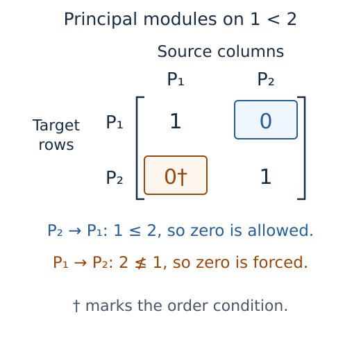

# [How a mathematical view becomes a figure](@id from-visual-specifications-to-renderers-and-exports)

Suppose we are looking at the matrix of a map between sums of principal
modules on a finite poset. A zero can appear because the map happens to have
that coefficient, or because the order forbids any nonzero coefficient in that
position. The distinction belongs to the map before we choose a color or a
font. It should survive a change of plotting package, a smaller displayed
block, or a caption pointing to one entry.

TamerOp records such information in a `VisualizationSpec`, the prepared
description of a mathematical view. The description contains the drawing
instructions together with the selected coefficients, labels and any checks
performed on the object. CairoMakie and WGLMakie are rendering backends: they
turn that description into a figure or a browser scene. Preparing the view may
ask a mathematical question, such as the rank of a selected map; drawing the
prepared view uses the answer already obtained.

The [visualization guide](../visualization.md) develops the public workflow,
and [composing figures](../tutorials/compose_figures.ipynb) shows how to bring
several views together. Here we follow the information they retain, then look
at the preparation and drawing mechanisms that keep it attached to the right
objects.

## Separate the mathematical request from its presentation

Consider the poset with two elements, $1<2$, over a field $K$. Its principal
projective $P_u$ has value $K$ at a vertex $q$ when $u\le q$, and zero
otherwise; its maps between nonzero stalks are identities. A *stalk* here
means the vector space assigned to one vertex. A map from $P_u$ to $P_v$ can
have a nonzero coefficient only when $v\le u$. Indeed, the image of the
generator at $u$ must lie in $P_v(u)$, which is zero unless $v\le u$.

For a map from $P_1\oplus P_2$ to $P_1\oplus P_2$, take

$$
A=\begin{pmatrix}1&0\\0&1\end{pmatrix}.
$$

Rows name target summands and columns name source summands. The lower left
zero is forced, since it would describe a map from $P_1$ to $P_2$. The upper
right zero is a permitted coefficient that happens to vanish. The prepared
view marks only the forced zero with a dagger, while retaining the original
matrix over $K$.

This is a schematic of the selected coefficient matrix. Both marked positions
contain the field element zero; the dagger records why one of them must do so.
Changing the permitted zero changes the map. Changing the forced zero to a
nonzero value violates the order condition and is rejected before drawing.

The preparation routine for an object is called its visual *recipe*. It first
checks whether the object supports the requested view and options, then
constructs a specification with graphical layers or child panels. A layer
groups one sort of drawing, such as points, paths, polygons, interval data or
a literal matrix. Its role may say that an item is selected or belongs to the
source of a map. The style translates these roles into colors and other
appearance choices at render time, so a grayscale export preserves the same
selection and coefficients.

Alongside these layers, metadata records the selected indices, coefficient
field, category, degree convention and scope of any computation. In the matrix
example it retains the complete selected matrix even when a display limit
shows only a block. A map into the zero space has zero rows; a map out of it
has zero columns. Retaining both dimensions keeps those cases distinguishable
even though neither has an entry to print. Coefficients themselves remain
literal text, including fractions and finite field elements, whose colors
would have no intrinsic interpretation as real magnitudes.

## Reuse source preparation before drawing

For a point cloud, the first question is often which points to join. A graph
of $k$ nearest neighbors (kNN) chooses neighbors using Euclidean distance in
the full coordinate space; a radius graph joins points whose distance is at
most the specified radius, including equality. Preparation shares this
computation with sparse ingestion and uses its floating point metric. An
activated spatial tree can accelerate the exact neighbor search, where “exact”
means no approximate neighbor selection, rather than exact real arithmetic.
Without that extension, the fallback retains the required nearest candidates
as it scans, avoiding a sort of every distance row. The renderer receives the
prepared edge segments.

For example, selecting axes `(2,1)` swaps the drawing coordinates. It leaves
the graph computed from all source coordinates unchanged. Selecting fewer
vertices then keeps only edges with both endpoints displayed. These operations
occur after preparation: the original edge index and endpoints remain attached
to each surviving segment. Supplied graph polylines follow the same edge IDs.
Weighted edges retain the full graph's bin limits, so an omitted extreme edge
cannot silently change every displayed color.

Repeated requests can share a `SessionCache`, a store of prepared results used
by both ingestion and previews. A graph entry records a copy of the
coordinates, the graph settings and the chosen neighbor backend. Comparing the
coordinates with that copy detects edits to the input; a matching hash alone
would not establish equality. At most four graphs are retained, with the
oldest removed when another is inserted. Coordinate projections have a
separate limit of four. A lock holds lookup and construction together, so
simultaneous requests share the prepared entry. Input coordinates must be
changed outside these calls. Arrays returned for display are copies, so
editing their metadata does not change a later graph query.

Reuse still requires a pass through the coordinates to establish that they
have not changed. Retained graphs occupy space for their edges and neighbor
distances, and retained projections occupy space for the source coordinates.
Selecting displayed edges may require another scan. When every source vertex
is shown, however, a computed graph already has valid endpoints, so the first
bounded set of edge IDs can be selected directly. A supplied graph still has
to validate its endpoints. A preview with `cache=:auto` retains no preparation
after the call; retaining a `SessionCache` is the explicit choice to share it.
Keeping the returned specification avoids this source preparation altogether
when the next request is only to draw the same view.

Preparation and display bounds have different meanings. Before brute force,
the requested bound on distance pairs is checked. kNN also checks its directed
candidate bound before allocation. Radius construction stops with an error
before appending an edge beyond its output cap, both in the fallback and
spatial tree routes. A failed construction is not cached as a partial graph.
Display budgets subsequently select source indices and report omissions
without changing the mathematical input. Point density bins still count the
full point cloud.

The shared [graph preparation](https://github.com/erikmnovak/TamerOp.jl/blob/main/src/data_ingestion/preview_graphs.jl)
owns neighbor reuse; [source
preparation](https://github.com/erikmnovak/TamerOp.jl/blob/main/src/visualization/source_previews.jl) owns projection reuse
and display identities. The [usage
section](../visualization.md#previewing-source-data) develops the workflow,
and the
[reference](../src/reference/visualization.md#source-previews-and-preparation-budgets)
owns exact option contracts.

## Keep collection identities attached to their numbers

A collection view begins with supplied tables and a declared sample order. A
feature table assigns numerical measurements to each sample; distance and
kernel tables assign a value to each pair. Preparation checks limits on the
number of samples and cells before checking shapes, labels and values, then
copies the supplied tables. It does not compute the pairwise values. A
`FeatureSet` retains its original metadata and each column's feature
definition, so selecting an entry can explain which mathematical query
produced it. A missing entry and a positive infinite distance both need an
uncolored heatmap cell, but remain distinct values in the retained table.

The heatmap uses rows for samples and columns for features or target samples.
Its floating drawing matrix is separate from the original selected value. Pair
tables are checked for exact symmetry. Even if a distance table is nonnegative
and zero on the diagonal, establishing the triangle inequality would require
further work. Similarly, a kernel matrix is positive semidefinite when $z^T
Kz\ge0$ for every real vector $z$, a condition that symmetry alone does not
establish. Neither property is certified by this preparation. A supplied
embedding places samples in the plane and retains its method, settings and
random seed. Those positions follow the sample order, without asserting that
their Euclidean distances equal the entries of the supplied table.

Selection rebuilds a bounded specification from retained data. The same sample
index highlights an embedding point and reveals its supplied invariant/source
panels. Composite sample views are flattened into their individual panels; no
new invariant or source reconstruction runs. Session updates validate first,
prepare the next snapshot, and only then commit and notify listeners. Failed
updates preserve the previous selection. Closing releases collection inputs
and witness references while leaving an exportable final snapshot.

For a pair of persistence diagrams, a retained matching records the interval
assignments used to witness their comparison. It is addressed by ordered
sample IDs because reversing a matching requires reversing those assignments.
Opening a retained witness creates an independent matching inspector.
Computing a new one is an explicit request for the selected pair, delegated to
the existing matching implementation; it leaves the supplied matrix unchanged.
The browser closes an embedded pair view with the collection, while a matching
session created by the caller remains independent. Exploring a collection
therefore does not start computations for every pair of samples.

The [collection builder](https://github.com/erikmnovak/TamerOp.jl/blob/main/src/visualization/builders_collections.jl) owns
value semantics and preparation; the
[session](https://github.com/erikmnovak/TamerOp.jl/blob/main/src/visualization/inspection_collections.jl) owns selection
and lifetime. The [guide](../tutorials/comparisons.ipynb) develops the
example, and the
[reference](../src/reference/visualization.md#collections-of-features-distances-and-kernels)
spells out shapes, budgets and matching options.

## Align queries before subtracting observables

Before subtracting the dimensions of two results, we need to decide which
parameters correspond. A comparison therefore receives named results and an
alignment of their queries. When queries use finite vertices, each result gets
its own vertex list: vertex 3 in one poset need not describe the same
parameters as vertex 3 in another. When queries use original parameters, each
encoding's classifier, the map assigning parameters to finite labels, finds
the appropriate vertices. Dimensions can then be read without constructing
structure maps.

A rank request fixes a source parameter and computes the ranks of its maps to
the target parameters, forming one row of a comparison table. For encoded
modules, preparation checks comparability in the original parameter order as
well as the finite poset. Two incomparable parameters can land in one coarse
fiber; their equal labels do not create a forward map. Unrepresented points
and unordered pairs remain distinct masked values through subtraction and
rendering. The live session retains one row per result, so selecting another
target or baseline reuses the computation. A changed anchor replaces that
bounded retained row. For a lazy encoding, the first nontrivial map calls
`encoding_module`, which materializes the finite representation. The viewer
bounds rank-table work, not the owner's module-construction cost.

Ordinary diagrams supply another implementation of the same observable
contract. Dimension counts intervals containing a parameter, and rank counts
intervals containing both ordered endpoints. These sums use all grouped
records with their multiplicities and endpoint conventions, even when the
drawing budget omits some groups. A bar that survives the computation cutoff
supplies no information beyond the recorded query window. The drawing clips it
to the known coverage and marks that end as censored, meaning the computation
ended before its death was determined. The stored interval remains separate
from this drawing choice.

Subtracting the baseline's integer value from the case's value now compares
the same declared query. For example, a difference of one in rank says that
the case's image has one more dimension than the baseline's. It does not
identify a vector in that extra dimension, provide a common basis, identify
coefficient fields, or match bars. Selected matrices remain separate literal
panels so that their own bases and fields stay visible. For floating point
coefficient fields, the rank routine is reevaluated at half and double the
declared tolerances. This modest sensitivity diagnostic is printed with its
limitations; it is not an exactness certificate. Authored construction and
approximation descriptions remain separate from provenance recorded by the
computational owner.

## Compose semantic views before resolving their positions

Suppose we place a source cycle beside its barcode and draw an arrow between
them. Moving the barcode panel should move that end of the arrow, while
choosing a different interval should require a different mathematical
selection. To make this distinction possible, composition takes prepared leaf
views, meaning individual panels with no further child panels, and gives each
a stable name. An overlay draws several such views in one axis after comparing
their declared coordinate context and visible windows. Rendering delegates
each child's layers back to its own drawing path, so interval endpoint
decorations, source labels and scalar ranges retain their meaning. A shared
legend includes repeated labels once when their graphical meaning agrees, and
rejects a label that would name conflicting encodings.

The coordinate context names the domain, units, parameter orientations,
coefficient field and degree. Its provenance identifier records which source
or construction the caller says the data came from. Known object metadata
constrains the caller's declaration. Equal identifiers express a declared
correspondence, not a recomputed theorem; an intentional comparison records
its mismatches and prints its explanation. Independent panels need no common
domain. Explicitly linked axes do, while linked scalar colors additionally
require the same quantity and colormap. Preparation scans finite samples for a
common range without altering the stored values.

An annotation's endpoint is an *anchor*: a panel name together with a choice
of an object or a position in that panel. For a source cell, the anchor uses
retained geometry to find that cell; for an interval, it uses the original
member ID, even when equal bars share a displayed row. A matrix anchor names
the actual coefficient label. Preparation checks that the selected item is
shown, rejecting anchors to omitted data. A coordinate supplied by the author
can instead explain a feature of the picture. Such annotations use a visibly
different style from a checked mathematical correspondence.

The ordinary cycle connector makes a narrower, checkable claim. It requeries
the selected interval representative and checks its field, source identity,
parameter and coefficient vector against the supplied cycle. This computation
uses the recovery of cycles on original cells described in the [source
representative account](source_representatives.md). It does not solve a new
representative optimization or identify a canonical geometric hole.
Composition and render validation repeat this check, so mutated mathematical
storage cannot silently retain a stale solid arrow.

At render time, each data anchor passes through its own axis transformation to
obtain a position in pixels for the whole figure. This common coordinate
system is what permits an arrow to cross between panels with different axes. A
panel or figure anchor instead uses normalized coordinates within its box, and
a matrix anchor uses the measured box of the printed coefficient.

In this schematic, widening the horizontal window changes where the same point
appears. The connector must follow the new pixel position. The implementation
therefore listens to changes in both the viewport, the panel's rectangle on
the screen, and the camera projection that transforms its data coordinates.
Listening only to axis limits can read the preceding camera transformation,
before the new one has been applied.

Annotations are drawn in a transparent scene placed after the panel scenes, so
their strokes appear above panel backgrounds in both WGL and Cairo. A light
halo behind text keeps signed weights readable over a scalar background.
Curved connectors use a quadratic arc with a bounded bend parameter; brackets
and highlights use the same resolved endpoints. If an endpoint leaves the
visible data window, the annotation disappears until that endpoint is visible
again, rather than acquiring a different mathematical endpoint at the window
edge. The drawing uses Makie's [coordinate
spaces](https://docs.makie.org/stable/reference/generic/space.html) and
[layout
observables](https://docs.makie.org/stable/explanations/layouting.html) to
keep those positions current.

Static HTML export prepares a fixed picture of the composition. Cairo renders
the complete selected composition to SVG; the export embeds that vector scene
and its textual interpretation in one responsive HTML file. A labelled scroll
region preserves the SVG's intrinsic size on narrow screens, so scientific
labels remain readable and panels and connectors retain one coordinate frame.
Reopening the file needs no running Julia process or remote resource. Live WGL
interaction with axes remains available while Julia is connected. Saving
mathematical objects independently of their figures uses the IO operations.

Preparation is linear in the retained layer and annotation counts, apart from
requested checks of source correspondences and scalar scans. Rendering has one
reactive endpoint per anchor and an arc sampled at a fixed number of points
per arrow. No search over every source pair, decomposition or new homology
computation is introduced by layout.

## Prepare signed contributions before drawing

A signed rectangle measure represents an observable as a sum of contributions
from rectangles, each with an integer weight that may be positive or negative.
For a rank query at an ordered pair of parameters, preparation checks which
rectangles contain both parameters, respecting their boundary conventions. It
compares endpoints in their original coordinate types and sums weights with
arbitrary precision integers, so drawing precision and machine integer
overflow do not alter that sum.

The corresponding rule for a cumulative point measure is different: an atom at
$a$ contributes to a query at $q$ exactly when $a_i\le q_i$ in every
coordinate. The set of such $a$ is the lower orthant at $q$. A summary over a
declared family of finite intervals instead tests inclusion of finite label
sets. These tests recover different observables, even though their signed
contributions can use the same graphical symbols.

The query sum is formed before selecting terms for drawing. Consequently a
small display budget or clipped window cannot change the reconstructed value.
Input IDs and full endpoint pairs remain attached to the records; a selected
term can replace the final budgeted entry without losing its identity.
Infinite deaths remain infinite in those records, while the drawing marks
their clipped positions explicitly. A supplied background of dimensions or
Euler characteristics must name its source and share the input's axes and
units before its samples are combined with the signed symbols. The Euler
characteristic is the alternating sum of homology dimensions at the chosen
parameter.

For rectangle smoothing, let $\varepsilon$ be the supplied vector of
nonnegative coordinate shifts. Preparation subtracts it from each rectangle's
upper endpoint and checks whether any part remains under that rectangle's
boundary convention. Testing the smoothed rectangle at a pair $(s,t)$ is then
the same as testing the original rectangle at $(s,t+\varepsilon)$. This
explains why the independent observable check uses the shifted target. The
displayed signed prominence multiplies each remaining side length by the sign
of the weight; the absolute weight is retained as the point's multiplicity.
These constructions follow [Botnan, Oppermann and Oudot,
§6.2](https://link.springer.com/article/10.1007/s10208-024-09672-9); they do
not perform density convolution or introduce an arbitrary importance score.

One optional callback evaluates the original observable independently. Its
answer and the reconstructed answer are retained separately, including when
they disagree. Term and view changes in a live session reuse that answer;
changed query or smoothing requests a fresh one. Updates build a candidate
snapshot before committing it. Failed validation preserves the old state. The
contribution scan visits each retained term once and stores one record per
term; coordinate precision and containment of finite label sets determine the
cost of each test. Input validation also checks the supplied axes or interval
family. Drawing is bounded separately. Preparation requires neither a full
rank tensor nor a new finite encoding. Inversion algorithms belong to the
signed measure implementation; the renderer only receives the resulting
semantics.

## Resolve storage conventions before drawing an arrow

A resolution replaces a module by a sequence of simpler modules and maps whose
exactness relates that sequence back to the original object. In the
[resolution guide](../tutorials/resolutions.ipynb), the diamond example has
one, two and one principal projective summands in degrees zero, one and two.
These are summands of the resolution terms. They are not a decomposition of
the resolved module into persistent classes. A separate support panel
therefore names the term and selected principal summand that it depicts.

Projective differentials run from degree `k` to `k-1`, whereas injective
differentials run from `k-1` to `k`. The selected degree consequently marks a
source column in one view and a target row in the other. A single step upset
presentation stores its matrix transposed relative to that display convention.
The preparation step normalizes these cases; the renderer sees only target
rows and source columns. On the injective side, the principal module $I_v$ has
value $K$ on the downset $q\le v$. Its socle is the copy of $K$ at its
terminal vertex $v$. Evaluating a map at the target summands' terminal
vertices recovers the coefficients between these principal injectives.

For source label `u` and target label `v`, the principal summand coefficient
is allowed only when `v ≤ u`, on either side. A forbidden nonzero is rejected.
The displayed forbidden zeros receive a dagger and a separate semantic role;
permitted zeros retain ordinary coefficient text. At a selected finite vertex,
preparation restricts the matrix to active summands, preserving their global
IDs. An upset presentation produces a cokernel, a downset copresentation a
kernel, and a fringe map an image. The visible construction and selected
dimension follow that distinction.

The view in the grade plane accepts a supplied order embedding: coordinates
whose coordinatewise comparisons agree with the finite poset's order. It
checks that agreement in the supplied coordinate type before converting
positions to floating point, and rejects distinct grades that collapse to one
displayed point. Positions chosen to lay out a Hasse diagram, which draws the
cover relations of the poset, need not have this property and are not used as
grades. The counts still describe summands in the finite category: [RIVET's
Betti
convention](https://rivet.readthedocs.io/en/latest/preliminaries.html#invariants-of-a-bipersistence-module)
concerns an ambient minimal free resolution and supplies mathematical context,
not an automatic identification or an algorithm dependency.

## [Checking exactness, minimality and termination](@id a-certificate-is-data-not-a-visual-impression)

A table of stored generators can be made by counting labels. Certifying a
resolution requires examining its maps, so the default view leaves minimality
and termination unchecked. Requested verification revisits the whole stored
prefix, including the augmentation onto the resolved module or the
coaugmentation from it.

The exactness check is ordinary linear algebra at each finite vertex. For
consecutive maps $U\xrightarrow{A}V\xrightarrow{B}W$, the equation $BA=0$
places $\operatorname{im}A$ inside $\ker B$. Rank-nullity then gives

$$
\operatorname{im}A=\ker B
\quad\Longleftrightarrow\quad
\operatorname{rank}A+\operatorname{rank}B=\dim V.
$$

Both the zero composite and the rank equation matter. Equality of the two
numbers alone would not put the image inside the kernel. The augmentation must
be surjective, or dually the coaugmentation injective. Verification also
checks that the stored term maps use the declared principal summand bases and
that each stored differential agrees with its extracted coefficient matrix, so
these rank calculations refer to the same maps throughout.

Minimality uses each map's actual kernel or image. For a projective term at
vertex `v`, let `D` be its map to the preceding object and let `D_old` retain
columns born strictly below `v`. If `b` summands are born at `v`, minimality
requires the following equality at every vertex:

$$\operatorname{rank}(D)-\operatorname{rank}(D_{\rm old})=b.$$

The rank difference is the number of independent images contributed by the new
columns after quotienting out the span of the old ones. Equality to $b$ says
that all $b$ are needed: no nonzero combination of new generators has its
image in the span of the older images. Requiring this at every vertex is the
usual condition that the kernel lie in the radical of the projective term,
where the radical at $v$ consists of coordinates generated strictly below $v$.

Dually, an injective extension is *essential* when every nonzero submodule
meets its image. For these finite modules this is equivalent to containing the
socle, the sum of the simple submodules. At $v$, the relevant socle
coordinates are the summands ending there. Write $D$ for the matrix of the
incoming map at $v$, and let $E_{\rm soc}$ consist of those standard basis
columns. Containment of the socle in the image of $D$ is then checked by

$$\operatorname{rank}[D\ E_{\rm soc}]=\operatorname{rank}(D).$$

These checks work at the last retained term too. Absence of a next
differential alone is insufficient to certify minimality. A nonzero terminal
kernel or cokernel marks a truncated prefix; a zero one certifies termination.
The view never pads uncomputed degrees with zero rows. For exact coefficient
fields, rank and equality use arithmetic in that field; numerical fields
retain their declared tolerance semantics.

A supplied basis change undergoes a separate check. If $S$ and $T$ express the
new source and target bases in the old coordinates, respectively, then a new
source coordinate vector $x$ represents the old vector $Sx$. Applying the old
matrix gives $ASx$; expressing the answer in the new target basis gives
$T^{-1}ASx$. Thus the new coefficient matrix is $B=T^{-1}AS$, and the check is
$AS=TB$. Both changes and their inverses must obey the grading and be
invertible over the declared field. This verifies the selected incidence map
in its new coordinates; it does not compute a minimal presentation or change a
whole complex. Adjacent differentials and the augmentation still use their
original coordinates unless an independently constructed object supplies them.

## Retained work, drawing costs and export

A multiplicity table allocates an array indexed by degree and vertex, without
performing elimination. An incidence view selects one differential and,
optionally, the block active at a single vertex. Explicit verification
traverses all retained degrees and finite vertices and performs ranks;
displaying only a few rows does not reduce that verification scope. A view of
a large sparse resolution may spend most of its time on dense stalk matrices
or on inverting the supplied basis changes. Matrices in specification metadata
are copied so that later display edits cannot mutate the resolution. The graph
and separate support panels add their own layout and scene costs; limits on
support panels state how much is shown.

Resolution construction happens before these recipes are called. A caller can
retain a specification and draw it again with another style or backend; the
recipe keeps no implicit store of previous results. Rebuilding with
verification recomputes the checks, avoiding stale claims after mutation. A
different mathematical selection requires a new specification. Live inspection
sessions have their own selection and lifetime contract; loading WGLMakie does
not add callbacks to static resolution views.

Backends register render and save functions through optional package
extensions. An explicit backend must be active. Automatic inline rendering
prefers WGL in a notebook when available, then Cairo; saving prefers an
available static backend. Explicit filename exports use their declared format,
while the simple export named by a directory and stem returns the actual path,
backend and format. Both backends use the same matrix and layout routines,
keeping literal coefficients and annotations consistent with the prepared
object.

### Batch drawing without changing the question

A layer can contain thousands of edges while sharing one color, line width and
meaning. The renderer stores their endpoints in a single segment plot. Each
pair remains independent: batching does not join the end of one edge to the
start of another. A barcode similarly expands the supplied multiplicities into
their original rows, then draws those strokes together. The decorated barcode
view groups colored strokes, foreground endpoint markers and endpoint labels
separately. Open marker centers and selected marks retain their order within
the array of markers. Diagram markers likewise share a scatter plot, while
annotations retain their measured layout and exact interval identities.
Connected paths retain their internal joins; separators between paths prevent
spurious connecting edges. Closure edges remain explicit.

Diagram annotations are arranged after the axis limits and tick orientation
are established. Arranging them against temporary limits would repeat the
collision layout when those limits change. Subsequent resizing still updates
their measured positions, with their mathematical anchors unchanged. The
renderer measures the rectangle occupied by each printed string, then places
labels in pixels relative to the axis. A bounded, deterministic search prefers
positions that avoid earlier labels and data markers. Existing offsets are
reused when they remain clear after a viewport change. The two coordinate
bounds are applied independently, including at corners. Labels are placed one
after another without revising earlier choices, so a dense view can still have
overlaps or crossing leader lines, the segments joining a label to its point.
A more expensive search might separate them. Every displayed interval keeps
its label.

One text plot holds all labels and one segment plot holds their leaders.
Leaders end at the measured label rectangle and leave a gap around the data
marker. Neither layout nor leader clipping changes the interval's data
coordinates. Projection and viewport changes update these two plots directly,
without a second hidden annotation scene or a connector subplot for each
label. The arrays of text and coordinates still grow with the number of
displayed labels.

Planar polygons use Makie's vector polygon recipe when their outlines can be
drawn together. Outlined polygons with overlapping bounding boxes retain the
supplied painting order, because drawing every fill before every outline could
expose an earlier boundary. This conservative choice can leave some concave,
disjoint polygons unbatched. Spatial faces are triangulated in the plane of
greatest projected area and collected into one mesh with separate vertices per
face. A vertical face is therefore not lost by projection onto the horizontal
plane, and adjacent faces do not acquire artificially smoothed normals.

Text is batched with a position, alignment and pixel offset for each label.
Halo text retains label order, including when labels overlap. WGL draws its
native outside stroke with a uniform width; Cairo interleaves a background
stroke and foreground glyph for each string. WGL cannot save a vector of text
stroke widths in its browser scene. An exact coefficient table uses one text
plot and one layout anchor. The measured extents of printed text determine the
maximum width of each column and height of each row. Matrix entries keep the
monospace font and literal strings such as `1/3`; row and column labels keep
their basis roles. A composition connector follows the selected coefficient's
position as the layout resizes, without requiring a separate plot or layout
block for it.

These mechanisms use the dependency's
[segment](https://docs.makie.org/stable/reference/plots/linesegments.html),
[polygon](https://docs.makie.org/stable/reference/plots/poly.html) and
[text](https://docs.makie.org/stable/reference/plots/text.html) recipes.
Batching reduces the number of scene objects and the updates they need as a
view changes. Arrays of coordinates and text still grow with the displayed
data; triangulation, font layout and exported geometry still have to be
computed. The renderer keeps no geometry cache shared across figures. The
caller owns a retained specification or figure, and closing a linked inspector
releases its session resources.

Display budgets act before rendering. For example, `matrix_limit` selects a
displayed block while retaining the complete inspected matrix, and
`max_intervals` limits visible interval groups while retaining their
identities and exact endpoints. Reducing scene objects never silently removes
entries or changes a mathematical query. A prepared specification draws all
its supplied layers; it is not an instruction to recompute a cheaper
mathematical answer.

The source boundaries are [specification
types](https://github.com/erikmnovak/TamerOp.jl/blob/main/src/visualization/types.jl), [request/specification
validation](https://github.com/erikmnovak/TamerOp.jl/blob/main/src/visualization/validation.jl), [resolution
preparation](https://github.com/erikmnovak/TamerOp.jl/blob/main/src/visualization/builders_resolutions.jl), [render/export
dispatch](https://github.com/erikmnovak/TamerOp.jl/blob/main/src/visualization/rendering.jl), and [shared Makie
rendering](https://github.com/erikmnovak/TamerOp.jl/blob/main/ext/visualization_makie_common.jl). The [executable
guide](../tutorials/resolutions.ipynb) develops the mathematical example; the
[reference](../src/reference/visualization.md) owns keyword contracts.

## Coordinate sections and shared scales

A `ScalarField` stores supplied scalar samples on a Cartesian grid. Each array
dimension follows one declared coordinate, with an optional final dimension
for layers such as successive landscape functions. Choosing plane `(3,1)` puts
coordinate 3 horizontally and coordinate 1 vertically; all other coordinates
stay at their selected values. The prepared matrix has rows along the vertical
coordinate and columns along the horizontal one. The common renderer
transposes it once for Makie's convention, where the first index follows the
horizontal coordinate.

For example, suppose a three coordinate array has shape $(2,3,4)$. Fixing its
second index at $j$ and choosing plane `(3,1)` produces a matrix with two rows
and four columns, whose entry in row $i$, column $k$ is the original sample
$V[i,j,k]$. This explicit correspondence matters on an asymmetric grid: an
extra transpose can otherwise produce a plausible picture of the wrong plane.

A comparison accepts fields only when coordinates, labels, units and ordered
layer identities agree. That input declares a pointwise correspondence; it
does not establish a module isomorphism. A baseline difference is formed only
where both samples are finite. The color range is scanned over all supplied
samples and layers, then reused across selections and planes. Signed data
require a symmetric range around zero and a diverging colormap. A manual range
follows the same signed contract. Field IDs and layer labels remain in each
panel, while the values of the fixed coordinates and selected value are
visible without browser controls.

An optional contour is a level curve of a specified interpolation between the
samples. Each grid rectangle is split along its southwest to northeast
diagonal, and each resulting triangle receives the affine function agreeing
with its three vertex values. An edge contributes a crossing when its lower
endpoint value is at most the requested level and its higher endpoint value is
strictly greater. This half open convention specifies what happens at an equal
vertex value. A triangle with an unavailable sample is omitted; a triangle
constant at the requested level has no crossing curve to draw. These contours
describe this interpolant, so their appearance alone does not certify the
support boundary of a module. Contour colors and line styles are derived from
their numeric levels, so a level retains its appearance when other levels are
added or removed. Panel axes scale independently to keep strongly unequal
coordinate ranges readable; their ticks retain the declared coordinates. The
segment layers reuse the normal renderer and retain their numeric levels. No
surface in three dimensions or isosurface is inferred from a finite poset
without declared coordinates. Such a poset continues to use its graph view.

Preparation costs one global scan for the shared scale and work proportional
to the selected plane samples for each redraw, multiplied by the number of
requested contour levels. A session caches the scale unless the baseline or
normalization changes. It limits the total panels to twelve and charges
contour levels against the budget for displayed cells. Input copying is
explicit; no rank, barcode or generalized rank computation occurs during a
field selection. The [landscape adapter account](feature_transforms.md)
explains how a sampled line family obtains valid ambient coordinates before
entering this pipeline.

See the [bibliography](references.md).
