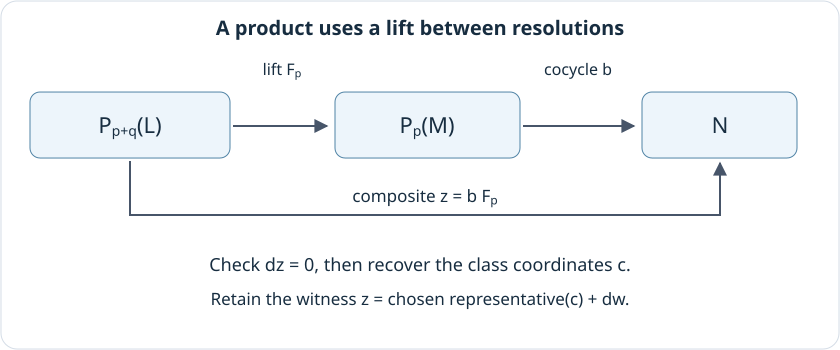
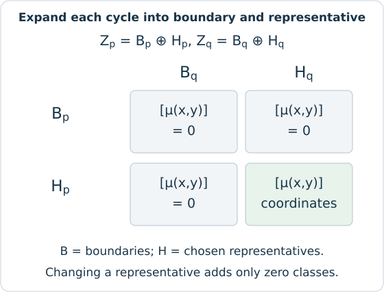

# Yoneda products and validated Tor algebra

An Ext group gives a space of extension classes. To multiply two compatible
classes, we need to choose representatives, connect the resolutions on which
they are defined, and express the composite modulo boundaries. Following
those steps explains both the returned coordinates and the work that can be
reused when several products are requested. Tor leads to a related question:
what must supplied multiplication on chains satisfy before it determines
multiplication on homology?

The inputs are representations of one finite poset over a coefficient field.
The [usage guide](../tutorials/derived.ipynb) starts with the diamond directly;
an encoding supplies the same setting through its stored finite module.
These calculations remain in that finite category. Comparing their answer
with Ext or Tor in another encoding or in an original parameter category
requires the [category and resolution hypotheses](../math_categories.md).

## Lift before composing

Suppose we have modules $L,M,N$ and classes

$$
\alpha\in\operatorname{Ext}^q(L,M),\qquad
\beta\in\operatorname{Ext}^p(M,N).
$$

Their Yoneda product $\beta\alpha$ belongs to
$\operatorname{Ext}^{p+q}(L,N)$, with the left factor acting after the right
factor. The relationship with splicing extension sequences is developed in
the [Stacks Project's treatment of Ext](https://stacks.math.columbia.edu/tag/06XP).
TamerOp computes the class using projective resolutions, so it can return a
representative without constructing all the modules of a spliced sequence.

Write $P_i(L)$ for the term in degree $i$ of a projective resolution of $L$.
Each such term is a direct sum of principal projectives, stored by their
vertex labels, and each differential is stored by a coefficient matrix.
A map from the principal projective at a vertex $v$ to $M$ is determined by
a vector of $M_v$. Thus a cochain $P_q(L)\to M$ can be stored as a concatenation
of these stalk vectors, one block per projective summand. This representation
avoids constructing a separate matrix at every vertex of the poset.

Let $a:P_q(L)\to M$ and $b:P_p(M)\to N$ be cocycles representing $\alpha$
and $\beta$. Their domains prevent us from composing them directly. First
lift $a$ through the augmentation $P_0(M)\to M$. Projectivity of $P_q(L)$
makes this possible. Then extend the lift through the successive resolution
terms, obtaining

$$F_i:P_{q+i}(L)\longrightarrow P_i(M),\qquad 0\leq i\leq p.$$

At each step, the preceding compatibility equation puts the required image
in a kernel. Exactness identifies that kernel with an image, and projectivity
allows the next lift. The resulting map $F_p$ has exactly the target needed
for $bF_p$, a cocycle on $P_{p+q}(L)$.

```@raw html
<figure class="notebook-figure">
<div class="notebook-figure-scroll" style="--notebook-figure-min-width: 840px" tabindex="0" role="region" aria-label="Scrollable figure: lifting an Ext class before composing">
```

[](../assets/implementation/yoneda_lift.svg)

```@raw html
</div>
<figcaption>The upper arrows show the lift and the left cocycle. Their composite is the product representative; the equation beneath it records how it differs from the representative chosen by the quotient basis. The diagram is a schematic of these maps, rather than an extension sequence reconstructed from the class.</figcaption>
</figure>
```

The right resolution must reach degree $p+q$, even though its selected class
has degree $q$; the left model needs degree $p$. Before solving the lift
equations, the calculation checks that the two descriptions of $M$ agree
in field, indexed order, stalk coordinates and cover maps. Otherwise a
vector in one description has no specified meaning in the other.

To form $bF_p$, the routine splits $b$ into its generator blocks. A nonzero
coefficient of $F_p$ contributes a multiple of a structure map of $N$
applied to one such block. With at least eight nonzero lift coefficients,
the current default accumulates these map applications into the output
blocks directly. For smaller lifts, it prepares the required map matrices
and then multiplies them by the blocks. Both routes concatenate the same
cochain coordinates; the choice concerns how the intermediate structure maps
are obtained. Quotient coordinates are then recovered using the shared
linear algebra for the chosen field. The
[rational coordinate account](qq_coordinates.md) explains the exact solves
and membership checks used over $\mathbb Q$.

## Fix the target coordinates

By default, the product is expressed using the right factor's resolution of
$L$, now with Hom into $N$. A supplied `ELN` may instead choose another
projective resolution of the same pair. The comparison must then go from
the requested target resolution to the resolution used for composition:
it lifts the identity of $L$, and precomposing with that lift transfers the
cocycle into the requested Hom complex.

Consequently, both the returned coordinate vector and any requested cocycle
belong to the returned target model. This matters when comparing two products:
agreement of group dimensions alone would not identify their coordinates.
No additional Koszul sign is inserted by this comparison convention; the
signs in the differentials already enter the lift equations and the resulting
coefficients.

For the bases used in the diamond example, the two products from the bottom
simple through the middle simples to the top simple are nonzero and sum to
zero in the same one-dimensional degree 2 group. The relation reflects the
opposite coefficients of the final differential in the bottom simple's
projective resolution. Over characteristic 2 those opposite coefficients
are equal. This provides a small calculation in which keeping the maps and
signs reveals something that the dimensions alone leave undetermined.
The [prepared product comparison](../tutorials/derived.ipynb#compare-the-products-in-one-target-basis)
keeps this common target basis while selecting either route or a zero factor.

The representative view retains a further check. For the composite cocycle
$z$ and its quotient coordinates $c$, write $h(c)$ for the representative
chosen by the result. The view solves for an incoming cochain $w$ satisfying

$$
dz=0,\qquad [z]=c,\qquad z=h(c)+dw.
$$

The last equation explains how the actual composite and the chosen
representative determine the same class. The solution $w$ need not be
canonical. When the product is zero, it witnesses that the composite is
a boundary. Numerical fields use their recorded tolerances in these
equations; a small floating residual has the meaning assigned by those
tolerances rather than the force of a symbolic equality.

## Reuse one table at a time

An `ExtAlgebra` retains a projective model of $\operatorname{Ext}^*(M,M)$.
For a pair of degrees $p,q$, let $d_p,d_q,d_{p+q}$ be the dimensions of the
three relevant groups. Its multiplication matrix has $d_{p+q}$ rows and
$d_p d_q$ columns. Column $(i-1)d_q+j$ contains the coordinates of left basis
vector $i$ multiplied by right basis vector $j$, so the matrix acts on
`kron(left,right)`.

The matrix form of `yoneda_product` computes selected collections of classes
by lifting each right class once and composing it with every selected left
class. These lifts last for that call. `ExtAlgebra` uses this operation on
basis classes and retains the completed table for later requests in the same
degree pair. Access to the table dictionary is synchronized so concurrent
requests cannot corrupt it; the construction itself happens outside that
lock. The resulting cached matrix is shared, so a caller must copy it before
editing. A dimensions query neither populates this dictionary nor chooses
quotient representatives.

The table alone stores $d_{p+q}d_p d_q$ coefficients, in addition to the
resolutions and lifts. The visual request therefore checks the permitted
number of input pairs and output entries before asking for multiplication.
Cropping the displayed matrix happens afterward and does not reduce that
work. When only one composition is needed, a selected `:yoneda_product`
request computes it without building a complete self-Ext multiplication table.

## Why Tor needs a supplied product

Incidence algebra Tor pairs a right module on the opposite poset with a left
module. The resulting graded vector space has no multiplication determined
by those two arbitrary modules alone. A `TorAlgebra` is therefore supplied
with linear maps between chain spaces of the form

$$\mu_{p,q}:C_p\otimes C_q\longrightarrow C_{p+q},$$

where $C$ is the computed tensor complex. The column order is the same as
for the Ext table: the right index varies fastest. A generator can supply
these matrices as they are requested. If both source and target chain spaces
are nonzero, a missing product is an error. A supplied unit is a homology
class; it is not assumed to be a strict unit on every chain.

To obtain multiplication on homology, $\mu$ must send cycles to cycles and
products involving a boundary to boundaries. Write
$Z_p=B_p\oplus H_p$, where $Z_p$ is the cycle space, $B_p$ is the boundary
space and $H_p$ is a chosen complementary space of homology representatives.
Here $H_p$ denotes that chosen subspace of chains, rather than an independent
canonical realization of homology.

[](../assets/derived_guides/tor_descent.svg)

The diagram expands two cycles according to this decomposition. The
implementation checks products of $B_p$ with all of $Z_q$, products of $H_p$
with $B_q$, and products of $H_p$ with $H_q$. The first two collections must
have zero target homology coordinates, which checks both that they are
cycles and that they are boundaries. The last collection must be cycles,
so that their target coordinates exist.

Bilinearity explains why these checks suffice. Replacing cycle
representatives $x,y$ by $x+b,y+c$, with $b,c$ boundaries, changes their
product by $\mu(b,y)+\mu(x,c)+\mu(b,c)$. Every term on the right is a boundary
by the checks above, so the resulting homology class is unchanged. Testing
only products of the chosen representatives would miss this requirement.
The boundary spaces include images from the extra degree above the displayed
range, since those images can still change a class in the last shown degree.

## Descent and algebra laws are separate checks

The preceding condition is called *descent*: a rule on representatives
defines a rule on their quotient classes. It is required whenever a new Tor
multiplication table is computed. Further algebraic laws are requested by
`check_tor_algebra(A; algebraic=true)`. One is the Leibniz identity,

$$\partial(xy)=(\partial x)y+(-1)^p x(\partial y),\qquad x\in C_p,$$

which says how a boundary interacts with the product. This is the homological
version of the compatibility law in the
[definition of a differential graded algebra](https://stacks.math.columbia.edu/tag/061U).
The implementation checks its matrix form, including the additional incoming
boundary degree needed by the computed range.

Associativity is checked on homology by comparing the two ways to multiply
three classes for each computed degree triple. It does not demand strict
associativity of the supplied chain multiplication. Both unit identities are
checked when a unit class was supplied, and the report states the degree
range covered by these checks.

The broader validation reads a consistent copy of the supplied multiplication
data without filling the original algebra's product cache. Ordinary table
computation also records which version of the supplied product it used.
Before storing a result, it checks that the product has not been replaced
through a setter in the meantime; an answer computed from older data cannot
then be restored to the cache as current. A lazy generator must therefore
remain stable until it is explicitly replaced and must permit concurrent
calls. Changing state hidden inside the generator would evade this check.

## Prepare mathematical data before drawing

The visualization routines consume the representatives and equations already
prepared by these calculations. Ext keeps cohomological degrees, while Tor
keeps homological labels and uses the reindexing $C^{-s}=C_s$ for shared
complex inspection. A selected vector uses its result's existing quotient
basis. Computing a fresh quotient merely for drawing could choose different
coordinates and change what that vector meant.

A prepared specification copies coefficient matrices, retains their full
sizes when the drawing is cropped, and records the finite base, field,
model, degree and sign convention. Rendering places those records without
performing further algebra. The [visual specification account](visual_specs.md)
explains that separation and the export paths. An actual supplied exact
sequence can be inspected in its own right; a product class is displayed
through the representative obtained above.

See the [implementation bibliography](references.md).
