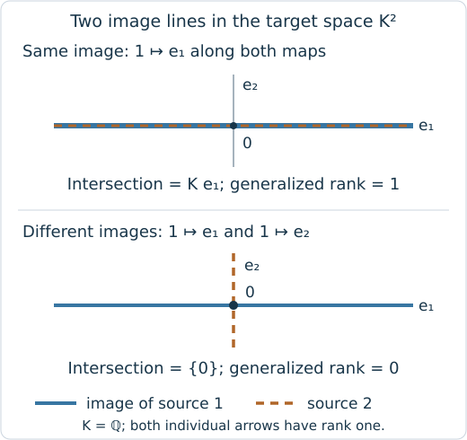

# Measure what persists through a branching region

Start with a finite module and a set of its labels that is connected by
comparabilities and order convex, meaning that it contains every label between
two of its labels. We will compute its generalized rank, the dimension of the
common image of vector choices that agree under all the maps in that region.
This example needs TamerOp and rational matrices; it does not need a filtration
or graphics backend.

The two source lines below map into the same line in a common target plane.
Their common persistent image has dimension one.

```julia
import TamerOp as OP
A = OP.Advanced
QQ = Rational{BigInt}
P = A.FinitePoset(Bool[1 0 1; 0 1 1; 0 0 1])
M = A.PModule{QQ}(P, [1, 1, 2],
    Dict((1, 3) => reshape(QQ[1, 0], 2, 1),
         (2, 3) => reshape(QQ[1, 0], 2, 1));
    field=OP.CoreModules.QQField())
region = [1, 2, 3]
A.check_generalized_rank_region(M; vertices=region, throw=true)
rank = OP.generalized_rank(M; vertices=region)
@assert rank == 1
```

Here `vertices` selects labels in the supplied finite poset. To ask about a
region in an original parameter space, we would first need an encoding
assignment describing how that space relates to these labels. `[1,2]` would be
disconnected; on a longer chain, omitting a label between two selected labels
would violate convexity.

The integer answers our question. To see how its compatible vectors pass to the
common image, request the matrices as well. `limit_basis` stores compatible
choices in the direct sum of the selected stalks; `colimit_projection`
identifies vectors related by the maps. The comparison uses one stalk, the
space at a selected label, to send a compatible choice to its common quotient
class.

```julia
witness = OP.generalized_rank(M; vertices=region, witnesses=true)
@assert OP.generalized_rank(witness) == rank
comparison = A.comparison_map(witness)
@assert size(comparison) == (2, 1)
```

To see why this is a region question, replace the second map by the column
`QQ[0,1]`. Both arrows still have rank one, but their image lines intersect
only in zero, so the rank on the whole region becomes zero.

```@raw html
<div class="notebook-figure-scroll" style="--notebook-figure-min-width: 480px" tabindex="0" role="region" aria-label="Scrollable figure: image lines and their intersections">
```

[](../assets/generalized_rank/fork_images.svg)

```@raw html
</div>
```

*The upper plane is the supplied example. Replacing the second column by
`QQ[0,1]` produces the lower plane and changes the common rank to zero.*

The [usage guide](../tutorials/generalized_rank_queries.ipynb#follow-both-branches-into-the-same-plane)
lets you compare these two forks and select one branch, keeping the matrices
beside the chosen region. It then develops signed reconstruction, grid boundary
barcodes and continuous worms. The
[implementation account](../implementation/generalized_rank.md) explains the
exact comparison; the [region-view
reference](../src/reference/visual_sessions.md#query-generalized-rank-regions)
specifies linked selection and its budgets.
