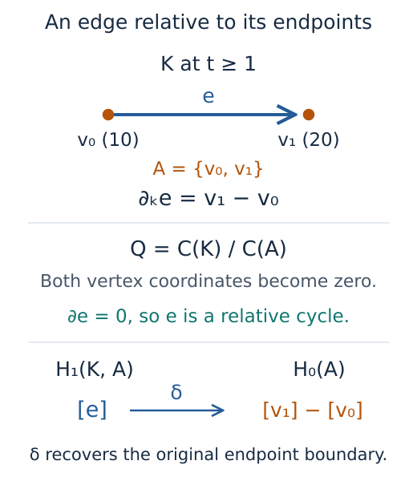

# Compute persistence relative to a boundary

Suppose a segment joins two endpoints. Its edge has a nonzero boundary, so
it does not represent an ordinary homology class in degree one. If we
agree to count chains supported on the endpoints as zero, that same edge
becomes a cycle. This is the idea of **relative homology**: for a space $K$
and a subcomplex $A$, we work with chains in $K$ modulo chains in $A$.
A chain is a linear combination of cells, and it is a cycle when its boundary
is zero.
We will compute the interval of the relative edge class and then recover
its endpoint boundary through the connecting map.

The input is a finite filtered complex and a selection of its cells. We use
rational grades and coefficients in $\mathbb F_3$, the field of integers
modulo three, so that the two endpoint signs remain distinguishable.

```julia
import TamerOp as OP
using SparseArrays: sparse
using TamerOp.CoreModules: F3

segment = OP.GradedComplex(
    [[10, 20], [30]],
    [sparse(reshape([-1, 1], 2, 1))],
    [(0//1,), (0//1,), (1//1,)],
)
pair = OP.filtered_pair(segment, [[1, 2], Int[]]; field=F3())
diagram = OP.persistence_diagram(pair)
OP.essential_births(diagram; dim=1)    # [1//1]
```

Here the vertices have labels 10 and 20, and the edge has label 30, with
boundary `[20] - [10]`. Both vertices enter $K$ at parameter zero, and the
edge enters at one. The inner vectors in `filtered_pair` select positions
within each dimension: `[1, 2]` selects both vertices, while `Int[]` selects
no edges. These positions are distinct from the labels 10, 20 and 30.
With no separate grades supplied, the selected vertices enter $A$ at the
same time as they enter $K$.



*The edge survives when we set the endpoint chains equal to zero. Its
relative boundary is therefore zero, although its original boundary in
$K$ is $v_1-v_0$. This schematic shows the chain calculation at any
parameter at least one; it does not draw a new geometric realization of
the quotient.*

The relative class has interval $[1,\infty)$: once the edge appears, nothing
in this filtered pair can make it a boundary or remove it from the quotient.
There is no relative $H_0$ because both vertices already belong to $A$.

To recover the edge's original boundary, we need homology bases at a scale
where it exists. These queries live in `TamerOp.Advanced`, which we import
as `OA`:

```julia
import TamerOp.Advanced as OA

h = OA.relative_homology(pair; scale=1//1)
OA.dimensions(h)                       # [0, 1]
maps = OA.relative_maps(h; dim=1)
maps.connecting                      # 2 × 1: [2; 1] over F₃
```

The dimensions are those of relative homology in degrees zero and one.
The **connecting map** takes the relative edge class to its boundary class
in $H_0(A)$, namely `[20] - [10]`. Over $\mathbb F_3$, minus one is two,
which explains the first entry of the column. Its rows use the chosen basis
of $H_0(A)$, and its column uses the chosen basis of $H_1(K,A)$. These bases
belong to this scale; they do not name individual barcode intervals.

In a larger example, inspect the representatives and the cell order before
interpreting a matrix:

```julia
OA.basis(h; dim=1)                   # The edge represents the relative class.
c = OA.relative_complex(h)
OA.relative_cells(c; dim=1)          # ambient position 1, cell ID 30
OA.relative_boundary(c; dim=1)       # a 0 × 1 zero matrix
```

The last matrix has no rows because the quotient has no vertices. Its one
column is the edge, whose relative boundary is zero.

## Let the subcomplex change later

A selected cell can enter $A$ after it has entered $K$. Keep the same ambient
segment, but let the first vertex enter $A$ at two, the second at three,
and the edge at four:

```julia
changing = OP.filtered_pair(segment, [[1, 2], [1]];
    grades=[[2//1, 3//1], [4//1]], field=F3())
d = OP.persistence_diagram(changing)
OP.finite_intervals(d; dim=0)          # [(0//1, 1//1), (0//1, 2//1)]
OP.finite_intervals(d; dim=1)          # [(3//1, 4//1)]
```

Until parameter two, $A$ is empty, so the relative calculation agrees with
the absolute one: two components appear at zero and merge at one. When the
first vertex enters $A$ at two, the remaining component class becomes zero.
The edge still has the other vertex as its relative boundary, so it is not
yet a relative cycle. At three both endpoints belong to $A$, making the
edge a cycle; at four the edge itself enters $A$, and its class becomes zero.


*The upper rows show when each cell is available as a quotient coordinate.
The lower rows show the resulting homology intervals. Having an edge
coordinate at one does not yet give a relative class: its boundary vanishes
only when the second endpoint enters $A$ at three.*

Choose a parameter in the schematic below to follow that calculation one
event at a time. The two drawings show the cells of $K_t$ and $A_t$;
the table records the remaining quotient coordinates and their boundary
over $\mathbb F_3$. In particular, compare one, two and three: the edge is
present throughout, while its boundary loses one endpoint and then the other.
The homology dimensions count the classes after taking those boundaries
into account.

```@raw html
<link rel="stylesheet" href="../assets/relative_persistence/delayed_entry.css">
<div class="relative-pair-explorer" id="relative-pair-explorer">
  <div class="relative-pair-control">
    <label for="relative-pair-scale">Parameter t</label>
    <select id="relative-pair-scale" aria-describedby="relative-pair-status" disabled>
      <option value="0">0: both vertices enter K</option>
      <option value="1">1: the edge enters K</option>
      <option value="2">2: v₀ enters A</option>
      <option value="3" selected>3: v₁ enters A</option>
      <option value="4">4: the edge enters A</option>
    </select>
  </div>
  <div class="relative-pair-drawing" aria-label="Cells in the ambient complex and its subcomplex"></div>
  <p class="relative-pair-legend">Solid cells are present. Faint dashed cells show what has not entered yet.</p>
  <div class="relative-pair-table">
    <table>
      <caption>Quotient chains and relative homology over F₃ at t = <span data-relative-scale>3</span></caption>
      <tbody>
        <tr><th scope="row">Vertex coordinates in C₀(Kₜ,Aₜ)</th><td data-relative-vertices>None</td></tr>
        <tr><th scope="row">Edge coordinates in C₁(Kₜ,Aₜ)</th><td data-relative-edges>e</td></tr>
        <tr><th scope="row">Boundary of e in the quotient</th><td data-relative-boundary>0 (a 0 × 1 matrix)</td></tr>
        <tr><th scope="row">Dimension of H₀(Kₜ,Aₜ)</th><td data-relative-h0>0</td></tr>
        <tr><th scope="row">Dimension of H₁(Kₜ,Aₜ)</th><td data-relative-h1>1</td></tr>
      </tbody>
    </table>
  </div>
  <p id="relative-pair-status" role="status" aria-live="polite">At three both endpoints belong to A. Their quotient coordinates are zero, so the edge is a cycle. There are no cells of dimension two to fill it, giving one relative class.</p>
  <p class="relative-pair-note">This is an authored schematic of the exact calculation in the recipe. The table describes quotient chain coordinates, without drawing a geometric quotient space.</p>
  <noscript><p>The table shows t = 3. Enable JavaScript to choose another parameter; the timeline above shows every event.</p></noscript>
</div>
<script src="../assets/relative_persistence/delayed_entry.js"></script>
```

We can inspect the map that ends this interval directly:

```julia
before = OA.relative_homology(changing; scale=3//1)
after = OA.relative_homology(changing; scale=4//1)
OA.relative_structure_map(before, after; dim=1)  # 0 × 1
```

The source has the edge class and the target is zero, so the matrix has one
column and no rows. Deleting all cells that will eventually enter $A$
would erase this interval before it had a chance to appear.

An empty selection, `[Int[], Int[]]`, recovers absolute persistence. Selecting
all cells with their inherited grades gives zero relative homology. In either
case, the selection must still form a subcomplex: selecting this edge requires
both endpoints, and the edge cannot enter $A$ before either endpoint does.
The constructor checks these conditions over the selected field.

The [pair reference](../src/reference/persistence_variants.md) specifies input
and map conventions. To see how the computation accommodates coordinates
that disappear from the quotient, follow the
[implementation account](../implementation/relative_persistence.md).
The [ordinary persistence guide](../ordinary_persistence.md) describes the
interval queries and diagram analysis available for this result.
