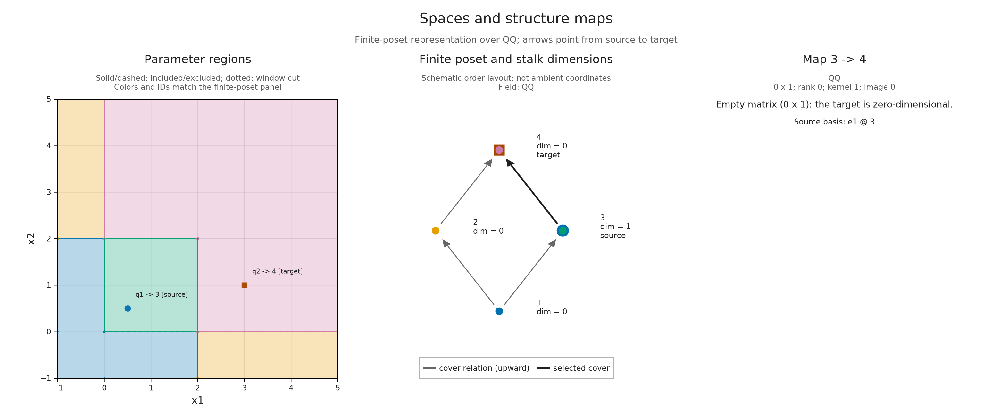

# Exploring spaces and maps

Once we have an encoding, we can ask what space belongs to a parameter and
follow its vectors to another parameter. The question makes sense whether
the module came from a filtration of data or was described directly by regions
and matrices. This guide develops the queries together with figures that show
how an original parameter, a finite label and a matrix refer to the same answer.

We start with an `EncodingResult`. You need
the meaning of a [space and structure map](persistence_modules.md), but need
not work through another construction lesson first. To construct your starting
object, [start from a filtration](tutorials/inputs_to_objects.ipynb#start-from-a-filtration)
or [define a module by regions](tutorials/inputs_to_objects.ipynb#define-a-module-by-regions).
That guide uses the same kinds of queries for both routes. The
[square notebook](tutorials/inspect_encoding.ipynb) develops the mathematics
through a complete worked example; here the emphasis is on choosing queries
you can reuse with your own encoding. If you already have a finite `PModule`,
you can begin with queries at finite labels and omit parameter lookup.

## Start from a recognizable object

The following setup makes a module supported on a square: a one dimensional
space on the closed square `[0,2] × [0,2]`, zero elsewhere, with identity maps
between comparable parameters in the square, including its boundary. Its
coefficients are rational.
Replace this setup with your own `enc` when exploring another object.

```julia
import TamerOp as OP
import TamerOp.Advanced as OA
import TamerOp.CoreModules: QQField

options = OA.EncodingOptions(; backend=:pl_backend,
    poset_kind=:signature, field=QQField())
enc = OP.encode([OA.BoxUpset([0, 0])], [OA.BoxDownset([2, 2])],
    reshape(OP.QQ[1], 1, 1), options);
```

`OP` provides the main workflow. `OA` gives access to the more detailed
queries used below, including lookup at finite labels and presentation inspection.
The two indicator regions and their coefficient describe the input; `encode`
returns the finite representation. See [indicator presentations](indicator_presentations.md)
for the construction, including what the active rows and columns mean.

An encoding keeps the finite poset, the assignment from parameters to its
labels, and the encoded module together. Ask what is retained before choosing
what to compute:

```julia
OP.describe(enc)
OP.provenance(enc)
```

The summary describes the stored information. The provenance is a record of
the construction and its conventions, including the coefficient field. This square constructor
already computes its module. Some ingestion workflows instead return a *lazy* result:
enough information to compute spaces and maps when requested. Displaying such
a result leaves that work deferred.

| What you need | Query | What it asks for |
| :--- | :--- | :--- |
| Finite labels and their order | `OP.encoding_poset(enc)` | The retained poset |
| Assignment from parameters to labels | `OP.encoding_map(enc)` | The retained classifier |
| Every stalk dimension | `OP.dimensions(enc)` | A dimension vector, computing it if needed |
| Spaces with their structure maps | `OP.encoding_module(enc)` | The finite module, materializing it if needed |
| A retained indicator presentation | `OP.encoding_presentation(enc)` | The finite fringe, or `nothing` if absent |

Dimension queries can do mathematical work even though they return only
integers. Having the dimensions does not imply that lazy structure maps have
been computed. The [guide to deferred computation](lazy_inspection.md) explains
reuse and costs across ingestion, algebra and geometry.

## Find a parameter's space

Keep the poset and its parameter assignment available, then ask for dimensions:

```julia
P = OP.encoding_poset(enc)
classifier = OP.encoding_map(enc)
dims = OP.dimensions(enc)
```

`dims[q]` is the dimension at finite label `q`. A label names a vertex in
the returned poset; its numerical value gives neither a parameter coordinate
nor its place in the partial order.
The signature encoder used here returns four labels; the picture with nine regions
in [finite encodings](finite_encodings.md) is another valid description of
the same square. Obtain labels from this result instead of assuming their
numbers.

```julia
x = (1//2, 1//2)
qx = OA.locate(classifier, x)
(label=qx, dimension=dims[qx])
```

The dimension is `1`. The expression `1//2` supplies the exact rational
one-half. Lookup first assigns the parameter its finite label, and then reads
the space at that label. We will use these same assignments to connect the
parameter picture to its matrix readout.

For classifiers that do not represent the whole parameter domain, `locate`
can return the reserved label `0`. Check for it before indexing a dimension vector:

```julia
z = (3, 1)
qz = OA.locate(classifier, z)
z_dimension = qz == 0 ? nothing : dims[qz]
```

Here `qz` is a represented label and `z_dimension` is `0`: the point is outside
the square's support, but its zero space is part of the encoding. An
unrepresented point would instead give `nothing` in this example code. The
distinction is useful for encodings whose classifier covers only part of the
parameter domain; missing information does not determine a zero space.

If your starting object is already a finite module `M`, use `OA.dim_at(M, q)`
for a single stalk dimension. `OP.dimensions(M)` returns a summary with a
`.stalks` vector; `OP.dimensions(enc)` returns that vector directly.

## Ask how vectors continue

A matrix answers a different question from a dimension. Its columns correspond
to the source space's coordinates, and its rows to the target's. Materialize
the finite module when you need these maps:

```julia
M = OP.encoding_module(enc)
y = (3//2, 3//2)
qy = OA.locate(classifier, y)
A = OA.structure_map(M; source=qx, target=qy)
```

The answer is the `1 × 1` identity matrix over the rationals: the vector
continues unchanged. `structure_map` takes **finite labels**. It can compose
cover maps, the maps on order relations with no intermediate vertex. When
the selected pair has intermediate vertices, composition supplies its map
without requiring a table of all comparable pairs. Returned matrices may share stored data,
so treat them as read only, or `copy(A)` before editing entries.

Now move beyond the support:

```julia
Z = OA.structure_map(M; source=qx, target=qz)
size(Z)
```

The shape is `(0, 1)`. This is the defined zero map from a one dimensional
space to the zero space. An empty array here has precise mathematical
content. Equal labels give the identity on their space, including a `0 × 0`
identity for a zero space.

A query beginning with original parameters needs one further piece of
information: their order. A query at finite labels uses the finite order
without checking the original pair. In the square, `(1/4,3/2)` and
`(3/2,1/4)` have the same label but are incomparable in coordinatewise order.
The finite identity at that label is not an ambient structure map between
those points. Supply the original parameters when this is the question:

```julia
u, v = (1//4, 3//2), (3//2, 1//4)
unordered_view = OA.visual_spec(enc; kind=:module_inspector,
    parameter_pair=(u, v))
unordered = OA.visual_metadata(unordered_view).inspection
(defined=unordered.defined, matrix=unordered.matrix)
```

The answer is `(defined=false, matrix=nothing)`. A specification is the
mathematical content of a view; building it needs no plotting package. Here
one coordinate increases in each direction while the other decreases, so
neither parameter precedes the other. The query keeps this order information
alongside the classification. Grid classifiers use their declared axis
orientations, including axes that run in the opposite direction.

Keep these outcomes separate when exploring your own object:

| Outcome | Interpretation |
| :--- | :--- |
| A represented stalk has dimension `0` | Its vector space is zero. |
| A defined map has rank `0` | Every source vector maps to zero; the map can have nonempty matrix dimensions. |
| A pair is incomparable or ordered only in reverse | There is no structure map in the requested direction. |
| A parameter has classifier label `0` | This encoding does not supply its space or map. |
| A presentation or source representative is absent | The retained result does not include that additional description. |

The last case depends on what was retained, not on whether the selected space
is zero. In particular, a coordinate vector in a finite module does not by
itself identify a cycle in an input complex.

## Connect the answer to a figure

Load CairoMakie for static figures. A single inspection view connects the
selected parameters, their finite labels, and the map readout:

```julia
import CairoMakie

view_box = ([-1, -1], [5, 5])
map_view = OA.visual_spec(enc; kind=:module_inspector,
    parameter_pair=(x, z), box=view_box)
OP.visualize(map_view)
```

```@raw html
<figure class="notebook-figure">
<div class="notebook-figure-scroll" style="--notebook-figure-min-width: 1150px" tabindex="0" role="region" aria-label="Scrollable figure: the map from the square to a zero stalk">
```

[](assets/guides/spaces_map.png)

```@raw html
</div>
<figcaption>The selected map has a 0 × 1 matrix, rank zero and kernel dimension one: its source vector vanishes at the target. Labels and colors connect the parameter plane to the actual finite poset. The poset layout is schematic.</figcaption>
</figure>
```

The window makes unbounded regions drawable. It does not restrict the module
queried by this inspector. Solid poset arrows are cover relations; a selected
comparable pair beyond a cover receives an additional dashed arrow. The
[conventions for the parameter plane](visualization.md#reading-the-parameter-plane)
explain included boundaries, window cuts and finite drawing precision.

The same request works without retaining a specification:
`OP.visualize(enc; kind=:module_inspector, parameter_pair=(x,z), box=view_box)`.
Keep a specification when you want to inspect its data or render the same
answer again:

```julia
answer = OA.visual_metadata(map_view).inspection
(rank=answer.rank, kernel=answer.kernel_dimension, matrix=answer.matrix)
```

Choose one selection form per request:

| Question | Selection |
| :--- | :--- |
| Space at an original parameter | `point=x` |
| Map between original parameters | `parameter_pair=(x,y)` |
| Space at a finite label | `vertex=qx` |
| Map in the finite model | `pair=(qx,qy)` |

A `PModule` has the finite poset and readout panels without invented geometric
coordinates. A supported planar encoding adds its parameter panel. Use
`OP.available_visuals(enc)` to discover its views, or
`OA.check_visual_request(enc; kind=:module_inspector)` to inspect the accepted
options and qualitative work. `kind=:hasse` asks only for the finite order
with dimensions; an inspector with no selection or a single stalk selected leaves
lazy structure maps deferred. A defined pair can materialize them.

Large selected matrices are cropped for display using `matrix_limit=(12,12)`
by default. The specification retains the full matrix; rank and kernel
dimension use all its entries. Raising or lowering the display limit changes
neither the result nor the cost of constructing it. With `RealField`, ranks
use the field's numerical tolerances; the rational example here is exact.

## Look inside a retained presentation

The module's matrix describes a map in its stored coordinate bases. A retained
indicator presentation answers an additional question: how do its active
coefficient blocks produce those spaces? Start by checking for the witness:

```julia
H = OP.encoding_presentation(enc)
```

For this encoding, `H` is a finite fringe. If the accessor returns `nothing`,
this inspection route is unavailable; it does not reconstruct a presentation
from the module. Presentation queries also accept a finite `FringeModule`
directly. The witness must belong to the current poset and field.

To see why counting active generators is insufficient, keep the square's
support but give it two active columns in the upper part of the square:

```julia
redundant = OP.encode([OA.BoxUpset([0, 0]), OA.BoxUpset([1, 1])],
    [OA.BoxDownset([2, 2])], OP.QQ[1 1], options)
qr = OA.locate(OP.encoding_map(redundant), y)
stalk = OA.presentation_stalk(redundant; vertex=qr)
(rows=OA.active_rows(stalk), columns=OA.active_columns(stalk),
    block=OA.presentation_matrix(stalk),
    dimension=OA.presentation_summary(stalk).dimension)
```

At `y=(3/2,3/2)`, row `1` and columns `1,2` are active. Their block is `[1 1]`,
whose image has dimension one. Two columns supply the same direction. The
default query computes the block and its rank, leaving an image basis
uncomputed. Request that basis when you want actual vectors in the active
downset coordinates:

```julia
with_basis = OA.presentation_stalk(redundant; vertex=qr, basis=true)
B = OA.image_basis(with_basis)
size(B)
```

The shape is `(1, 1)`: one basis vector in one active target coordinate. In
general, the basis matrix's row count is the number of active downsets, and
its column count is the image dimension. A zero image in a one dimensional
target therefore has a `1 × 0` basis, not a missing result.

```julia
presentation_view = OA.visual_spec(redundant; kind=:presentation_inspector,
    point=y, basis=true, box=view_box)
OP.visualize(presentation_view)
```

```@raw html
<figure class="notebook-figure">
<div class="notebook-figure-scroll" style="--notebook-figure-min-width: 1150px" tabindex="0" role="region" aria-label="Scrollable figure: two active columns span one direction">
```

[![At the overlap of two upsets, the active coefficient block is [1 1]. Its image has one dimension and its basis has one column.](assets/guides/spaces_presentation.png)](assets/guides/spaces_presentation.png)

```@raw html
</div>
<figcaption>The block keeps both active columns; an image basis keeps one independent direction. The support panels show a selected upset and downset. Choosing a different support with upset or downset changes the picture while leaving all active indicators in the calculation.</figcaption>
</figure>
```

Support colors use the actual classifier regions. Their outlines, including
cuts at the viewing window, remain region boundaries; they are not newly
computed boundaries of a merged upset or downset. Without supported planar
geometry, the same inspector reports membership on finite labels.

For a comparable finite pair, `presentation_map` computes an image basis at
each endpoint and expresses the induced map in those bases:

```julia
rx = OA.locate(OP.encoding_map(redundant), x)
presented_map = OA.presentation_map(redundant; source=rx, target=qr)
Bx = OA.image_basis(OA.source_stalk(presented_map))
By = OA.image_basis(OA.target_stalk(presented_map))
R = OA.ambient_projection(presented_map)
C = OA.induced_map(presented_map)
By * C == R * Bx
```

The answer is `true`. The columns of `Bx` place source image coordinates
in the active downset coordinates. `R` then keeps the downset coordinates
still active at the target. Taking this route gives `R * Bx`. Alternatively,
`C` changes to target image coordinates, and `By` places them in the target's
active downset space, giving `By * C`. The equality says that the two ways of
following the vector agree. It is exact over the rational field; a numerical
field requires its tolerances when comparing matrices.

To see these matrices together, use the presentation inspector with
`parameter_pair=(x,y)`. Pair queries compute the required endpoint bases;
`basis=true` is a single stalk option. Presentation image bases and the
module's stored bases need not agree for an arbitrary encoding supplied by the caller.
Neither identifies source cycles without additional retained correspondence.
The [square notebook](tutorials/inspect_encoding.ipynb) explores the richer
example with two squares, including an active zero block and a zero composite of
two nonzero maps.

## Explore nearby selections in a live session

The static examples above can be followed with CairoMakie alone. To explore
several selections in a running Julia session, an optional live view keeps
the parameter plane, finite poset and matrix readout linked. Return to the
original square `enc` for this example; [optional integrations](optional_integrations.md)
explains how to install WGLMakie if needed.

```@raw html
<details><summary>Optional: select and save a view with a running Julia session</summary>
```

```julia
import WGLMakie

session = OP.inspection_session(enc; box=view_box)
OA.select_inspection!(session; parameter_pair=(x, z))
OP.visualize(session; backend=:wglmakie)
```

Choose **Selection endpoint** to make a click select a stalk, source or target.
**Finite vertex** and the finite source/target fields provide the same choices
by label. A finite `PModule` has these controls with a Hasse diagram and readout;
an encoding with supported planar geometry adds the parameter picture.
**Coordinate view** switches between stored module coordinates and the image
coordinates of a retained presentation.

A pointer gives approximate drawing coordinates. For a boundary question, use
the **Exact point x/y** or **Exact source/target x/y** fields. Fractions such
as `1/2` or `1//2`, integers, decimal text and scientific notation are interpreted
exactly as entered; these fields accept numbers, not Julia arithmetic
expressions. Tab and Shift-Tab move between controls, and Enter or Space
activates the focused button.

The same choices are available from Julia:

```julia
OA.select_inspection!(session; point=y, view=:presentation, basis=true)
OA.inspection_selection(session)
OA.inspection_summary(session)
```

Use one of `point`, `parameter_pair`, `vertex` or `pair` in an update. Omitting
the selector keeps the current location while changing its view or support.
Changing the view does not identify the module and presentation bases.
A single stalk needs `basis=true` to compute an image basis, while a defined
presentation pair computes both bases needed for its map. The session reuses
prepared geometry and selected answers; the [session reference](src/reference/visual_sessions.md#finite-modules-and-encodings)
gives the cache limits and full update contract.

A snapshot keeps the selected answer as a static specification that can be
rendered independently of the live controls:

```julia
snapshot = OA.inspection_snapshot(session)
OP.save_visual("selected-space.svg", snapshot; backend=:cairomakie)
OA.close_inspection!(session)
```

Closing releases the live viewers, callbacks and cache, preserving the final
snapshot. Create a new session to resume exploration. The SVG is a static
figure; for a file with prepared choices that can be opened without Julia,
follow the [saved inspection recipe](tutorials/live_inspection.ipynb).

```@raw html
</details>
```

A selected vector gives another way to explore these maps: the
[generated submodule guide](tutorials/generated_submodules.ipynb) follows its
images and constructs the submodule they span. Its
[prepared comparison](tutorials/generated_submodules.ipynb#compare-the-vectors-at-one-target)
lets us change the chosen columns while keeping the target map fixed.
To compare descriptions with
different finite labels, use [refinement and transport](tutorials/compare_encodings.ipynb).
