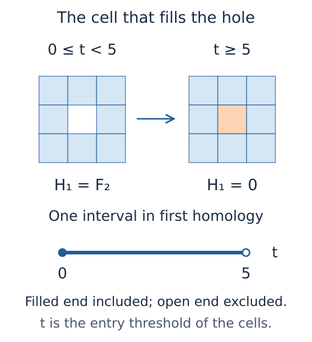

# Choosing views and inspecting intervals

A barcode tells us when a class is present. A picture of its source can show
the loop it follows, and a matrix can explain what happens to it under a map.
Choosing a view begins with deciding which of those questions we want to
answer. We will start with a small barcode, then use a square in the parameter
plane to explore maps and restrictions to lines. The later sections give other
questions a figure can help investigate.

## Start with the question

Consider nine square cells arranged in a three by three image. The eight outer
cells enter at zero and the middle cell enters at five. Between those values
there is a hole; at five the middle square fills it. Here is the computation
and a figure of its interval in first homology:

```julia
import TamerOp as OP
import CairoMakie

values = zeros(Int, 3, 3)
values[2, 2] = 5
diagram = OP.cubical_persistence(values)
OP.visualize(diagram; kind=:barcode, dim=1)
```

The coefficients are in `F2`, the field with two elements, which is the
default for ordinary persistence. The parameter is the cell's entry value. The
interval is `[0,5)`: the class exists at zero and is gone at five, so the
barcode includes its left endpoint and excludes its right endpoint.



*The loop is present while the middle cell is absent. This schematic records
the same interval as the computed barcode above; it is not a selected cycle
from the reduction.*

`OP.available_visuals(diagram)` lists the views accepted by this result. Each
view keeps its mathematical conventions visible, including the parameter,
endpoint inclusion and any infinite endpoints. When comparing two barcodes,
supply the same `window=(low, high)` to both calls so the lengths can be read
on one scale. [Ordinary persistence](ordinary_persistence.md) develops the
computation, and the [ring lesson](tutorials/ring.ipynb) connects the source
image to its intervals.

Sometimes we want to examine the content of a figure before drawing it. A
*visual specification* stores the selected mathematical data, labels and
coordinate conventions. Its construction needs no plotting package:

```julia
import TamerOp.Advanced as OA

spec = OA.visual_spec(diagram; kind=:barcode, dim=1)
OP.visualize(spec)
```

The `Advanced` import gives access to specifications and the detailed
selection queries used below. `OA.check_visual_request(object; kind=...)`
describes accepted options and the mathematical work a view may request; it
does not predict elapsed time. Unknown options, including options with no
effect on the chosen view, are rejected.

For a longer investigation of spaces, maps and presentation bases, see
[Exploring spaces and maps](spaces_and_maps.md). To keep a selection and
return to it later, [Keeping a selected mathematical
view](tutorials/live_inspection.ipynb) explains saved figures, exact recorded
data and finite offline choices. CairoMakie renders static figures; the live
examples below load WGLMakie and require Julia to remain running. You can
explore the guide's [prepared square selections](tutorials/live_inspection.ipynb#keep-the-choices-that-explain-your-result):
the selector displays the identity map inside
the square, its boundary space and the zero space beyond that boundary.

## Previewing source data

Before interpreting an invariant, it helps to see the data and the
construction that produced it. For a point cloud, drawing a graph of nearby
points lets us inspect a rule for choosing neighbors. To know which edges or
cells a computation used, we instead need its retained graph or filtered
complex.

```julia
points = OP.PointCloud([0.0 0.0; 1.0 2.0; 4.0 3.0; 6.0 0.0])
sc = OP.SessionCache()
preview = OA.visual_spec(points; kind=:knn_graph, k=1, cache=sc)
```

The specification identifies this as a reconstructed metric preview. For a
large source, bound the drawing while keeping its original identities:

```julia
small_view = OA.visual_spec(points; kind=:knn_graph, k=1, cache=sc,
                           max_points=3, max_edges=2)
OA.visual_metadata(small_view).point_ids
```

The second request reuses the prepared graph. The caption reports how many
points and edges are displayed; omitting an edge from the picture does not
remove it from a filtration. Point selection is deterministic in source index
order, so this thinning is a display choice, with no statistical sampling
claim. Changing `dims` chooses drawing axes while neighbor distances still use
every source coordinate.

If ingestion already computed a compatible sparse graph, keep the same
session:

```julia
filtration = OP.RipsFiltration(max_dim=1, knn=1,
    construction=OP.ConstructionOptions(sparsify=:knn))
complex = OP.encode(points, filtration; stage=:graded_complex, cache=sc)
preview = OA.visual_spec(points; kind=:knn_graph, k=1, cache=sc)
```

For the actual complex at a parameter, use the retained [filtered complex
workflow](tutorials/complexes.ipynb). It preserves cell IDs, grades and
geometry, including later restrictions or construction choices. A supplied
`GraphData` can instead be passed directly to `visualize` without
reconstructing its edges.

Graph preparation has separate work and edge limits. If a raw preview exceeds
them, reuse an existing graph, activate NearestNeighbors for exact spatial
queries, or deliberately increase the relevant preparation budget. The
[reference](src/reference/visualization.md#source-previews-and-preparation-budgets)
states defaults, supported options and the difference between full counts and
displayed subsets.

## Reading the parameter plane

For the next examples, let `enc` represent a module with a one dimensional
rational vector space on the closed square `[0,2] × [0,2]`, zero spaces
elsewhere, and identity maps between comparable points inside the square. The
following indicator presentation constructs it:

```julia
options = OA.EncodingOptions(; backend=:pl_backend,
    poset_kind=:signature, field=OP.CoreModules.QQField())
enc = OP.encode([OA.BoxUpset([0, 0])], [OA.BoxDownset([2, 2])],
    reshape(OP.QQ[1], 1, 1), options)
OP.visualize(enc; kind=:regions, box=([-1, -1], [3, 3]))
```

The two regions specify where the presentation's column and row are active;
the coefficient `1` makes their image one dimensional where they overlap.
[Indicator presentations](indicator_presentations.md) explains this
construction. The encoding also retains a *classifier*, the map assigning each
parameter to its label in the finite model. The drawn regions are the sets of
parameters with a common label, so their boundaries belong to the mathematics.

For grid encodings, the regions begin at the filtration thresholds and respect
the orientation of each axis. Their final slabs extend without bound, even
though the viewing box shows only a finite part. A threshold is a boundary
where the classifier changes; placing boundaries halfway between sampled
grades would describe a different assignment. Polyhedral encodings clip their
regions using rational halfspaces, retaining slanted boundaries. These views
use the encoder's rational coordinates; grid views also preserve supported
exact algebraic grades, such as square roots. When a region has several
pieces, each piece keeps its label and color. Filtering the viewport does not
renumber the surviving labels.

Solid edges are included in the indicated region; dashed edges are excluded.
Dotted edges mark a cut made by the viewing window. An open circle excludes a
vertex; a filled marker includes it. Adjacent regions can have coincident
outlines: use an exact query to resolve ownership at that location. A region
of dimension one is drawn as a segment, and one of dimension zero as a point.
Clipping an unbounded region does not make it bounded mathematically.

The classifier label `0` means that the encoding does not represent that
parameter. It is shown separately from a represented region whose vector space
has dimension zero. For integer encodings, the picture uses tiles for the
nearest lattice point, with ties rounded to the even integer; the subtitle
states this drawing convention.

Queries are classified using the coordinates you supplied, before conversion
for drawing. This matters even for the square: `(2 + 2^-53, 1)` represented as
an exact rational lies beyond its closed right edge, although its horizontal
coordinate rounds to `2.0` in Float64. Use `[2 + 1//(2^53), 1//1]` to express
that exact point in Julia.

```julia
spec = OA.visual_spec(enc; kind=:query_overlay,
    points=[[2//1, 1//1], [2 + 1//(2^53), 1//1]],
    box=([3//2, 1//2], [5//2, 3//2]))
OA.visual_metadata(spec).query_readout
```

The readout retains original coordinates, the actual region ID, drawing
coordinates, and whether the point is inside the viewing window. Distinct
exact coordinates may occupy the same screen position. In that case the
subtitle flags drawing precision, and metadata retain the distinct points. Use
the retained coordinates and classification when the distinction is smaller
than a screen pixel. `metadata.geometry.components` retain exact vertices,
dimensions, and edge and vertex inclusion. A rank-query overlay similarly
retains exact pairs, region IDs, and computed ranks in
`metadata.query_results`.

## Which source cells form this component?

A bar in degree zero can be linked to the entire connected component of its
source complex. Construct `history = OP.component_history(cells)` and call
`OP.visualize(history; scale=...)` to join its intervals, source geometry and
merge forest. The [source cell
guide](tutorials/source_cells.ipynb#follow-whole-connected-components)
explores membership before and after a merge and explains why a multiparameter
input needs a specified slice. Exact conventions and linked controls are in
the [component
reference](src/reference/source_representatives.md#components-and-merge-histories).

## Which vectors survive from here?

The space at a parameter is often called its *stalk*. Its dimension tells us
how many independent vectors are available there. To follow those vectors, we
need the maps. Fix a source parameter `p` and vary the target `q`:

```julia
OP.visualize(enc; kind=:rank_section, source=(1, 1))
```

At each target with `p ≤ q`, the figure shows the rank of the structure map
`M(p ≤ q)`, or equivalently the dimension of its image. This counts how many
independent source vectors remain independent in the target. Both coordinates
of `p` stay fixed while those of `q` vary along the axes. Labels give ranks
and varying stalk dimensions in nonzero stalk regions; repeated geometric
cells share one label. For the closed square module, the rank is one while
both points remain in its support and zero after the class has died. The
source itself is marked in the plane.


*This schematic fixes `p=(1,1)` in the square module. The blue square has
identity maps from `p`; the white part has maps to zero spaces. The gray part
has no map in the requested direction, even where its target space is
nonzero.*

In the computed view, white likewise denotes rank zero. The gray *order mask*
marks targets for which `p ≤ q` fails. Those targets cannot tell us whether a
class has died, because there is no forward map to inspect. When the encoding
leaves a parameter unrepresented, its space is unknown and receives a separate
pale gray appearance. This distinction is made in the original parameter
order, before replacing points with finite labels. Two incomparable points in
the same classifier region still have no structure map. Reversed grid axes
retain their declared order, which is stated on the axes.

To understand one value, select its target:

```julia
OP.visualize(enc; kind=:rank_section, source=(1, 1), point=(2, 2))
```

The adjacent panel displays the actual matrix with source columns and target
rows, both endpoint dimensions, and its rank. For the dual question, use
`target=(2, 2)`: the target stays fixed and the source varies. The *rank
invariant* assigns a rank to each comparable pair. Holding one endpoint fixed
gives the section we have drawn. It records dimensions of images, without
choosing individual homology classes or their correspondence. [Generalized
ranks](tutorials/generalized_rank_queries.ipynb) ask a different question
about a whole connected region of the poset.

Moving the fixed source changes which maps enter the calculation. To compare
several sources on a shared numerical scale, supply them together:

```julia
OP.visualize(enc; kind=:rank_section, source=[(0, 0), (1, 1), (2, 2)])
```

For a finite module `M`, `source=1` or `target=3` selects a finite vertex and
shows a Hasse diagram: vertices are finite labels, and edges are cover
relations, with no intervening label in the order. Use `source=[1, 2, 3]` for
several finite diagrams on the same scale and `vertex=3` to select the other
endpoint. An integer anchor on an encoding also selects its finite model; it
does not choose a representative parameter. Use `OP.encoding_module(enc)` when
comparing several finite labels.

The linked inspector offers the same questions without rebuilding the session:

```julia
import WGLMakie

rank_session = OP.inspection_session(enc; view=:rank_from)
OP.visualize(rank_session; backend=:wglmakie)
```

Choose **Rank from source** or **Rank to target** in the View control. A
single point or vertex sets the anchor. A source/target pair also selects the
map; its source is the anchor in the first view, its target in the second.
Select points in the navigation panels or use the exact coordinate fields to
settle boundary questions. Clicking the rank section itself selects the
varying endpoint while retaining its anchor. Reset clears the fixed endpoint;
the usual module and presentation views remain available in the same session.

Each distinct anchor label requests one rank row or column, without
constructing the full pair table. Live sessions retain these rows in their
bounded cache. Moving the source within one classifier region reuses these
finite ranks, but recomputes which original parameter pairs are comparable.
Only a selected map is copied into the readout; querying ranks may materialize
a lazy encoded module. Numerical fields use their declared rank tolerances. A
`box` clips the drawing, without changing the mathematical ranks.

Close the live session when you have finished exploring its selections:

```julia
OA.close_inspection!(rank_session)
```

## Maps between modules

A structure map moves between two spaces inside one module. A module morphism
`f : M → N` instead supplies a map `f(q) : M(q) → N(q)` at every finite label,
compatible with the structure maps. Compatibility means that following a
structure map and then `f` gives the same vector as applying `f` first and
following the structure map in `N`. With a supplied morphism `f`, we can
inspect its component at a finite label:

```julia
OP.visualize(f; vertex=2)
```

The source and target use the same poset layout. The selected matrix has
source coordinates in its columns and target coordinates in its rows. Its rank
is the dimension reached in the target; its kernel consists of vectors sent to
zero, and its cokernel is the target modulo the image. The diagrams are
schematic: their horizontal and vertical positions are not filtration
parameters. The overview checks compatibility on every cover relation in the
finite poset, using the supplied maps. As with the algebra routines, the input
modules are assumed to satisfy their own composition laws.

To inspect compatibility along a comparable pair, select a naturality square:

```julia
OP.visualize(f; kind=:naturality, pair=(1, 4))
```

For a valid morphism, the four displayed maps satisfy

```math
N(p\leq q)\,f_p=f_q\,M(p\leq q).
```

Here `f_p` is the component at `p`. Both products use the same source and
target bases, so their comparison has a precise meaning. Incomparable or reversed labels have no
forward square. With rational coefficients or a finite coefficient field, this
is an exact equality. For a numerical field, the readout reports the residual,
the largest absolute entry in the difference of the two matrix products, together with its tolerance. A
selected square establishes only that equation, while the morphism overview
checks all cover squares.

### Inspect what the morphism kills and reaches

```julia
OP.visualize(f; kind=:kernel_image_cokernel, vertex=2)
```

This request constructs the kernel, image and cokernel modules. It shows their
spaces over the common poset and the actual maps `ker(f) → M`, `im(f) → N`,
and `N → coker(f)` at the selected label. These matrices use the bases chosen
by the algebra routines. These are modules with their own structure maps.
Their dimensions can help explain the morphism without implying that the
original module splits as a direct sum. Use `OA.visual_spec` when you want to
retain the inspectable result before rendering or saving it. Matrix display
limits cap the figure, not the underlying computation.

A short exact sequence describes an inclusion followed by a quotient, with the
inclusion's image equal to the quotient map's kernel. Given the actual maps,
its view checks this relation at the selected label and across the poset:

```julia
ses = OA.short_exact_sequence(inclusion, projection)
OP.visualize(ses; vertex=2)
```

The sequence view checks the actual maps afresh, including naturality,
injectivity, surjectivity, zero composition and equality of the middle image
and kernel. Matching dimensions alone does not prove exactness. If an
unchecked sequence container fails these conditions, the figure shows the
failures. Over a numerical field the checks use the algebra routines' declared
tolerances.

### Relate a supplied map to geometric supports

If `enc` retains a supported planar classifier on the same finite poset object
as `f`, use it to interpret both modules on that parameter domain:

```julia
OP.visualize(f; kind=:morphism_support, encoding=enc, box=([0, 0], [2, 2]))
```

The support of a module is the set of parameters where its space is nonzero.
The panels show the two supports, their overlap, and the image's support. A
zero morphism between nonzero modules has an empty image even where the first
two supports overlap. At a parameter, each displayed module takes the space at
its classifier label. This is the pullback along that classifier, and it
requires the declared common finite poset. Equal vertex numbers in two
separately constructed encodings do not establish such a relation. Relate
their finite bases explicitly before making this comparison. The window clips
the drawing, while the classifier retains boundary and domain semantics.
Unrepresented regions remain distinct from represented zero spaces.

### Choose a Hom map or compare lifts

The ordinary Hom space consists of all module morphisms from `M` to `N`, with
pointwise addition and scalar multiplication. When this space is nonzero,
select a basis element and inspect it with the same component or square controls:

```julia
H = OP.hom(M, N)
OP.visualize(H; basis_index=1, vertex=2)
```

This request computes the Hom basis if needed. Its basis depends on the
coordinate choices made by the calculation; the first basis element is not a
distinguished morphism of the modules. The calculation is Hom in the category
of modules over the stated finite poset.

A cochain map relates complexes while respecting their differentials. Its view
follows that compatibility square in a selected degree; `induced=true` also
computes the map on cohomology. A supplied `ModuleCochainHomotopy` accepts
`kind=:homotopy_comparison` to compare two maps using the equation `f-g = d h
+ h d`, where `d` increases degree and `h` decreases it. Induced maps are
expressed in compatible quotient bases, and supplied `induced_maps=(a,b)` are
checked against that computation. [Working with complexes and spectral
pages](tutorials/complexes.ipynb) develops the calculation on actual vectors.

```julia
# Here f is a supplied cochain map, rather than a map of ungraded modules.
OP.visualize(f; kind=:chain_map, degree=0, vertex=2, induced=true)
```

A projective resolution has the separate `:resolution_lift` view. Supply its
`target_resolution`, resolved `morphism`, and coefficient matrices in `lift`,
then choose `degree` and `vertex`. An optional `comparison_lift` is checked
against the same module map; `homotopy` supplies the actual homotopy between
them, with differentials decreasing degree. Here degree `k` means `P_k`, and
`homotopy[k+1]` goes from `P_k` to `Q_(k+1)`. The view checks the supplied
augmentation and chain equations, displays the permitted coefficients labelled
by generators and selected stalk maps, and states the verified degree range. A
generator's label names its finite poset vertex. Drawing that label does not
assign the generator a geometric grade. A dagger marks a zero forced by the
order relation; an ordinary `0` is an allowed coefficient that happens to
vanish. A truncated lift does not certify an uncomputed tail. Different lift
coefficients can represent the same resolved module map; the view compares the
supplied choices without assuming uniqueness.

All of these views use selections supplied in Julia. Static exports and WGL
browser figures retain those selections; they do not add live selection
controls. Their matrices, diagrams and numerical checks can be examined before
rendering through `OA.visual_spec(...)` and saved with `OP.save_visual(...)`.

## Inspect resolution terms and their maps

A resolution already stores finite algebraic data that can be inspected
without returning to an input filtration. Its default view is a table indexed
by degree and vertex: `visualize(resolution)` counts stored projective or
injective summands. Use `verify=true` to check exactness, minimality and
completion of that prefix. For a selected differential, use
`kind=:resolution`, `degree`, `summand` and `vertex`; its coefficient
rows/columns and support panels share summand IDs.

The [resolution guide](tutorials/resolutions.ipynb) develops a diamond
example, its injective dual, truncation, supplied grades and graded basis
changes. The
[reference](src/reference/visualization.md#resolutions-and-presentation-incidence)
gives the precise contracts. Grade-plane views require supplied coordinates; a
resolution over a finite poset does not become an ambient multigraded free
resolution just because it can be drawn in a plane.

## Explain a signed contribution

A rank or dimension function can be expressed as a sum of elementary
contributions with positive and negative coefficients. Selecting a term lets
us see where it contributes, how cancellation occurs and whether the sum
agrees with an independently supplied query of the original module. The
[slices and signed contributions guide](tutorials/slices_diagrams.ipynb)
develops this on one finite encoding, including rectangle diagonals and the
effect of smoothing by a specified parameter shift.

Use `kind=:signed_cancellation` for existing point atoms or inclusive grid
barcodes; this is the default for rank measures with four endpoint coordinates
and summaries on a declared family of intervals. The sum reconstructs the
stated rank or dimension queries, which need not give a direct sum splitting
of the module. The
[reference](src/reference/visualization.md#signed-observables-and-cancellation)
specifies the different query domains, boundaries and live-session controls.

## Choosing a view

The object's type narrows the available views. Within that choice, decide
whether you need its spaces, its maps, a geometric interpretation, or a
summary such as rank. `OP.available_visuals(object)` and
`OA.check_visual_request(object; kind=...)` give the accepted requests for
your particular object. Geometry construction does not compute module bases or
cycle representatives, although views that ask new mathematical questions,
such as slice barcodes, can require further computation.

The [view reference](src/reference/visualization.md#selecting-a-view) lists
view names, selections and the mathematical work they request. Matrix display
limits crop the picture while keeping its underlying computation; an original
parameter selection needs a supported classifier as well as the finite module.

For images, rows follow the vertical axis and columns the horizontal axis.
Use the same `colorrange=(low, high)` for snapshots meant to share a scale.
For example, the [ring notebook](tutorials/ring.ipynb) uses `(0, 1)` so that
its empty, ring and filled masks keep their meanings across panels. The
[image reference](src/reference/visualization.md#image-coordinates-and-shared-scales)
gives slice defaults, pixel coordinates and the remaining display options.

For encodings with more than two parameters, choose coordinate sections as
described in the [features guide](tutorials/features.ipynb); the planar region
views do not represent their whole parameter domain.

## Follow a selected space or map

The [spaces and maps guide](spaces_and_maps.md#connect-the-answer-to-a-figure)
connects parameters, finite labels and matrix readouts. Its
[presentation section](spaces_and_maps.md#look-inside-a-retained-presentation)
explains active blocks, image bases and induced maps. For exact entry, linked
viewers and capturing a completed selection, see the
[live inspection guide](tutorials/live_inspection.ipynb#optional-use-a-live-browser-view);
the [session reference](src/reference/visual_sessions.md#create-and-update-a-live-session)
specifies reset and close. A finite encoding alone need not retain cycles in
its original data; the barcode section below explains how to request ordinary
representatives.

## Move a line and read its intervals

Restricting an encoded module to an increasing line gives intervals whose
endpoints are measured in that line's parameter. The
[slices guide](tutorials/slices_diagrams.ipynb#what-a-slice-window-can-establish)
follows two closed square summands through this calculation. Its figures compare
the full intervals with their restrictions to a smaller window, where question
marks leave ambient endpoints undetermined. A certified infinite endpoint,
a known finite endpoint outside the picture, and a censored endpoint convey
different information.

The guide's [optional controls](tutorials/slices_diagrams.ipynb#optional-moving-a-slice)
let you move the line, enter exact coordinates and select interval groups.
These controls require Julia. A global query requires the entire line to be
represented and uses the encoding's coefficient field; numerical fields retain
their rank policy. Changing the line does not track individual classes between
slices.

## Inspect an existing barcode and its members

An existing barcode can be inspected without computing persistence again.
The [interval example](tutorials/slices_diagrams.ipynb#inspect-repeated-intervals)
explains multiplicity, essential intervals and groups outside the viewing
window, followed by the corresponding live selections.

To inspect a cycle for an ordinary interval, request `representatives=true`
when computing the diagram. Equal endpoint groups can contain several original
members with different retained cycles. The
[source cell guide](tutorials/source_cells.ipynb#ask-which-cells-represent-the-hole)
shows a cycle and its filling, and its
[periodic example](tutorials/source_cells.ipynb#keep-a-periodic-class-tied-to-its-cells)
selects one member of a repeated interval. These choices retain their field
coefficients and cell identities; they need not be canonical or shortest.
A slice barcode alone does not supply that correspondence with source cells.

## Rendering and saving

Once the mathematical selection is settled, styling and export can be done
independently. To preserve several named selections for offline use, follow
the [saved view guide](tutorials/live_inspection.ipynb#keep-the-choices-that-explain-your-result).

Use the same `VisualStyle` for an interactive view and its saved figure. A
style changes how the picture is drawn; its spaces, matrices, region labels,
interval endpoints and selected query stay the same. Create a fresh session
and select a map in the square:

```julia
import WGLMakie
import CairoMakie

session = OP.inspection_session(enc; box=([-1,-1], [3,3]))
OA.select_inspection!(session; parameter_pair=((0,0), (1,1)))
style = OP.VisualStyle(fontsize=18, linewidth_scale=1.2)
OP.visualize(session; backend=:wglmakie, style)
snapshot = OA.inspection_snapshot(session)
OP.save_visual("selected-map.svg", snapshot; backend=:cairomakie, style)

print_style = OP.VisualStyle(palette=:grayscale, fontsize=18)
OP.save_visual("selected-map-print.pdf", snapshot;
               backend=:cairomakie, style=print_style)
```

The default palette uses consistent source and target colors across the
parameter plane, finite poset and matrix headings. Their labels and marker
shapes also identify their roles. For example,
`OP.VisualStyle(colors=(source=:darkblue, target=:darkorange))` changes those
two colors while preserving the labels and their roles. Region colors repeat
for large posets; the region labels distinguish the sets assigned to each
finite vertex. The solid, dashed and dotted lines still distinguish included
edges, excluded edges and cuts made by the viewing window in grayscale.

The [style and export reference](src/reference/visualization.md#styles-and-export)
gives font, spacing, color and format options. A style applies to one rendering;
pass it again when saving a snapshot. It does not change a numerical scale or
the mathematical selection.

For a volume, a live slice viewer lets Julia draw a new plane when a slider
changes. Exporting `:slice_viewer` to HTML raises an error because offline
Julia callbacks are unavailable; use `:image` to export the selected slice
instead. The linked inspector also requires live Julia; export its
`inspection_snapshot` to keep a static selection. Static query labels are
drawn annotations: changing `point`, `vertex`, or a pair in `visual_spec`
builds a new view, whereas an inspection session updates its linked panels.
Renderer controls are `figure`, `size`, and `style`; options choosing
mathematical content belong to specification construction. See [optional
integrations](optional_integrations.md) for installation and export.

The [square notebook](tutorials/inspect_encoding.ipynb) brings these choices
together with computed figures of the spaces, maps and presentation bases.
Close a session when finished with its controls; an already captured snapshot
remains available for saving.

```julia
OA.close_inspection!(session)
```

## Other questions a figure can answer

These views begin with results you already have. Their guides supply worked
examples and explain any additional inputs the chosen question needs.

### Inspect a distance witness

A bottleneck matching pairs intervals from two barcodes, allowing finite
intervals to match the diagonal. `visualize(witness)` shows the assignments
and costs from `bottleneck_matching(a, b)`; `inspection_session(a, b)` links
those views while Julia runs. Ordinary diagrams require `dim`. Repeated
intervals retain separate identities, and infinite costs remain visible.
The [distance witness recipe](tutorials/distance_witness.ipynb) explains the
pairing; the [matching guide](exact_matching.md#retain-and-inspect-the-witness)
continues to slices and optimizer witnesses over a finite window.

### Spectral pages

Starting from a computed spectral sequence, `visualize(ss; page=r)` shows
its dimensions. Selecting `kind=:spectral_differential, source=(p,q)` follows
one differential through its kernel and image to the next page. The
[complexes guide](tutorials/complexes.ipynb) explains this calculation, with
unknown terms, truncation and supplied maps specified in the
[reference](src/reference/visualization.md#spectral-pages-and-differentials).

### Relate geometric constructions to their invariants

The [multicover guide](tutorials/multicover.ipynb) follows covering balls
into constructed cells and their homology. Its figures distinguish physical
radius, included depth endpoints and the geometry of the cells. The guide
states the numerical conditions on core and core–Delaunay constructions;
source shading alone does not compute homology.

### See the filtered cells behind a result

`filtered_complex(values)` retains the cubical model used by
`cubical_persistence`, with values on maximal cells. The
[source cell guide](tutorials/source_cells.ipynb) develops its views, alongside
geometric inputs accepted by `filtered_complex(data, filtration)`. Select a
`parameter` to see the active cells, or a `cell` to inspect its identity,
grades and signed boundary. The
[reference](src/reference/visualization.md#filtered-complexes-and-source-cells)
specifies geometry, drawing limits and live controls.

A [parameter atlas](tutorials/source_cells.ipynb#keep-several-parameter-states-in-view)
arranges chosen states with their homology and actual transition maps. It can
show entering cells and retained witnesses such as a cycle and its filling.
The chosen states may omit events between them; incomparable states have no
map. For differential matrices and connecting maps, continue with
[complexes](tutorials/complexes.ipynb) and the
[chain inspection reference](src/reference/visualization.md#chain-and-cochain-inspection).

### Compare finite descriptions and transported modules

The [refinement and transport guide](tutorials/compare_encodings.ipynb)
connects classifier regions, finite posets and order preserving maps. A supplied
comparison morphism gives actual matrices and commuting squares. Certification
of realized label pairs applies to the supplied finite source; it does not
establish that Ext or Tor is independent of the chosen encoding category.
The [reference](src/reference/change_of_posets.md) specifies these comparisons.

To follow individual vectors through maps and generated submodules, use the
[selected vector guide](tutorials/generated_submodules.ipynb). Its figures keep
absent maps, zero images and unrepresented parameters distinct.

### Ext classes and products

`visualize(E)` shows computed dimensions of an Ext or Tor result. For a
particular class, `kind=:derived_class` takes its `degree` and coordinate
`vector` in the computed quotient basis, then displays a representative and
adjacent differentials. The [derived algebra guide](tutorials/derived.ipynb)
continues to products, including `:product_table` and `:yoneda_product`.
These are computations in the stated finite category, field and bases;
Tor multiplication requires supplied chain products. The
[reference](src/reference/derived.md#visualization-requests) specifies inputs
and budgets. These views keep the selection supplied in Julia; they add no
live selection controls. Cropping a matrix affects only its drawing.

### Combine and share selected views

Use `visual_panel` for a selected view, `overlay_visuals` for compatible layers
and `compose_visuals` for an arrangement of panels. The
[composition guide](tutorials/compose_figures.ipynb) explains shared scales
and annotations, including arrows asserting a correspondence between source
cells and intervals. The [short recipe](recipes/compose_figure.md) starts
with a supplied scalar table.

### Compare corresponding results

`compare_visuals` puts dimensions, ranks from a fixed endpoint or ordinary
barcodes on shared scales. Declare the corresponding labels or parameter
queries before computing differences. The
[comparison guide](tutorials/comparisons.ipynb) explains comparisons across
fields, bases and finite descriptions; the
[reference](src/reference/visualization.md#comparisons-through-declared-probes)
records masks, endpoint conventions, budgets and linked sessions.

### Explore collections of supplied results

`visual_collection` displays supplied feature rows, distance or kernel
matrices, and optional embeddings. Selection can link a sample to its retained
invariant and source, or a pair to its matching witness. Preparation does not
normalize values or compute every pair. The
[comparison guide](tutorials/comparisons.ipynb) develops an interval example;
the [reference](src/reference/visualization.md#collections-of-features-distances-and-kernels)
states context, masks, budgets and session behavior.

### Choose a display

Choose the display according to what you want to explore. CairoMakie produces
a figure for a selected result. Saved visual sessions let a reader compare
prepared selections in a browser. With Julia running, WGLMakie provides controls
that can request new computations, such as another slice or parameter value.

| What you want to do | Display |
| --- | --- |
| Include a selected result in a notebook, paper or presentation | A CairoMakie figure, with SVG, PNG or PDF export. |
| Let readers compare prepared results on a website | A saved visual session with named selections and their figures. |
| Explore new parameter values and linked selections | A WGLMakie inspector connected to a running Julia session. |

A volume `:slice_viewer` has labelled sliders for choosing a plane. Each render
has its own selection; CairoMakie shows the selected plane as a figure. For
live exploration, the [inspection guide](tutorials/live_inspection.ipynb)
opens a standalone browser window. Embedding the same controls in IJulia,
Pluto or VS Code also depends on that host's connection to Julia; these
embedded controls have not been verified in those hosts. Static notebook figures remain
available through CairoMakie.

### Enter and repair a finite diagram

`module_editor` lets you enter a finite diagram's order, dimensions and
matrices. A failed commuting relation displays both composites so you can
locate the disagreement. Valid input exports a module for further queries.
The [construction guide](tutorials/presentations.ipynb) develops this and
finite indicator presentations; the
[editor reference](src/reference/visual_sessions.md#author-a-finite-module-or-presentation)
specifies validation, history and live or static use.

### Explore rank across a region

A generalized rank asks which vectors persist compatibly over a region,
including its branching. `generalized_rank_session(M; vertices=[1,2,3])`
uses a connected convex set of finite labels. The selected order relations
must connect it, and every label between two selected labels must be included.
`witnesses=true` exposes the limit and colimit calculation developed in
[Generalized rank queries](tutorials/generalized_rank_queries.ipynb).

For a grid encoding with two increasing coordinates, `boundary=true` can
supply a boundary barcode witness, preserving repeated boundary occurrences
and multiplicities. A continuous region has different input:
`generalized_rank_session(enc; center=(1,2), width=1)` uses a closed worm,
a polygon stretched along the anti-diagonal. This query uses the grid extension
that is zero below either first threshold and constant beyond the final
thresholds. GRIL, the generalized rank invariant landscape, measures the supremum of widths retaining a chosen rank;
that supremum need not be attained. The guide, [session reference](src/reference/visual_sessions.md#query-generalized-rank-regions)
and [computation account](implementation/generalized_rank.md) explain these
different domains. For scalar invariants with more coordinates, the
[features guide](tutorials/features.ipynb) uses coordinate sections and explains
how to place stored line landscapes in the original parameter space.

### Repeated results and uncertainty

The [ensemble guide](tutorials/uncertainty.ipynb) compares repeated scalar
queries, empirical bands and support frequencies in their parameter
coordinates. Observed variation describes the supplied results. Inference
about a population mean needs independent, identically distributed samples
and the stated population bounds. The
[reference](src/reference/ensembles.md) gives shapes, policies and coverage
over finite sets of queries.
